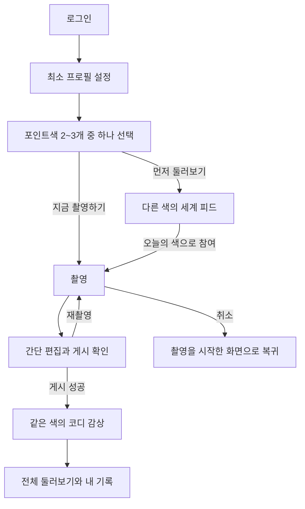
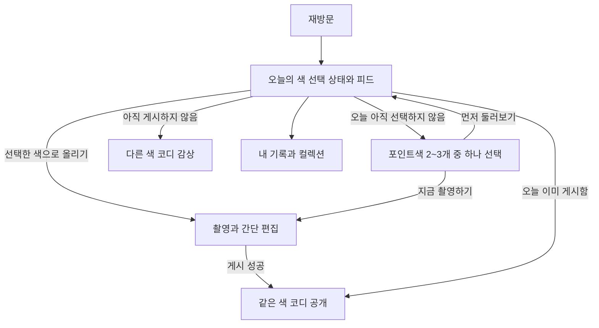

# Esel — 오늘의 색과 첫 사용 흐름 초안

현재 단계는 UX 방향 탐색이다. 아래 제안은 구현 승인이나 최종 스펙이 아니다.
제안된 포인트색 2~3개 중 하나를 고른 뒤 바로 촬영하거나, 업로드를 미룬 채 다른 색의 게시물을 감상하는 두 경로를 검토한다.
색의 표시 방식과 색상 데이터 공급처는 분리해서 결정한다.

## 현재 목표와 배경

사용자는 매일 개인에게 제공되는 색감을 패션으로 표현하고, 사진과 받은 색감을 함께 공유하는 미니멀 앱을 구상하고 있다. 목표는 평범한 일상의 패션도 아름답게 전시되는 공간이다.

이번 대화에서 다룰 범위는 오늘의 색을 받는 경험, 짧은 촬영·편집·게시 과정, 업로드 전후 피드 진입이다. 화면의 최종 시각 디자인이나 앱 구현은 아직 시작하지 않는다.

## 확정된 방향과 현재 선호

| 구분 | 내용 | 상태 |
|---|---|---|
| 핵심 경험 | 개인에게 오늘의 색감을 제공하고, 그 색에 맞춘 착장 사진과 받은 색감을 함께 게시 | 사용자 확인 완료 |
| 색 선택 방식 | 앱이 제안하는 포인트색 2~3개 중 사용자가 하나를 선택 | 사용자 최신 답변 반영 |
| 디자인 | 밝은 배경, 적은 경계와 버튼, 사진·여백·글자·배치가 함께 구성되는 전시 공간 | 사용자가 제시한 방향 |
| 상호작용 | 익숙한 세로 스크롤, 일관된 기본 조작 | 사용자가 제시한 방향 |
| 아이콘 | `assets/esel-app-icon-bg-F9F9FB.png` | 사용자 선택 완료 |
| 화면 배경색 | 아이콘과 같은 `#F9F9FB` | 제안, 전체 앱에 대한 별도 확정 없음 |
| 촬영 | 카메라 진입 → 간단한 편집 → 빠른 게시 | 최신 사용자 선호, 세부 제약 미정 |
| 피드 공개 | 같은 색 게시물은 자신의 업로드 후 공개, 다른 색의 세계 사용자 게시물은 미리 감상 | 최신 사용자 선호를 반영한 후보 |
| 시작 경로 | 로그인 → 프로필 설정 → 오늘의 색 → 지금 올리기/나중에 → 피드 | 사용자 초안, 검토 중 |

## 화면 흐름 제안

### 처음 가입했을 때

- 최소 프로필은 닉네임을 우선 제안한다. 프로필 사진·자기소개 등은 이후에도 설정할 수 있도록 검토한다.
- 오늘의 색에서는 포인트색 후보 2~3개와 이름, 짧은 참여 안내를 보여준다. 사용자는 하나를 선택하며, 여러 색을 모두 착장에 넣어야 하는 팔레트 과제가 아니다.
- 각 후보 목록이 모든 사용자에게 같은지, 개인별로 다른지는 미정이다. 선택 이후 변경 허용 여부와 시점도 아직 결정하지 않았다.
- 버튼 문구 후보는 `지금 촬영하기`와 `먼저 둘러보기`다. 후자는 다음에 보게 될 내용을 설명한다.
- 게시 전 확인 화면에 받은 색감을 자동으로 붙인다. 사진의 색 해석과 구도를 살리고, 게시 전에는 사용자가 사진과 공개 내용을 확인한다.
- 게시 실패나 업로드 취소는 성공한 참여로 취급하지 않는 것을 제안한다. 초안은 보존하고 재시도할 수 있어야 한다.
- 카메라 진입을 기본으로 제안한다. 앨범 허용 여부는 아직 결정하지 않았다.

### 다시 방문했을 때

이 경로는 재방문마다 별도의 시작 화면을 거치는 부담을 줄이기 위한 제안이다. 오늘 선택한 색 또는 아직 선택하지 않았다는 사실은 피드의 고정된 영역에서 확인할 수 있도록 검토한다. 색을 선택하기 전 피드에서 공개할 게시물의 범위는 잠금 후보와 함께 별도 검토가 필요하다. 로그인 방식과 세션 처리는 이 단계의 논의 범위에 포함하지 않는다.

### 같은 색 게시물 잠금의 일관성

| 사용자 상태 | 다른 색 게시물 | 오늘의 같은 색 게시물 |
|---|---|---|
| 아직 게시하지 않음 | 감상 가능 | 잠금 후보 |
| 촬영·편집 중 / 게시 실패 | 감상 가능 | 잠금 유지 후보 |
| 게시 성공 | 감상 가능 | 감상 가능 |

위 표는 오늘의 색 하나를 선택한 이후의 상태를 다룬다. ‘같은 색’은 사진에서 추출한 유사색이 아니라, 사용자가 선택한 동일한 색 과제를 기준으로 판단하는 방향을 제안한다. 모든 사람에게 완전히 고유한 색을 주는 것으로 해석하지 않는다. 유한한 후보 색을 여러 사람이 공유해야 같은 색의 다른 해석을 볼 수 있다.

색을 고르기 전 후보 색의 게시물을 보여주거나, 다른 색으로 바꾸어 잠금을 우회할 수 있는지는 아직 미정이다. 선택 시점·변경 허용·공개 범위가 연결되므로 잠금 후보를 채택할 때 함께 결정해야 한다.

이 후보를 채택하면 같은 색 게시물이 세계 피드·프로필·검색·공유 링크에서 먼저 노출될지에 대한 기준도 일관되어야 한다. 잠금 탭만 숨기고 다른 경로에서 그대로 보여주는 방식은 의도와 충돌한다. 아직 기술적 접근 제어 구현은 설계하지 않았다.

세계 사용자를 대상으로 하므로 ‘오늘’과 날짜 경계, 과거 같은 색 게시물의 공개 범위, 게시물 삭제 후 잠금 상태도 정식 구현 전 결정해야 한다. 이번 프로토타입은 고정된 예시 날짜로 경로를 보여줄 수 있다.

## 오늘의 색: 표시 방식과 공급처

### 표시 방식 후보

색 선택 화면은 포인트색 2~3개를 비교할 수 있는 색면과 이름, 짧은 참여 안내로 구성하는 방향을 제안한다. 하나를 선택하면 해당 색을 오늘의 색으로 강조한다. 예를 들어 `오늘의 색 — 세이지`와 `옷이나 작은 액세서리로 표현해보세요`처럼 안내할 수 있다. 이 이름과 문구는 Esel의 자체 시안이며 특정 서비스에서 가져온 공식 명칭이 아니다.

HEX 값은 디지털 색을 정의하는 내부 정보로 사용할 수 있지만, 초기 화면에서 필수로 크게 노출할지는 별도 디자인 판단이다. 색을 정밀하게 일치시키는 과제인지, 색감을 자유롭게 해석하는 과제인지 역시 구분이 필요하다. 현 컨셉에는 자유로운 해석을 허용하는 방향을 제안한다.

색칩이라는 표현 형식을 참고하는 것과 Pantone의 명칭·번호·색상 라이브러리를 앱에 탑재하는 것은 다른 결정이다.

### 공급처 후보와 조사 결과

| 후보 | 장점 | 결정 전 확인할 점 |
|---|---|---|
| Pantone 공식 연동 | 공식 색상 체계와 데이터 활용 | 모바일 앱 탑재 범위, 계약 조건과 비용 확인 |
| 다른 컬러 서비스 | 색 선정이나 조합을 참고할 후보가 다양함 | 서비스별 API 제공 여부, 데이터 재사용 조건과 운영 의존성 |
| Esel 자체 색상 목록 | 앱의 촬영·패션 과제에 맞춰 이름과 후보 색을 직접 구성 가능 | 색 선정 기준과 일관성, 반복과 난이도 검토 |

Pantone은 공식적으로 모바일 앱·웹·소프트웨어를 위한 색상 라이브러리·데이터·번호 체계의 비즈니스 라이선스와 API를 안내한다. 특정 계약의 가격이나 이 프로젝트에 대한 이용 가능성은 확인하지 않았다.

- [Pantone Business Licensing](https://www.pantone.com/uk/en-gb/license)
- [Pantone Software + Web](https://www.pantone.com/na/en-us/license/software-and-web)

확인일: 2026-09-05. 검색에서 공식 자료를 확인했다. 일부 웹 직접 열기 요청은 403으로 제한되었다. 다른 컬러 서비스의 데이터 재사용 허용이나 API 제공 여부를 검증한 것으로 간주하지 않는다.

첫 UX 초안에서는 Esel 자체 예시 색을 사용하고, 사용 경험이 정리된 뒤 실제 공급처를 확정하는 방향을 제안한다. 외부 색상 목록을 복제하거나 연동하는 작업은 하지 않았다.

## 열린 질문과 결정 순서

| 시점 | 질문 | 초안 처리 |
|---|---|---|
| 현재 답변 반영 | 오늘의 색은 어떤 형태인가? | 포인트색 2~3개 중 사용자가 하나 선택 |
| 지금: 선택과 공개 범위 | 선택 전에는 무엇을 볼 수 있고, 선택한 색을 변경할 수 있는가? | 잠금 후보와 함께 검토, 아직 미정 |
| 지금: 진입과 탐색 | 업로드를 미뤄도 다른 색 코디를 볼 수 있는가? | 사용자 선호를 후보 흐름으로 반영 |
| 지금: 게시 전후 | 같은 색 게시물 잠금을 채택할 것인가? | 잠금 유무의 상태를 초안으로 비교할 수 있게 기록 |
| 촬영 화면 구체화 전 | 카메라만 가능한가, 앨범도 가능한가? | 촬영 우선, 강제 여부 미정 |
| 공급처 선정 전 | 공식 서비스 연동인가, 자체 색상 목록인가? | 자체 예시 색으로 UX 작업 가능 |
| 구현 전 | 일일 갱신·시차·재추첨·삭제·과거 게시물은 어떻게 처리하는가? | 열린 질문, 이번 경로 초안의 고정 예시 밖 |

기능 중 화면 이동을 바꾸는 정책은 지금부터 후보로 다뤄야 한다. 세부 데이터 공급처나 색 선정 알고리즘이 미정이어도 후보 경로는 검토할 수 있다.

## 제외 및 유보한 방향

- 생성형 UI와 AI 전시 편집은 후속 검토 대상으로 둔다.
- 희귀 팔레트, 연속 출석, 전용 반응 버튼, 친구 챌린지 등 이전 심리 장치는 채택되지 않았다.
- BeReal·스토리의 빠른 촬영 경험을 참고한다는 표현만으로 시간 제한, 동시 전후면 촬영, 필터, 영상, 24시간 후 삭제를 요구사항으로 추가하지 않는다.
- 현재 문서로 로그인 제공자, 국가·성별·체형 수집, 사진 업로드 수량, 앨범 금지 등을 확정하지 않는다.

## 구현 계획과 검증 기준

현재 구현 계획은 없으며, 다음 산출물 후보는 핵심 화면의 클릭 가능한 프로토타입이다. 플랫폼과 기술 스택도 아직 결정하지 않았다.

검토 기준:

1. 처음 온 사람이 오늘의 색과 다음 행동을 이해할 수 있는가?
2. 업로드를 미뤄도 피드를 감상하고 나중에 촬영으로 돌아올 수 있는가?
3. 카메라 진입부터 게시 확인까지 불필요한 입력이 적은가?
4. 받은 색이 게시물에 함께 표시되고, 업로드 성공 전후 공개 범위를 이해할 수 있는가?
5. 취소·재촬영·실패 후에도 작업을 이어갈 수 있는가?
6. 재방문 때 오늘의 색과 참여 상태를 쉽게 확인할 수 있는가?
7. 일상적인 거울 사진과 복잡한 배경의 사진도 갤러리 컨셉에 어울리는가?

## 다음 확인 사항

오늘의 색은 포인트색 2~3개 중 하나를 선택하는 방식으로 사용자 답변을 반영했다. 다음으로 색 선택 전후와 게시 전후의 피드 공개 범위를 구체화한다. 현재 문서는 선택을 돕기 위한 임시 초안이며 최종 기능 목록이 아니다.
