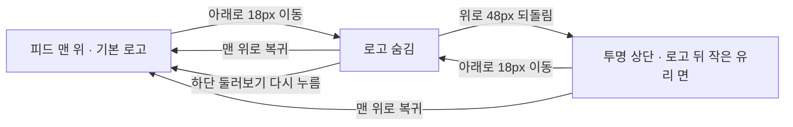

# Esel 피드의 여백과 스크롤 상단

## 요약

사용자가 제공한 Instagram 스크린샷은 상단 표현의 참고 자료이며, 이미지 속 게시물이나 문구를 복제하지 않는다. 상단 숨김·재등장은 이번 요청의 구현 범위이고, 하단바·여백은 최종 확정하지 않은 비교 시안이다. 기존 Expo 앱은 변경하지 않는다.

## 화면 목록과 핵심 요소

- 기존 세 화면인 오늘의 색·둘러보기·내 전시를 유지한다.
- 피드는 프로필·닉네임·아크릴 물감·착장 사진·좋아요·공유만 표시한다.
- 비교 페이지에서 여백형과 사진형을 같은 콘텐츠로 확인한다.

## 추정 화면 흐름과 확정된 전이 규칙

18px/48px와 맨 위 허용 범위 12px는 테스트용 가정이며 실사용 피드백 후 조정한다. 새 화면 전이나 서비스 기능은 추가하지 않는다.

## 구현 범위와 연결 지점

- `.codex/temp/prototype/20260906-paint-feed/src/index.html`에 비교 전용 CSS·상태 계산·DOM 연결 스크립트를 연결한다.
- 기본 주소와 `?layout=quiet`는 여백형, `?layout=glass`는 사진형이다. `?layout=original`은 이전 구성을 유지한다.
- 상단 높이를 스크롤 중 바꾸지 않고 콘텐츠 위에 겹쳐 그린다. 아래 스크롤 시 로고만 숨겨 피드의 높이 변화·점프를 피한다.
- 상단 전체는 투명이며 재등장한 로고 뒤에만 작은 blur 영역을 둔다. 글자는 불투명하고 배경 위 대비를 유지한다.
- 하단 탐색은 두 안 모두 계속 보이며, 제스처만으로 조작하도록 바꾸지 않는다.

## 필요한 에셋과 확보 여부

기존 로고 폰트·샘플 사진·세 물감 PNG를 재사용한다. 이번에는 이미지 생성이나 편집이 없다. Figma 링크가 없고 Figma 원본의 재현 요청이 아니므로 REST 수집·OAuth는 필요 없다.

## 모바일 검토 전제

대상 서비스는 iOS·Android이며 기존 프레임워크는 Expo다. 이번 산출물은 기존 폰 크기의 로컬 HTML 프로토타입이다. 외부 통신·오프라인 동기화·태블릿 확장은 추가하지 않는다. 사용자는 패션 SNS의 일반 소비자이며 추가 접근성 요구는 아직 없다.

검토 파일: mobile-design-thinking, touch-psychology, mobile-performance, mobile-backend, mobile-testing, mobile-debugging, platform-ios, platform-android. 적용 원칙은 48px 터치 영역, 노치·홈 영역과 조작부 분리, 모션·투명도 축소 설정 대응이다. 5개 아이콘 고정바와 숨은 제스처 전용 탐색을 기본값으로 추가하지 않는다.

MFRI 판단: 플랫폼 명확성 5 + 접근성 준비 4 − 상호작용 복잡도 2 − 성능 위험 2 − 오프라인 의존 1 = 4. 따라서 브라우저 상태·레이아웃과 순수 상태 계산을 검증하며, 실제 iOS/Android 성능과 시스템 접근성 검증은 이 시안의 완료 범위에 포함하지 않는다.

## 상태·접근성 처리

- 방향 변경 때 누적 이동량을 초기화하여 미세한 역방향 움직임으로 상단이 깜빡이지 않게 한다. 음수·하단 바운스는 계산 범위 안으로 제한한다.
- 스크롤은 수동 이벤트와 화면 프레임 단위 계산으로 처리한다. 상단은 현재 위치·속도를 유지하는 감쇠 스프링으로 움직이며, 레이아웃 크기는 애니메이션하지 않는다.
- 숨은 상단은 클릭과 키보드 초점 대상에서 제외한다. 키보드로 로고를 사용 중이면 숨기지 않는다.
- 모션 축소 시 이동 애니메이션을 생략한다. 투명도 축소·고대비·blur 미지원 시 단색에 가까운 배경을 제공한다.
- 기존 샘플 데이터와 좋아요·색 선택·공유 모의 상태는 유지한다. 새로운 서버·저장·카메라 동작은 없다.

## 사용자 확인 필요

여백형의 조용한 탐색과 사진형의 유리 도크 중 어떤 구성이 더 Esel답게 느껴지는가? 물감과 사진이 주인공이라는 전제는 유지한다. 첫 사진 자체의 넓은 흰 배경은 앱의 여백과 구분해 판단한다.

## 검증 기준

- 하단 이동 → 숨김 → 위로 일정량 이동 → 유리 로고 → 맨 위 복귀를 실제 스크롤로 확인한다.
- 상태 계산은 단위 테스트로 경계값·방향 반전·바운스를 검사한다.
- 두 안의 캡처와 숨김·재등장 상태를 기록한다. 320px에서 가로 넘침과 버튼 크기를 확인한다.
- 검증 결과와 캡처는 [프로토타입 기록](/Users/gimminsang/Desktop/Esel/.codex/temp/prototype/20260906-paint-feed/prototype.md)에 추가한다.
