> **보관된 자료 · 최신 아님** — 2026-09-05 갤러리형 Expo 앱의 설계·검증 기록이다. 지금 디자인 기준은 [디자인 보드](../../../../docs/design/README.md)와 [앱 목업](../20261011-app-mockup/README.md)이고, 무엇이 최신인지는 [저장소 안내](../../../../README.md#보관된-자료)에 있다. 비교와 기록용으로만 읽는다.

# Esel — 일상을 전시하는 색의 갤러리

## 한눈에 보기

아이폰·안드로이드·웹에서 같은 React Native 화면을 사용할 수 있는 Expo 기반 UX 프로토타입이다. 실제 회원가입이나 서버 전송 없이 색 선택, 사진 편집, 게시 후 공개의 경험을 검토한다. 사용자가 구현을 요청했으므로 이전 흐름 초안을 바탕으로 바로 제작한다.

## 설계 목표

- 세 가지 포인트색 중 하나를 쉽게 고른다.
- 사진·여백·타이포그래피로 일상적인 착장을 전시한다.
- 업로드 전후 같은 색 게시물이 열리는 후보를 직접 비교한다.
- 촬영을 미룬 사람도 다른 색의 게시물을 둘러본다.

## 화면 목록

| 화면 | 역할 | 핵심 행동 |
|---|---|---|
| 시작과 프로필 | 서비스 소개와 모의 입장 | 닉네임으로 시작 |
| 오늘의 색 | 세 가지 색을 비교 | 하나 선택, 촬영 또는 둘러보기 |
| 피드 | 다른 사람들의 착장 전시 | 둘러보기, 같은 색 보기, 좋아요·저장 |
| 사진 스튜디오 | 촬영·앨범·샘플과 간단 편집 | 회전·자르기, 캡션, 모의 게시 |
| 내 전시 | 나의 참여와 저장한 영감 | 게시물 확인, 데모 초기화 |

## 페이지와 사용자 흐름

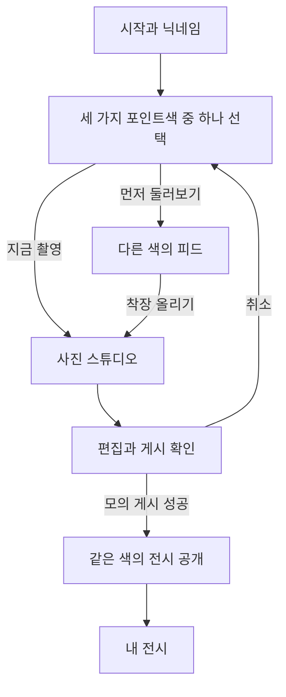

## 시각적 방향

배경은 아이콘과 연결되는 #F9F9FB, 본문은 짙은 차콜로 구성한다. 세이지·버터·파우더 블루는 실제 색 선택 영역과 작은 작품 라벨에 사용한다. 주황색은 브랜드의 작은 표시로만 쓴다. 경계선과 카드 장식을 최소화하고 서로 다른 사진 비율, 넓은 여백, 부드러운 세리프 색 이름을 사용한다. 화면 문구는 한국어이며 Esel과 색의 영문 이름만 고유명사로 병기한다.

### 상단 로고 수정 — 2026-09-05

사용자 요청에 따라 공통 상단 로고를 대문자 E로 시작하는 `Esel`로 표기하고 화면 중앙에 배치한다. 상단 구분선은 제거하여 사진과 여백 중심의 방향을 유지한다. 양끝 그라데이션 선은 선택 가능한 대안으로 남기고 이번에는 추가하지 않는다.

- 구현: `src/components/shell.tsx`의 Brand와 Shell. 같은 너비의 좌우 영역 사이에 로고를 두어 색 이름의 길이가 바뀌어도 중앙을 유지한다. 데스크톱 탐색은 왼쪽, 선택 색은 오른쪽, 모바일 탐색은 기존 하단에 둔다.
- 흐름·에셋: 위 Mermaid의 화면 전이와 상태 규칙은 변경하지 않는다. 기존 글꼴과 브랜드 포인트를 재사용하며 새 이미지 에셋은 필요 없다. 모바일 시작 화면의 보조 문구는 상단에서 생략하고 본문 소개를 유지한다.
- 검증 기준: 320·390 크기 모바일과 넓은 웹에서 로고 중앙 정렬, 구분선 제거, 긴 색 이름과 겹침 없음, 기존 탐색 동작을 확인한다. 타입 검사와 상태 테스트를 다시 실행한다.

검증 완료: 웹 빌드·타입 검사·상태 테스트 12개 통과. 브라우저에서 320·390·760·1440 너비를 확인했으며 320/760/1440의 로고 중앙 좌표는 각각 160/380/720이었다. 상단 테두리 0px, 320 너비에서 긴 색 이름은 말줄임 처리되고 버튼과 로고가 겹치지 않았다. 피드 탐색과 로고를 눌러 오늘의 색으로 돌아오는 동작을 확인했다.

이전 화면: [수정 전](screenshots/remote-today.png). 수정 화면: [모바일](screenshots/header-centered-mobile.png), [데스크톱](screenshots/header-centered-desktop.png).

### 문구와 하단 메뉴 간소화 — 2026-09-06

사용자가 표시한 오늘의 색 화면의 날짜와 제목 아래 두 줄 설명을 삭제한다. 하단은 SNS형 아이콘 탭 대신 조용한 텍스트 목차처럼 구성한다. 기존 화면 흐름은 위 Mermaid 그대로 유지한다.

- `app/index.tsx`: 날짜와 `세 가지 제안 중…작은 포인트만으로도 충분해요.` 삭제. 제목, 색 선택, 선택 후 안내와 촬영 행동은 유지한다.
- `src/components/shell.tsx`: 모바일 하단 아이콘과 상단 경계선을 제거한다. `오늘의 색`, `둘러보기`, `내 전시` 텍스트만 남기며 현재 위치는 글자 색과 굵기로 표시한다. 불필요한 SNS형 버튼 테두리·알약형 배경은 추가하지 않는다.
- 안전성: 실제 터치 높이는 48 이상, 접근성 탭 이름·선택 상태·기존 이동 가드를 유지한다. 기기 상단 안전 여백과 하단 홈 인디케이터 여백은 유지한다. 새 이미지 에셋은 필요 없다.
- 검증: 타입 검사·상태 테스트·웹 빌드, 작은 모바일에서 삭제 문구 부재·하단 텍스트 탭·각 탭 이동과 선택 표시를 확인한다. 이전 캡처와 수정 캡처를 남긴다.

검증 완료: TypeScript·상태 테스트 12개·웹 빌드 통과. 390 너비에서 두 문구 부재, 하단 SVG 0개·테두리 0px, 각 터치 영역 106×48을 확인했다. 320 너비에서도 각 영역 약 83×48과 가로 넘침 없음을 확인했다. 오늘의 색→둘러보기→내 전시→오늘의 색 이동과 선택 표시 정상. 1440 너비에서는 기존 상단 탐색을 유지했다. 네이티브 노치·홈 인디케이터 실기기 검증은 아직 수행하지 않았다.

변경 전: [상단 정렬 버전](screenshots/header-centered-mobile.png). 변경 후: [모바일](screenshots/minimal-navigation-mobile.png), [데스크톱](screenshots/minimal-navigation-desktop.png).

## 모바일 구현 기준

플랫폼: iOS·Android·웹. 프레임워크: Expo·React Native·TypeScript. 사용자가 스택 선택을 위임했다. 휴대전화 중심이며 넓은 웹은 다열 전시로 확장한다. 서버·오프라인 동기화는 현재 범위 밖이며 데모 상태는 메모리에서만 유지한다.

읽은 지침: mobile-design-thinking, touch-psychology, mobile-performance, mobile-backend, mobile-testing, mobile-debugging, platform-ios, platform-android 및 Expo 화면·미디어 지침.

원칙: 최소 48 크기의 터치 영역, 안전 영역과 시스템 뒤로 가기, 색 이름과 선택 표시를 함께 제공. 피드는 FlatList와 안정적 게시물 ID를 사용한다. 사진 실패는 대체 상태와 재시도를 제공한다. 사용자 사진은 외부로 전송하지 않는다. 불필요한 권한과 알림·추적 기능을 추가하지 않는다.

화면별 판단: 색 선택은 큰 비교 영역과 하단 행동, 피드는 지연 렌더링, 스튜디오는 전체 화면 집중 작업과 취소 경로, 프로필은 단순한 기록 목록. 탭은 세 목적지만 둔다. iOS의 뒤로가기와 Android 시스템 뒤로가기는 Expo Router가 담당하며, 촬영·앨범은 플랫폼 모듈을 사용한다. 한 손으로 선택 가능한 조작, 텍스트 크기 변경, 축소 모션을 고려한다.

MFRI 자체 점검: 플랫폼 명확성 5 + 접근성 준비 4 − 상호작용 2 − 성능 위험 2 − 네트워크 의존 2 = 3. 웹 상호작용 검증을 추가하고 실기기 성능·접근성은 출시 전 검증 항목으로 남긴다.

## 가정과 제한

- 같은 색 잠금은 후보를 구현한 데모이며 최종 정책이 아니다. 선택하기 전 피드 진입은 색 선택으로 안내한다. 게시 전 색 변경은 허용하고 게시 후에는 고정한다. 서버 접근 제어가 아니다.
- 샘플 색은 Esel 자체 예시이며 Pantone 데이터 연동은 없다.
- 샘플 게시물은 가상의 사용자·도시·반응 수다. 실제 가입자 게시물이 아니다.
- 로그인은 닉네임 기반 데모 입장이다. 실제 인증·백엔드·기기 간 동기화·일일 갱신은 없다.
- 웹 테스트 편의를 위해 앨범과 샘플 사진을 제공한다. 실제 카메라는 기기·브라우저 권한에 따라 달라진다.
- prototype-design의 정적 HTML 소스 방식은 사용자 요청인 iOS·Android 공용 구현을 위해 Expo 소스로 대체한다. Expo 웹 산출물을 이 문서 옆 src에 내보내고 Python 정적 서버로 제공한다.

## 검토 방법

- 개발: `npm run web` — http://localhost:8081
- 정적 웹 빌드: `npm run build:web`
- 정적 웹 확인: `npm run preview` — http://localhost:4173
- 자동 검증: `npm run typecheck`, `npm test`
- 정적 서버는 `scripts/serve-preview.py`를 사용한다. Expo의 단일 페이지 경로를 처리하여 `/gallery`와 `/welcome`을 새로고침해도 HTTP 200으로 앱을 제공한다.

## 화면 콘셉트와 캡처

### 시작과 색 선택

기존 아이콘의 빈 이젤로 시작하고, 세 가지 색면에서 오늘 표현할 색 하나를 고른다. 화면 아래의 행동은 선택 전 비활성이다. 모바일에서는 촬영 행동을 둘러보기보다 먼저 배치했다.

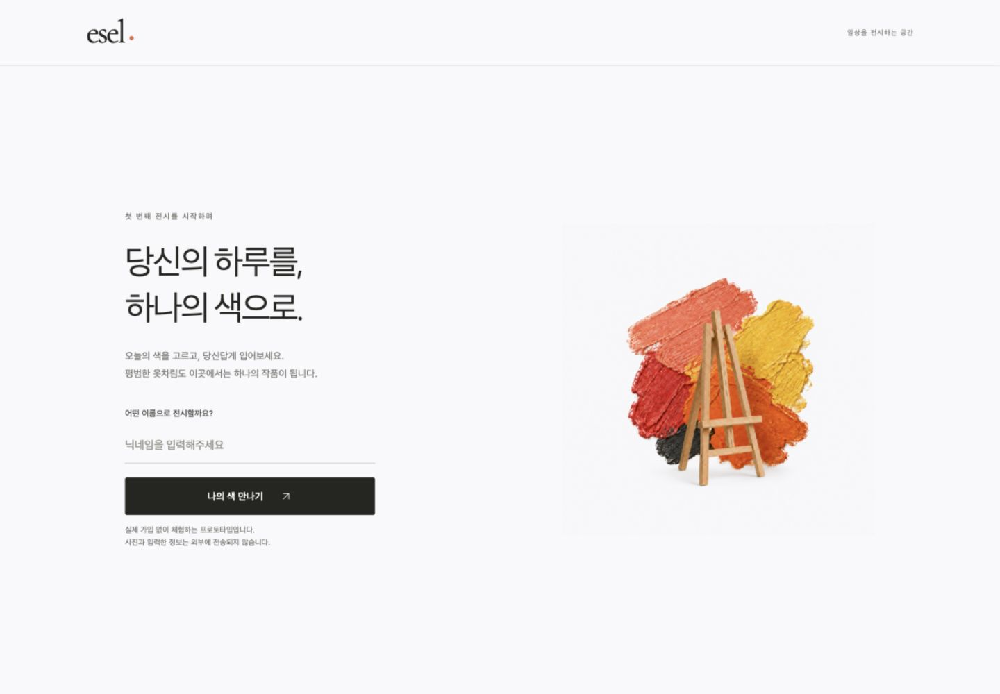

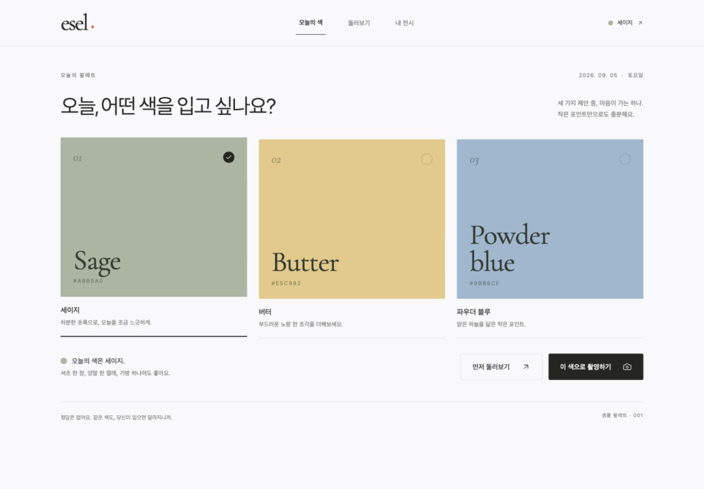

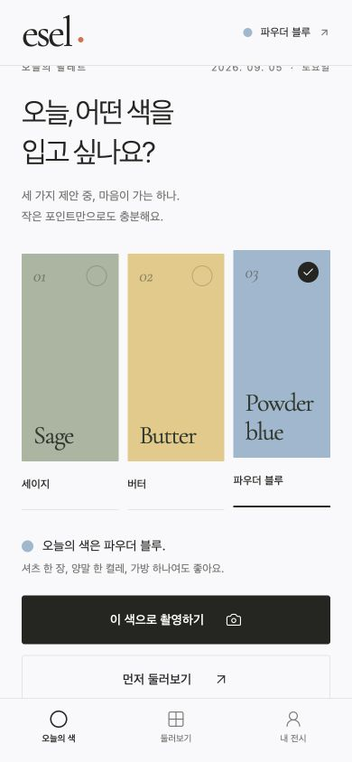

### 피드와 공개 상태

데스크톱은 여백이 있는 3열 전시, 휴대전화는 익숙한 단일 열 스크롤이다. 선택한 색의 게시물은 게시 전 피드에서 제외하며, 잠금 안내에 실제 사진을 미리 노출하지 않는다.

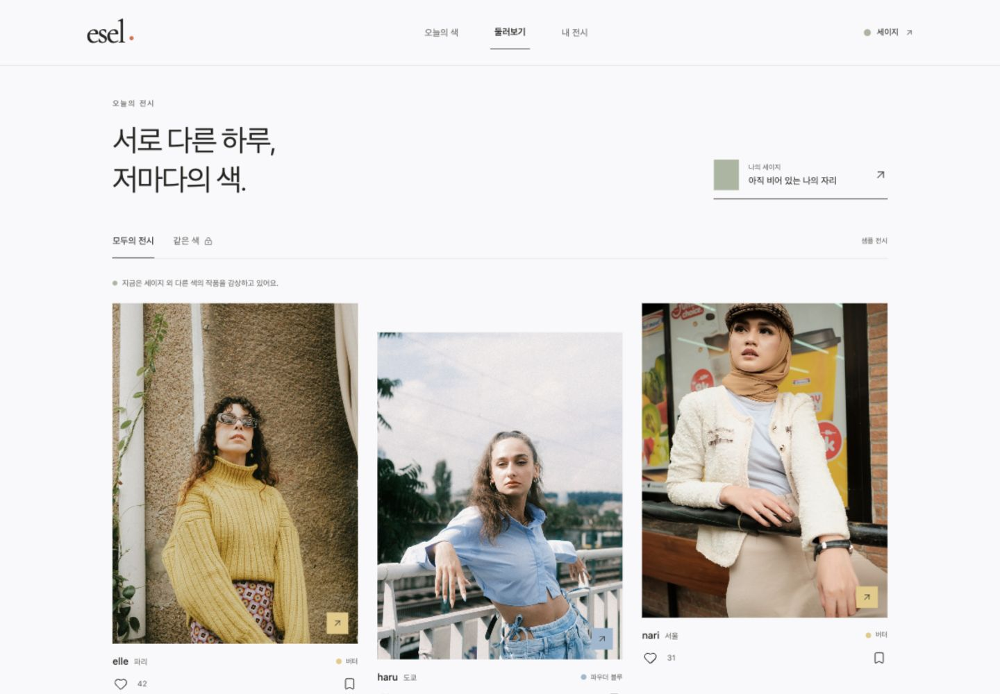

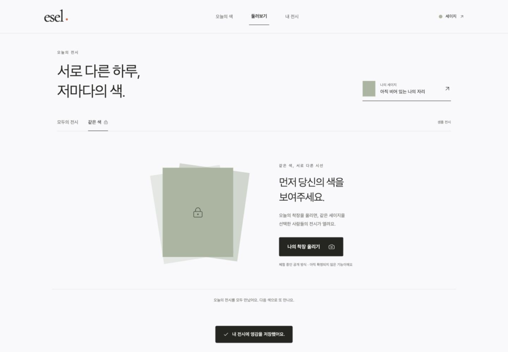

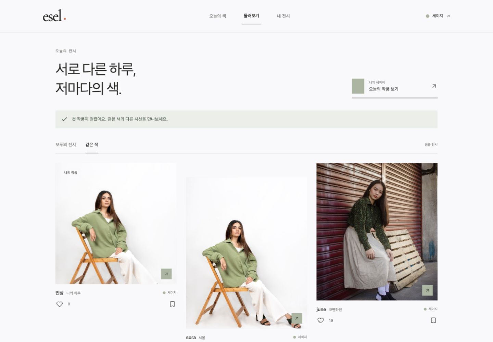

### 촬영·편집과 내 전시

기기 카메라 또는 앨범을 선택할 수 있으며, 권한 없이 샘플 사진으로 전체 경로를 검토할 수도 있다. 사진 편집은 화면 효과가 아니라 실제 회전·자르기 결과를 생성한다.

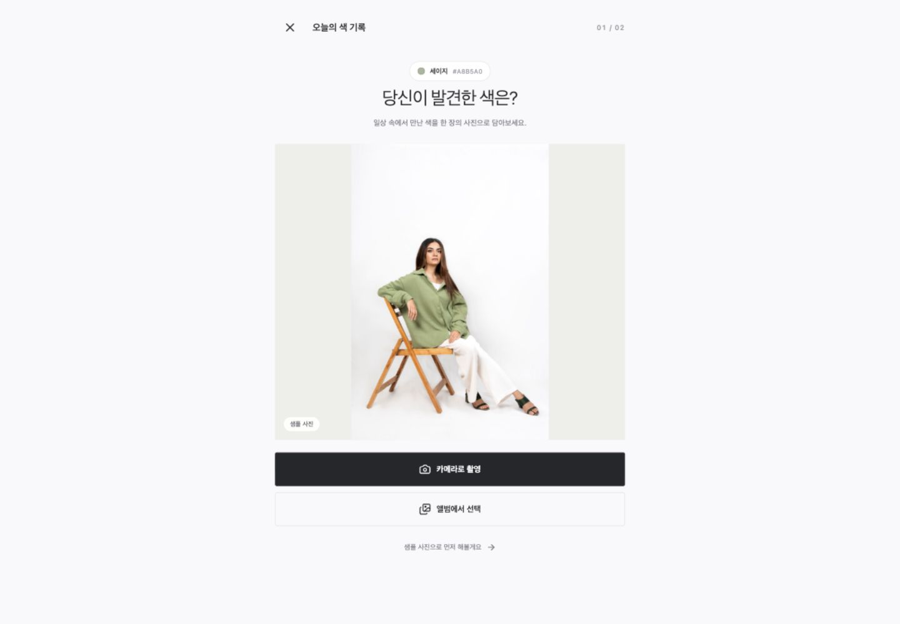

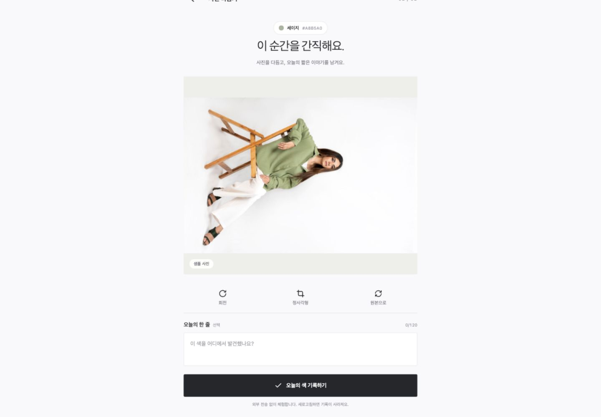

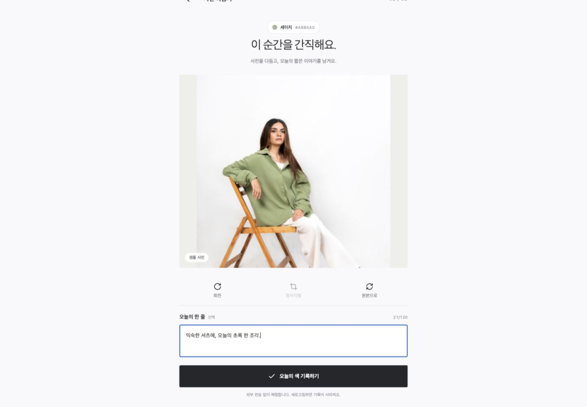

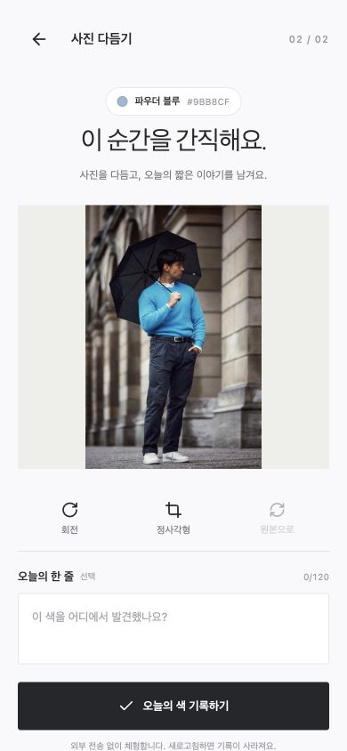

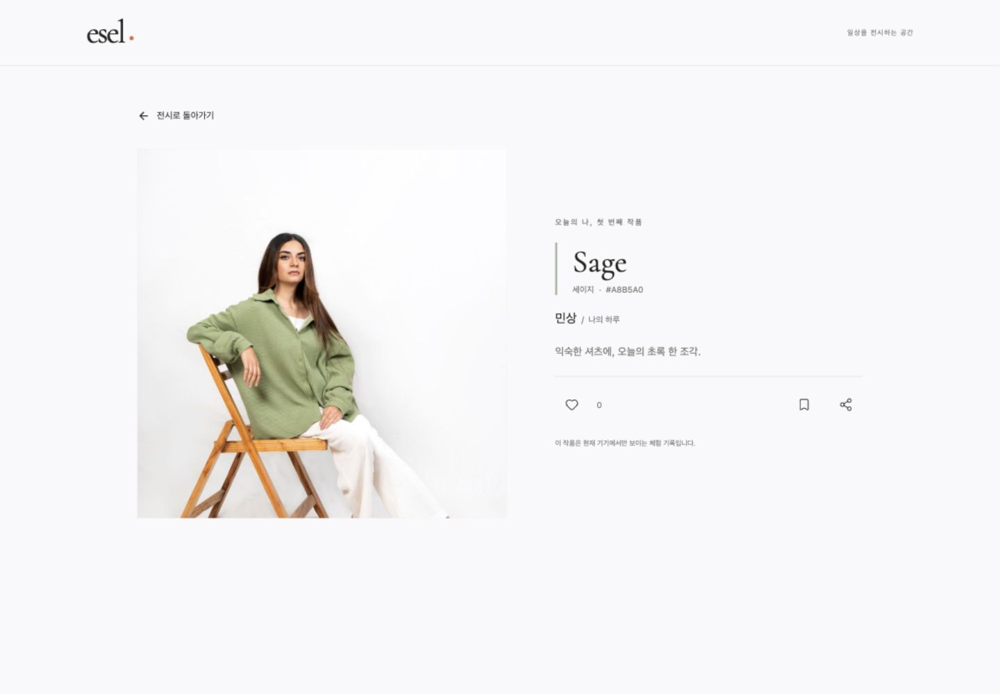

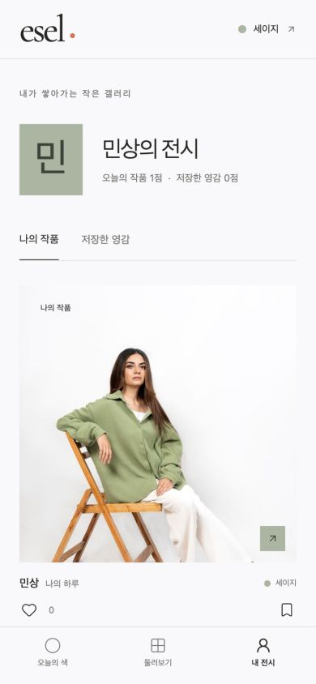

## 검증 결과

2026-09-05, Codex 앱 내 브라우저에서 개발 서버와 정적 빌드를 직접 조작했다.

| 검증 | 결과 |
|---|---|
| TypeScript | `npm run typecheck` 통과 |
| 공개 범위·게시·좋아요·저장 상태 | `npm test` 12개 통과 |
| 의존성 호환성 | `npx expo install --check` 통과 |
| 웹 배포용 코드 | `npm run build:web` 통과 |
| iOS·Android 번들 | 양쪽 Expo export 통과. 네이티브 설치·실기기 실행을 뜻하지 않음 |
| 닉네임 검증 | 빈 입력 오류와 정상 입장 확인 |
| 오늘의 색 | 하나만 선택, 선택 전 행동 비활성, 라디오 체크 접근성 확인 |
| 미루기·잠금 | 다른 색 피드 진입, 같은 색 잠금, 촬영으로 이동 확인 |
| 샘플 편집 | 800×1200 사진을 1200×800으로 회전, 원본 복구, 800×800 중앙 자르기 확인 |
| 실제 파일 선택 | 앱에 포함된 파란 착장 파일을 시스템 선택기로 불러와 800×1200 미리보기와 게시 확인 |
| 게시 후 이동 | 같은 색 피드 공개, 입력 캡션과 편집 결과가 작품 상세 및 내 전시에 반영됨 |
| 반응 | 좋아요와 저장 상태 및 사용자 피드백 확인 |
| 반응형 | 1440×1000과 390×844 검토. 모바일 문서 폭 390, 가로 넘침 없음 |
| 정적 빌드 오류 | 최종 정적 빌드의 앨범→게시 경로에서 브라우저 오류 로그 없음 |

독립 검토와 브라우저 검증에서 웹의 이미지 경로 해석 오류와 게시 후 중복 화면 이동을 발견해 수정했다. 단일 사진 선택에 불필요한 앨범 전체 권한 요청을 제거하고, Android 시스템 뒤로가기를 내부 편집 단계와 맞췄다. Android 뒤로가기 코드는 번들 검증만 했으며 실기기 동작은 미검증이다.

실기기 카메라 촬영, 권한 거부 후 복구, 음성 화면 읽기, 느린 기기 성능 및 실제 네트워크 업로드는 검증하지 않았다. 현재 기기의 카메라 권한을 대신 승인하지 않았다.

`npm audit --omit=dev`는 중간 등급 경고 13개, 높음·치명적 0개를 보고했다. Expo 빌드 도구 체인의 uuid와 라우터의 decode-uri-component 간접 의존성이 원인이다. 자동 해결 제안이 주요 Expo 버전을 과거로 낮추므로 강제 적용하지 않았다. 출시 전 호환되는 보안 업데이트 검토가 필요하다.

## 구현 근거와 에셋

- [Expo 프로젝트 구성](https://docs.expo.dev/get-started/create-a-project/): 공용 앱 프로젝트와 공식 패키지 호환 버전 확인.
- [Expo ImagePicker](https://docs.expo.dev/versions/latest/sdk/imagepicker/): 플랫폼 사진 선택기와 권한 사용 범위 확인.
- [Expo ImageManipulator](https://docs.expo.dev/versions/latest/sdk/imagemanipulator/): 실제 회전·자르기·이미지 저장 API 확인.
- 사진 원본과 작가 정보는 프로젝트 루트 `assets/demo-sources.md`에 기록했다. 공개 스톡 사진을 앱 내부 예시로만 사용한다.

## 피드백 질문

가장 먼저 확인할 부분은 세 가지 색을 고르는 경험과 사진이 전시되는 밀도다. 잠금 정책과 사진 편집 도구는 후속 피드백으로 변경할 수 있다.
