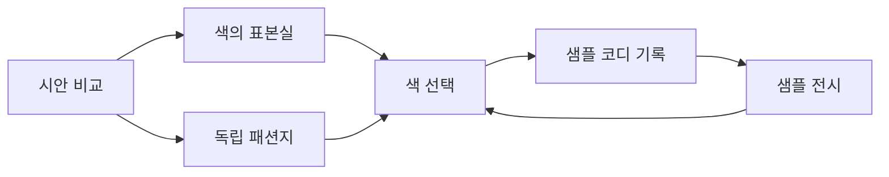
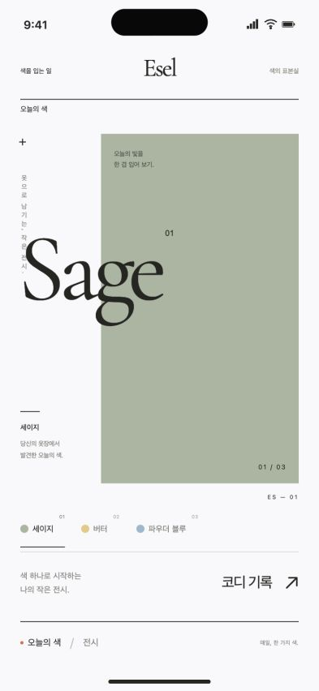
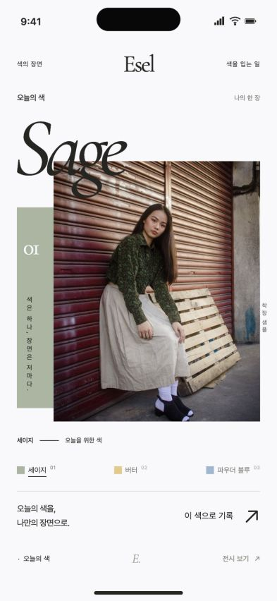
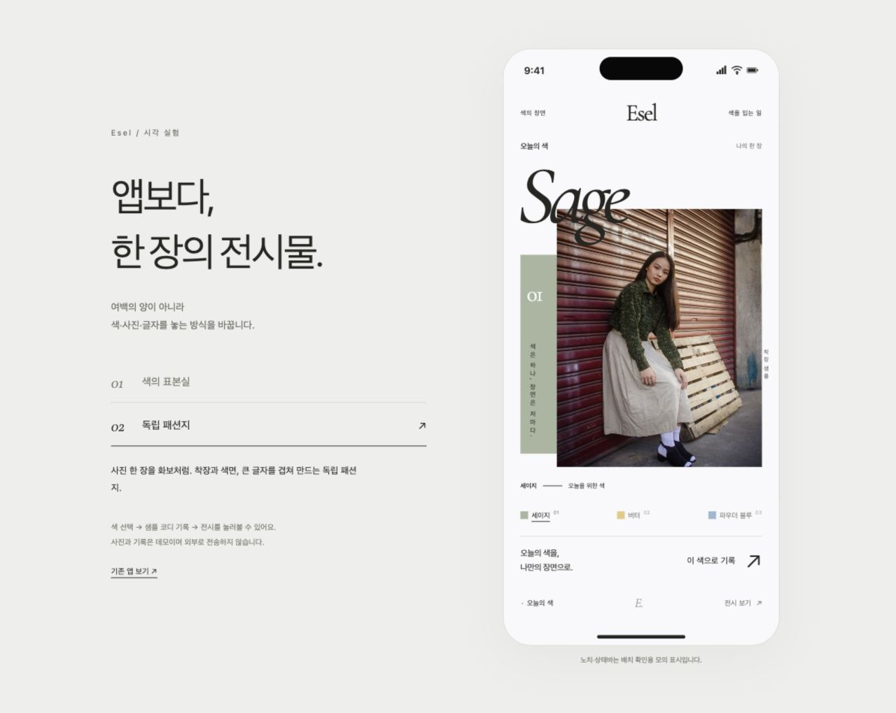
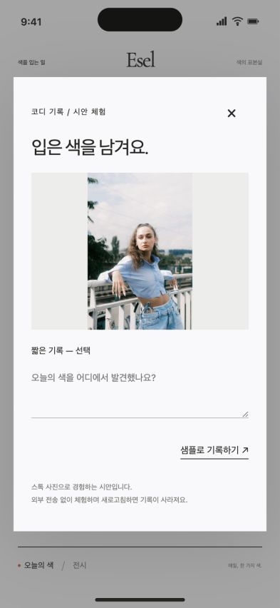
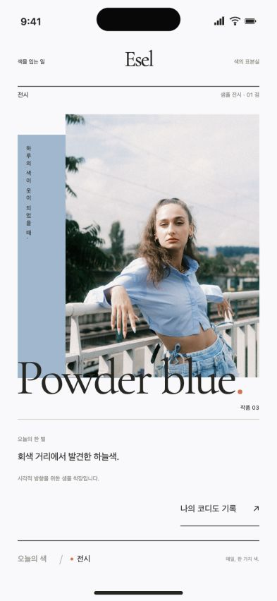
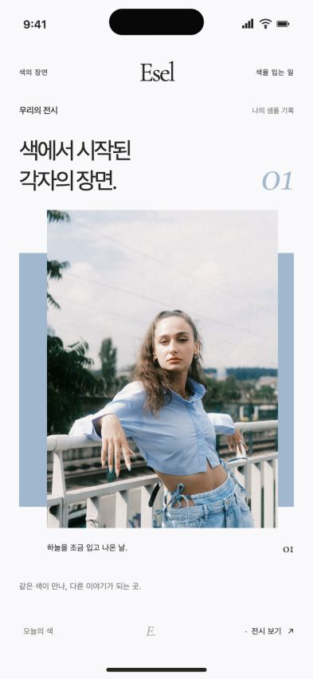

> **보관된 자료 · 최신 아님** — 2026-09-06 미술관·아틀리에 방향 탐색 기록이다. 지금 디자인 기준은 [디자인 보드](../../../../docs/design/README.md)와 [앱 목업](../20261011-app-mockup/README.md)이고, 무엇이 최신인지는 [저장소 안내](../../../../README.md#보관된-자료)에 있다. 비교와 기록용으로만 읽는다.

# Esel — 앱에서 전시물로

## 한눈에 보기

여백과 아이콘 삭제만으로 해결되지 않은 ‘일반적인 SNS 같다’는 피드백을 화면 구도 차원에서 검토한다. 오늘의 색 선택을 두 가지 독립된 미술·패션 편집 방향으로 시각화한다. 기존 Expo 앱은 변경하지 않는다.

## 설계 목표

- 같은 크기 카드 세 장과 큰 검은 버튼이라는 익숙한 구도를 벗어난다.
- 흰 바탕과 중앙 Esel, 사용자의 착장이 화면에 개성을 더한다는 기존 방향을 유지한다.
- 색 선택과 촬영 진입은 알아볼 수 있게 남기되 화면 자체에 편집 의도가 느껴지게 한다.

## 화면 목록

| 화면 | 역할 | 핵심 행동 |
|---|---|---|
| 시안 비교 | 두 방향의 차이 확인 | 색의 표본실 / 독립 패션지 전환 |
| 오늘의 색 | 각 방향의 메인 구성 | 세 색 중 하나 선택, 코디 기록 진입 |
| 샘플 기록 | 선택 후 경험 확인 | 짧은 글, 샘플로 기록 |
| 전시 | 기록과 감상 구조 예시 | 샘플 착장 감상, 오늘의 색으로 복귀 |

## 페이지와 사용자 흐름

## 시각적 방향

### 색의 표본실

색 한 면을 크게 전시하고, 큰 세리프 색 이름·작은 주석·어긋난 정렬을 사용한다. 세 색을 동시에 큰 카드로 나열하는 대신 작은 색 목차로 비교한다. 색 자체가 주인공이며, 절제된 개념미술 포스터 쪽으로 해석한다.

### 독립 패션지

착장 사진과 색면, 겹치는 글자를 하나의 화보 구도로 만든다. 색을 먼저 설명하기보다 ‘입었을 때의 분위기’를 보여준다. 사진 선택과 구도가 완성도에 더 큰 영향을 주는 방향이다.

## 화면 콘셉트

### 색의 표본실 — 색 자체가 작품

한 개의 큰 색면을 오른쪽으로 치우치게 배치하고 색 이름이 종이의 빈 부분까지 걸쳐 나오도록 구성했다. 날짜와 기존 설명 문구는 되살리지 않았다. 작은 한국어 색 목차로 선택하며 코디 기록은 가벼운 텍스트 행동으로 둔다.

### 독립 패션지 — 착장이 화면을 완성

사진의 가장자리, 이탤릭 색 이름, 색면의 위치를 어긋나게 배치했다. 사진과 문자의 관계가 개성을 만들며 일반 게시물 카드와 반응 수는 사용하지 않는다. 사진에 따른 완성도 차이가 크고, 매일의 색 선택에 타인의 샘플 사진을 얼마나 보여줄지는 추가 결정이 필요하다.

### 시안 선택 화면

한 시안을 휴대전화 크기로 보여주며 두 방향을 바로 전환할 수 있다. 이 선택기는 앱 기능이 아니라 검토용 화면이다.

## 상태 변화

색 선택 시 색면·이름·관련 샘플 사진이 함께 바뀐다. 기록은 샘플 사진과 모의 상태만 사용한다. 전시 진입과 복귀를 클릭하여 확인한다.

## 검토 방법

- URL: http://localhost:4174
- 기존 앱: http://localhost:4173 (변경하지 않음)
- 검증할 상호작용: 시안 전환, 각 색 선택, 샘플 기록 취소·확정, 전시 이동과 복귀.

검증 완료: 브라우저에서 시안 전환, 세이지·버터·파우더 블루 선택, 기록 취소, 한 줄을 포함한 샘플 기록, 전시와 복귀를 확인했다. 기록 후 다른 색을 선택해도 기존 샘플 사진과 글이 보존된다. 393×852 및 320×740에서 구도를 확인했고, 작은 화면에서 문서 가로 넘침은 없었다. 색 선택의 작은 터치 너비를 발견해 최소 48×48로 보완했다. 공유 JavaScript의 `node --check`와 로컬 HTTP 응답 확인을 통과했다. 스톡 사진의 실제 업로드·로그인·네이티브 기기 실행은 수행하지 않았다.

브라우저 검토에서 만든 UI만 캡처했으며 사진을 편집하거나 합성한 결과물이 아니다. 캡처에 보이는 검은 기기 표시와 시간은 HTML로 만든 모의 상태바다.

## 가정과 제한

- ‘예술병’이라는 표현을 전시 포스터·독립 패션 잡지의 과감한 편집으로 해석했다. 최종 사용자 선택 전 실제 앱에 통합하지 않는다.
- 사진은 기존 앱에 포함된 스톡 샘플이며 실제 게시물이나 추천 결과가 아니다. 원본 정보는 `/Users/gimminsang/Desktop/Esel/assets/demo-sources.md`에 있다.
- 카메라·앨범·실제 게시·서버·동일 색 잠금 정책은 이 시각 비교의 범위 밖이다. 샘플 기록은 새로고침 시 사라진다.
- 기기 프레임의 노치·상태바는 배치 검토용 모의 표시다. 아이폰 실기기 검증이나 정확한 기종별 치수를 뜻하지 않는다.

## 피드백 질문

색 자체를 전시하는 표본실과 착장 사진을 편집하는 패션지 중 어느 쪽이 원하는 분위기에 더 가까운가?
