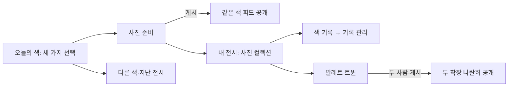

# Esel — 사진과 색으로 돌아가는 미니멀 수정안

## 한눈에 보기

기능은 유지하고 첫 화면에 노출되는 관리 정보와 중복 행동을 줄인다. 이번 시안은 사용자의 최종 승인을 기다리는 디자인 제안이며, 실제 Expo 앱과 이전 4176 데모는 보존한다.

## 설계 목표

- 오늘 화면에는 세 가지 선택과 하나의 게시 행동만 둔다.
- 희귀 확률·복구권 설명·시연 조작은 관련 상세 화면에서만 공개한다.
- 내 전시는 사진 컬렉션이 기본이고 색상 기록은 같은 화면의 보조 보기다.
- 게시물의 프로필·닉네임·물감·사진·하트·공유 구조를 유지한다.

## 화면 목록

| 화면 | 역할 | 주 행동 |
|---|---|---|
| 오늘의 색 | 색을 선택 | 착장 남기기 |
| 둘러보기 | 사진 감상 | 같은 색·지난 전시 전환 |
| 내 전시 | 사진 컬렉션 | 색 기록 보기·트윈 진입 |
| 색 기록 | 월간 색상 기록 | 필요한 경우 기록 관리 |
| 팔레트 트윈 | 두 해석을 나란히 감상 | 초대·게시 |
| 사진 준비 | 사진을 확인 | 데모 게시 |

## 페이지와 사용자 흐름

## 시각적 방향

흰색에 가까운 `#F9F9FB`, 어두운 중립색 글자, 실제 사진과 물감만을 기본 표현 요소로 사용한다. 미니멀은 작은 글자나 기능 삭제가 아니라 정보의 우선순위와 점진적 공개로 만든다. 세리프는 중앙 Esel 워드마크에 한정하며 대형 홍보 카피·각종 배지·확률 상시 노출을 피한다.

## 모바일 판단

- 플랫폼: iOS·Android 지향, 이번 검증은 휴대폰 웹 프로토타입. Expo 구조와 서버는 변경하지 않는다.
- 프레임워크: 로컬 HTML/CSS/JS. 기존 세 탭을 유지한다. 태블릿·완전 오프라인 지원·실제 인증 정책은 미확정이며 새 범위로 만들지 않는다.
- 모바일 위험 평가: 플랫폼 명확성 5, 접근성 준비 4, 상호작용 복잡성 2, 성능 위험 2, 오프라인 의존성 1 → MFRI 4. 작은 화면과 실제 클릭 검증을 추가한다.
- 적용 원칙: 48px 터치 영역, 첫 화면 주 행동 하나, 시스템 영역과 콘텐츠 분리.
- 회피: 기능마다 카드·배지 만들기, 제스처만으로 숨긴 기능, 화면에 시연 설명을 반복하기.
- 성능 범위: 소량 로컬 샘플, transform·opacity 중심 헤더 동작. 실서비스 피드는 가상화·페이지네이션 별도 검증이 필요하다.

## 화면 콘셉트

### 오늘의 색 — 정보 목록에서 세 가지 선택으로

상시 희귀 배지·확률, 중복 선택 요약, 트윈 진입, 중복 둘러보기, 배정 시연 목록을 기본 화면에서 덜어냈다. 설명은 안내를 누르면 볼 수 있고, 세 후보와 게시 행동 하나가 중심이다.

| 수정 전 | 수정 후 |
|---|---|
|  |  |

### 내 전시 — 관리 정보보다 착장 사진이 먼저

기본 보기를 두 열의 사진 컬렉션으로 바꿨다. 캘린더는 ‘색 기록’, 복구권과 제약은 ‘기록 관리’로 옮겼다. 희귀 배정 표식은 작은 물감, 트윈은 프로필 한쪽의 짧은 진입점으로 유지한다.

| 수정 전 | 수정 후 |
|---|---|
|  |  |

### 기능을 없애지 않고 깊이를 나눔

| 상태 | 화면 |
|---|---|
| 배정 설명 |  |
| 월간 기록 |  |
| 필요한 때 복구 |  |
| 같은 색 공개 전 |  |
| 게시 준비 |  |
| 트윈 기다림 / 완성 |   |

### 작은 화면과 스크롤

## 상태 변화

기존 공개·희귀 배정·복구·트윈 상태 모듈을 재사용한다. 희귀 배정 화면도 선택을 세 개로 제한한다. 기본 세이지·버터·블루 중 버터 자리를 특별 조합으로 바꾼다. 이는 이번 시안의 임시 표시 규칙이고 실서비스 배정 정책의 확정이 아니다.

## 검토 방법

- URL: http://localhost:4177/
- `npm run check:harness`: 공통 진입점·문서·경로·CSS 토큰·제품 계약·수동 검증 항목 정합성 검사 통과.
- `npm run test:design`: 기능 상태 30개 + 헤더 상태 7개, 총 37개 통과.
- `npm test`: 기존 Expo 상태 12개 통과. `npm run typecheck` 통과. Expo 시각 디자인·네이티브 코드는 이번에 변경하지 않았다.

### 직접 확인한 결과

| 검증 | 관찰 결과 |
|---|---|
| 일반/특별 후보 | 각각 세 개. 특별 배정 설명·확률은 상세에 있음 |
| 게시 전 같은 색 | `#post-list .post-photo` 0개. 다른 색·지난 전시 표시 가능 |
| 지난 전시 | 게시 전에 사진 4개 공개, 날짜는 9월 5일 |
| 사진 준비·게시 | 사진 없음일 때 게시 비활성. 샘플 로드 후 게시하여 같은 색 사진 1개 공개 |
| 색 기록·복구 | 기본은 사진 보기. ‘색 기록’으로 전환, 9/3을 버터로 복구. 게시 수 4 유지, 복구권 2→1, 점선 표시 |
| 빈칸 소진 | 다시 관리 열면 남은 1장과 ‘빈칸 모두 채워짐’ 안내. 불가능한 복구 버튼 없음 |
| 복구 후 잠금 | 실제 게시 전 같은 색 사진 0개 유지 |
| 내가 먼저 / 친구 먼저 | 두 순서 모두 한 사람 게시 때 트윈 이미지 0개, 둘 다 게시 때 2개 |
| 불필요한 시연 버튼 | 초대 전·친구만 게시한 상태에서는 친구 역할 시연 진입을 숨김 |
| 키보드 선택 | Tab/Enter로 색 선택·색 기록 보기 전환 후 활성 요소와 선택 상태 유지 |
| 320×740 | 문서와 오늘 화면 너비 320px, 가로 넘침 없음, 화면의 버튼 중 48px 미만 영역 없음 |
| 상단 | 아래 스크롤 y=518에서 hidden, 위로 y=407에서 floating 확인 |

브라우저 자동화 연결이 한 차례 끊겨 재연결 후 남은 시나리오를 확인했다. 코드 리뷰에서 찾은 오래된 이미지 이벤트·포커스 이탈·실행할 도구 없는 시연 진입·데모 헤더 포커스 보호를 수정했다. 키보드 초대·관리 완료의 포커스 복원은 코드 검토로도 보강했으며 실제 파일 교체 타이밍 경쟁과 모든 보조기기 조합을 재현했다고 주장하지 않는다.

## 가정과 제한

인원·사진·배정 비율·친구·달력은 로컬 예시다. 실제 계정/서버 업로드/동기화는 없다. 새로고침하면 상태가 초기화된다. 노치·시간·홈 표시는 미리보기 장치이며 실기기 검증이 아니다.

최종 사용자 디자인 승인은 아직 받지 않았다. 복구권 월 2장·특별 배정 3.2%·후보 교체·색 확정 시점은 데모 가정이다. 200% 글자 확대·VoiceOver/TalkBack·실제 카메라·사진 파일 업로드 선택·iOS/Android 실기기 검증은 미수행이다. 순수 상태 테스트와 320px 시각 확인을 출시 검증으로 확대 해석하지 않는다.

## 다른 AI를 위한 산출물

- [공통 AI 진입점](../../../../AGENTS.md)
- [앱 컨셉·디자인·기능·검증 하네스](../../../../docs/ESEL_HARNESS.md)
- [기계 판독용 실행 명세](../../../../harness.json)
- [Claude 진입점](../../../../CLAUDE.md)

## 사용한 스킬

`intent-first`로 이번 범위를 UI 수정·공통 문맥 작성으로 한정했다. `prototype-design`으로 이전 시안과 Expo 앱을 보존한 새 프로토타입·캡처를 만들었다. `mobile-design`으로 터치 영역·세 탭·주 행동·스크롤을 점검했고, `cognitive-writing`으로 상세 하네스를 결정 수준과 검증 범위별로 나눴다. `orchestrate-subagents`로 코드 현황과 위험 검토만 분리하고 디자인 판단·코드 수정·브라우저 검증은 주 작업자가 수행했다. 보조 에이전트의 마지막 재검토는 사용량 제한으로 완료되지 않아 주 작업자가 발견 사항 반영과 문서 일치를 직접 확인했다.

## 피드백 질문

설명을 읽지 않아도 색을 선택하고 사진을 감상하는 앱으로 느껴지는가? 기록과 트윈을 필요할 때 찾을 수 있는가?
