# Esel — 사진과 색으로 돌아가는 미니멀 수정안

## 한눈에 보기

기능은 유지하고 첫 화면에 노출되는 관리 정보와 중복 행동을 줄인다. 이번 시안은 사용자의 최종 승인을 기다리는 디자인 제안이며, 실제 Expo 앱과 이전 4176 데모는 보존한다.

## 설계 목표

- 오늘 화면에는 세 가지 선택과 하나의 게시 행동만 둔다.
- 희귀 확률·복구권 설명·시연 조작은 관련 상세 화면에서만 공개한다.
- 내 전시는 사진 컬렉션이 기본이고 색상 기록은 같은 화면의 보조 보기다.
- 게시물의 프로필·닉네임·물감·사진·하트·공유 구조를 유지한다.

## 화면 목록

| 화면 | 역할 | 주 행동 |
|---|---|---|
| 오늘의 색 | 색을 선택 | 착장 남기기 |
| 둘러보기 | 최신순 기본 통합 피드 | 전체·같은 색 전환, 스크롤 감상 |
| 내 전시 | 사진 컬렉션 | 색 기록 보기·트윈 진입 |
| 색 기록 | 월간 색상 기록 | 필요한 경우 기록 관리 |
| 팔레트 트윈 | 공통 포인트색 하나로 두 해석을 나란히 감상 | 초대·수락·색 제안/동의·각자 트윈 게시 |
| 사진 준비 | 사진을 확인 | 데모 게시 |

## 페이지와 사용자 흐름

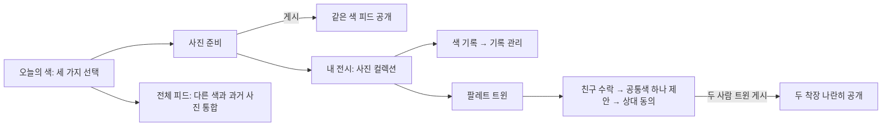

## 시각적 방향

흰색에 가까운 `#F9F9FB`, 어두운 중립색 글자, 실제 사진과 물감만을 기본 표현 요소로 사용한다. 미니멀은 작은 글자나 기능 삭제가 아니라 정보의 우선순위와 점진적 공개로 만든다. 세리프는 중앙 Esel 워드마크에 한정하며 대형 홍보 카피·각종 배지·확률 상시 노출을 피한다.

## 모바일 판단

- 플랫폼: iOS·Android 지향, 이번 검증은 휴대폰 웹 프로토타입. Expo 구조와 서버는 변경하지 않는다.
- 프레임워크: 로컬 HTML/CSS/JS. 기존 세 탭을 유지한다. 태블릿·완전 오프라인 지원·실제 인증 정책은 미확정이며 새 범위로 만들지 않는다.
- 모바일 위험 평가: 플랫폼 명확성 5, 접근성 준비 4, 상호작용 복잡성 2, 성능 위험 2, 오프라인 의존성 1 → MFRI 4. 작은 화면과 실제 클릭 검증을 추가한다.
- 적용 원칙: 48px 터치 영역, 첫 화면 주 행동 하나, 시스템 영역과 콘텐츠 분리.
- 회피: 기능마다 카드·배지 만들기, 제스처만으로 숨긴 기능, 화면에 시연 설명을 반복하기.
- 성능 범위: 소량 로컬 샘플, transform·opacity 중심 헤더 동작. 실서비스 피드는 가상화·페이지네이션 별도 검증이 필요하다.

## 화면 콘셉트

### 오늘의 색 — 정보 목록에서 세 가지 선택으로

상시 희귀 배지·확률, 중복 선택 요약, 트윈 진입, 중복 둘러보기, 배정 시연 목록을 기본 화면에서 덜어냈다. 설명은 안내를 누르면 볼 수 있고, 세 후보와 게시 행동 하나가 중심이다.

| 수정 전 | 수정 후 |
|---|---|
| 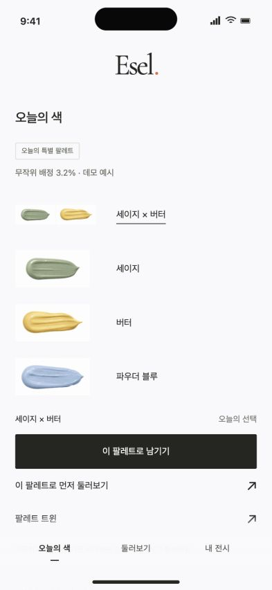 | 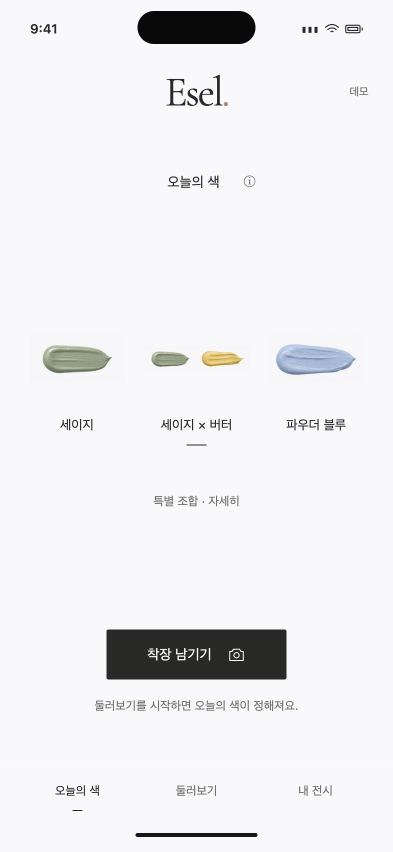 |

### 내 전시 — 관리 정보보다 착장 사진이 먼저

기본 보기를 두 열의 사진 컬렉션으로 바꿨다. 캘린더는 ‘색 기록’, 복구권과 제약은 ‘기록 관리’로 옮겼다. 희귀 배정 표식은 작은 물감, 트윈은 프로필 한쪽의 짧은 진입점으로 유지한다.

| 수정 전 | 수정 후 |
|---|---|
| 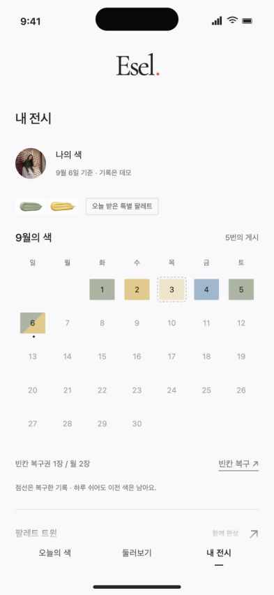 | 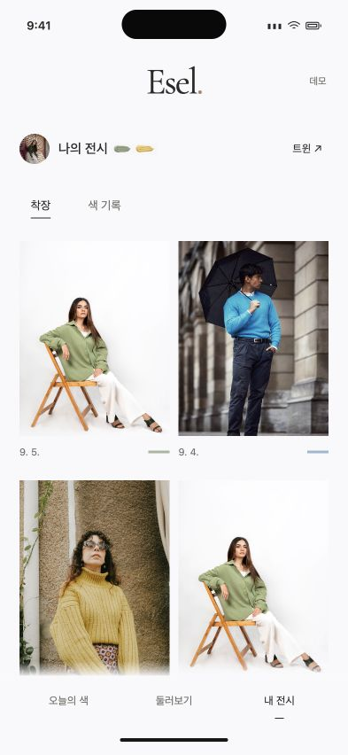 |

### 기능을 없애지 않고 깊이를 나눔

| 상태 | 화면 |
|---|---|
| 배정 설명 | 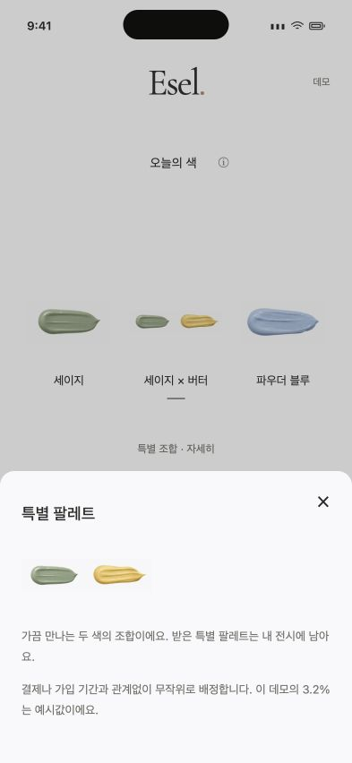 |
| 월간 기록 | 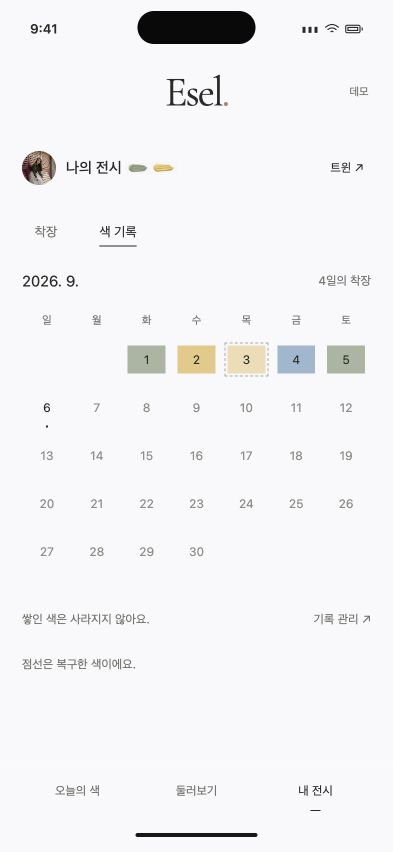 |
| 필요한 때 복구 | 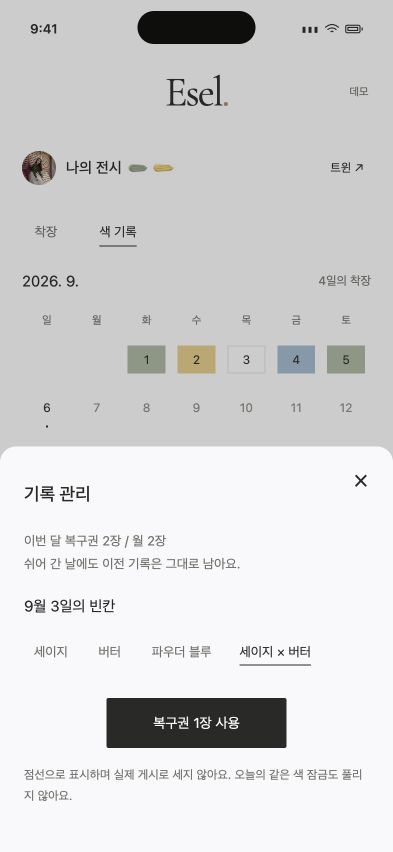 |
| 같은 색 공개 전 | 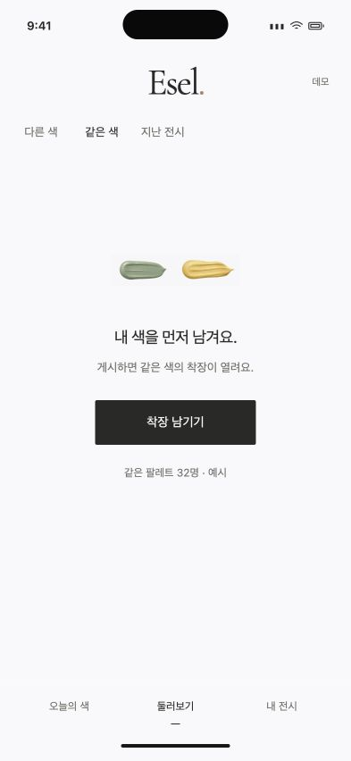 |
| 게시 준비 | 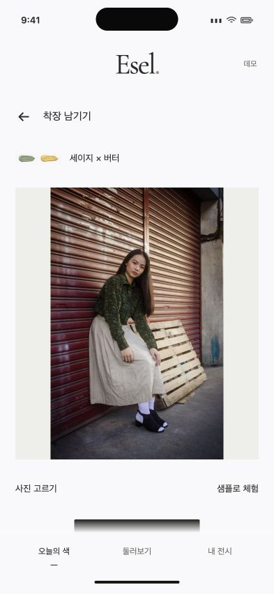 |
| 트윈 기다림 / 완성 | 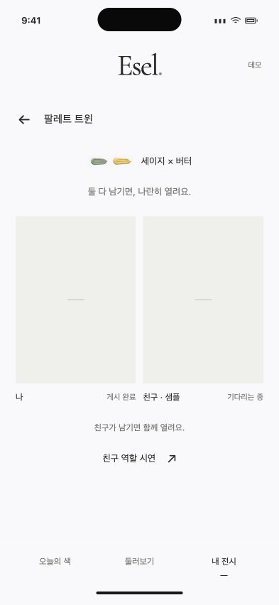 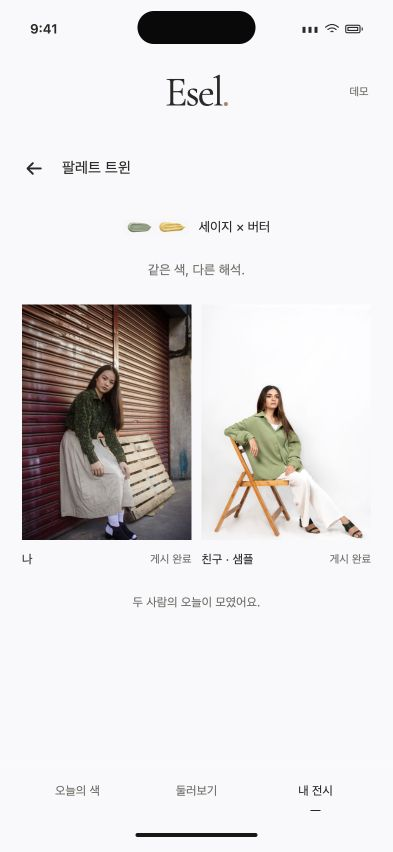 |

### 작은 화면과 스크롤

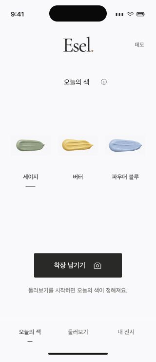
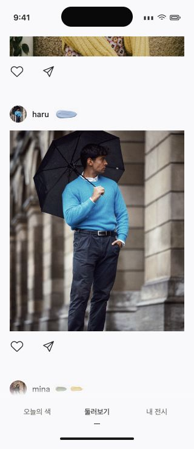
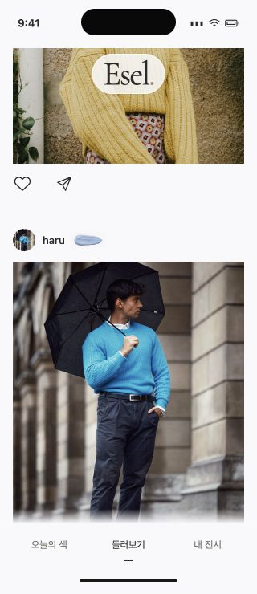

## 상태 변화

기존 공개·희귀 배정·복구·트윈 상태 모듈을 재사용한다. 희귀 배정 화면도 선택을 세 개로 제한한다. 기본 세이지·버터·블루 중 버터 자리를 특별 조합으로 바꾼다. 이는 이번 시안의 임시 표시 규칙이고 실서비스 배정 정책의 확정이 아니다.

## 검토 방법

### 최신 수정: 친구 동의 상태·사진별 태그

친구가 공개에 동의하면 이름이 담긴 알림과 함께 트윈 화면에 ‘함께 업로드 완료’, ‘피드에서 보기’를 표시한다. 동의 대기와 완료는 화면 재진입 후에도 구별되며 철회 시 완료 표시를 제거한다. 친구만 먼저 동의했으면 친구 동의 완료만 표시하고 자동으로 내 공개를 확정하지 않는다. 새로고침 복원이나 실제 친구 알림 서버는 범위 밖이다.

묶음 피드는 각 사진 바로 아래에 상대 아이디를 배치한다. 내 사진 아래는 친구 태그, 친구 사진 아래는 내 태그다. 단독 공개는 한 사진 아래 두 아이디를 유지한다. 추가 카드나 배너 없이 기존 미니멀 구성과 48px 터치 영역을 유지한다.

검증: `tests/editor-flow-browser.cjs`에 동의 대기·완료 알림·재진입·피드 바로가기·사진별 태그 매핑·철회 검사를 추가했다. 아래 캡처는 현재 화면이며 이후 단락은 이전 변경 이력이다.

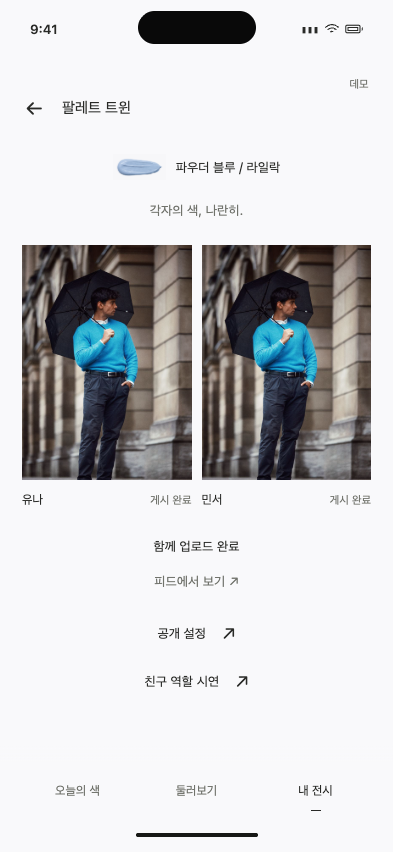
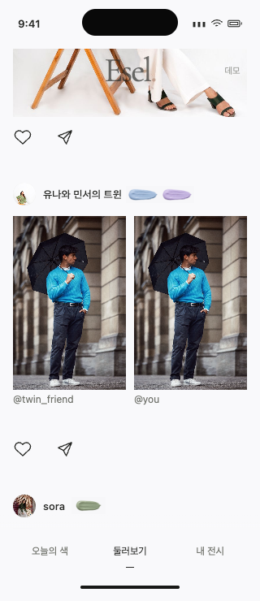

### 최신 수정: 명시적 업로드·서로 다른 추천·아크릴 얼굴 편집

- 공개 방식은 초안에서 선택하고 ‘업로드’ 버튼으로만 확정한다. 닫기는 미저장이다.
- 트윈 추천은 각자 3개, 교집합은 정확히 1개다. 나머지 각자 2개는 무작위이며 다른 색을 입어도 된다. 수락 시 한 번 정하고 재렌더 시 바뀌지 않는다. 이전 ‘공통색 하나를 반드시 입기’ 규칙을 대체한다.
- 묶음 제목은 데이터의 닉네임을 사용해 ‘유나와 민서의 트윈’으로 표시한다. 업로드 안내에 두 아이디가 표시됨을 명시하고 사진 바로 아래에 둘 다 누를 수 있게 둔다. 이전 개별 태그 허용 UI를 대체한다.
- Esel 로고는 피드만 표시하며 다른 화면은 상단 여백도 줄였다.
- 얼굴 가리기는 모자·선글라스 미착용을 사용자가 선택하고 얼굴 중앙을 직접 눌러 수평/대각선 물감을 배치한다. 크기 슬라이더와 키보드 방향키도 지원한다. 사진 선택 시 초기화되며 그대로 게시도 가능하다. 브라우저에 FaceDetector가 없어 자동 얼굴·액세서리 인식을 구현했다고 주장하지 않는다. 사진은 로컬 Canvas에서 최대 변 1600px PNG로 합성되고 그 결과를 실제 데모 게시물에 사용한다. 잘못 배치하면 얼굴을 가리지 못하며 익명화 보장은 없다.

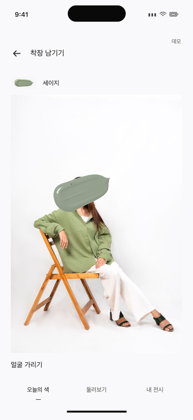
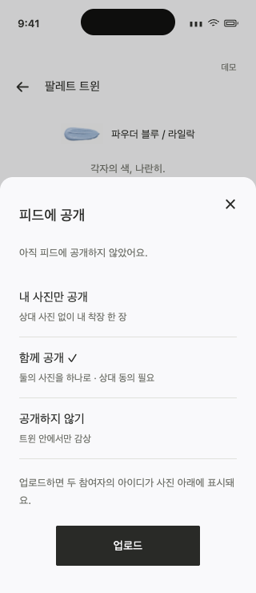

현재 브라우저 검증은 `tests/editor-flow-browser.cjs`를 기준으로 한다. 393×852·320×740에서 수평/대각선 선택·위치 미지정 게시 거절·PNG 합성 게시, 피드 전용 로고, 서로 다른 색 선택, 공개 선택 취소와 업로드 확정, 두 태그와 닉네임 제목을 확인했다. 이후 단락의 공통색 강제·태그 토글과 테스트 수는 과거 이력이다. 새 추천 불변식 테스트 3개를 추가해 순수 테스트 총 51개를 유지한다.

### 트윈 피드 공개 방식과 상대 태그

기존 미니멀 트윈 화면에는 ‘피드에 공개’ 진입점 하나를 추가했다. 하단 시트에서 내 사진만 / 함께 / 비공개를 선택한다. 상대가 함께 공개를 거절해도 내 사진만 공개할 수 있다. 묶음은 양측 동의 후 하나의 게시물로 나타난다. 각각 단독을 선택하면 두 게시물이며 묶음으로 변경하면 중복 없이 대체한다.

태그는 별도 동의가 기본 꺼짐이다. 사진 아래, 좋아요/공유 위에 누를 수 있는 상대 아이디를 표시하고, 공개 사진만 담은 로컬 프로필 상세를 연다. 내 전시에는 내가 공개한 트윈 사진을 추가하되 개인 캘린더나 잠금 해제에는 반영하지 않는다. 상대 행동은 ‘친구 역할 시연’ 안에 둔다. 현재는 서버 없는 데모이므로 동의/공개 상태와 링크는 새로고침하면 복원되지 않는다.

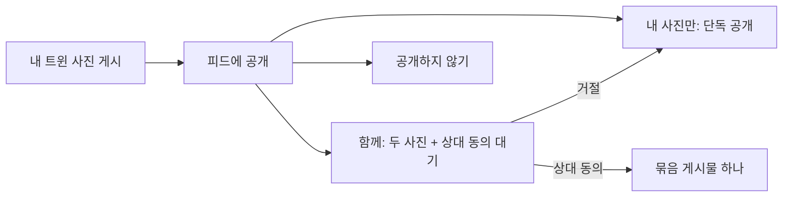

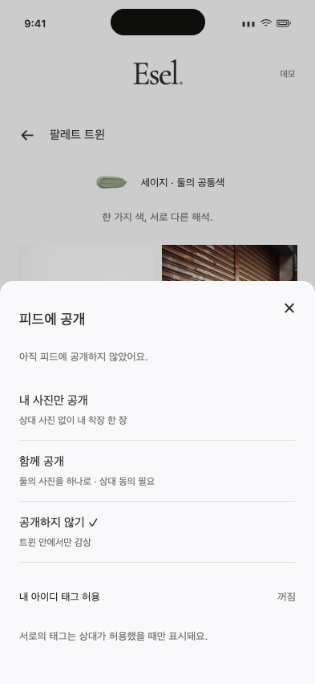
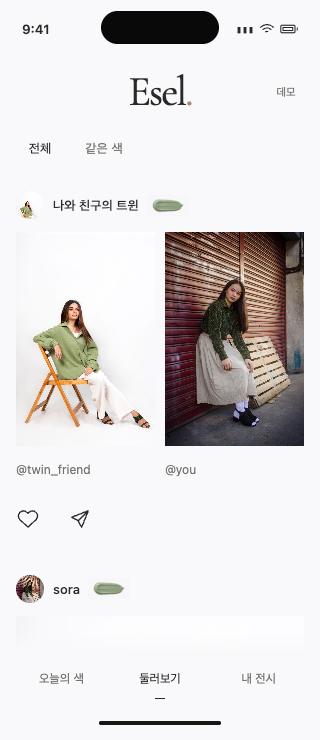

검증 스크립트: `tests/publication-browser.cjs`(설치된 Chrome·Playwright 필요). 공개·태그 순수 테스트 5개를 추가했다. 기존 단계의 테스트 수·트윈 완료 캡처는 이력이며 이번 수정은 그 이후 상태다.

검증 결과: 순수 테스트 48개, 하네스 정합성(경로 26개·제품 계약 10개·수동 시나리오 9개), diff 공백 검사 통과. Chrome 393×852·320×740에서 공개 대기/거절/단독/두 단독/묶음 대체, 상호 태그·철회, 태그 클릭 프로필의 비공개 사진 차단, 개인 같은 색 잠금 유지와 가로 넘침·JavaScript 오류 없음을 확인했다. 기존 통합 피드 브라우저 검증도 다시 통과했다. 실제 친구 동의 서버나 네이티브 기기를 검증한 것은 아니다.

### 2026-09-06 트윈: 공통색 하나, 나머지는 자유

같은 4177 미니멀 프로토타입의 트윈만 수정한다. 개인 오늘 색과 트윈을 분리하고, 색 없는 초대부터 시작한다. 수락 후 세 단색 후보에서 공통 포인트색 하나를 제안하고 상대 동의 후 확정한다. 다른 색 요청은 재선택으로 돌아간다. 나머지 코디 색은 자유이며 모든 색을 맞추라는 조건이 아니다.

개인 사진과 트윈 사진은 별도다. 개인 기게시자도 참여할 수 있고, 트윈 게시로 개인 같은 색 피드가 열리거나 개인 캘린더가 채워지지 않는다. 사진의 색 일치 여부를 자동 검사하지 않는다. 링크는 색 없이 초대 대기를 재현하며 실제 초대·친구 동기화가 아니다.

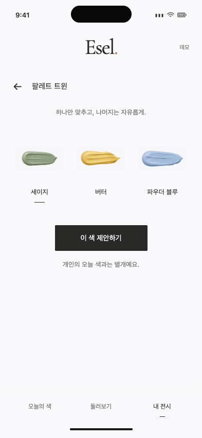
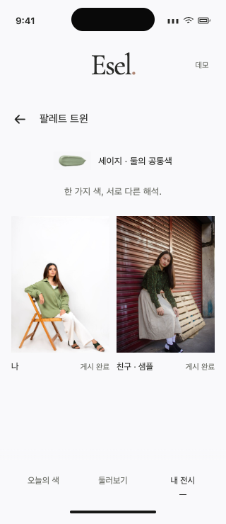

검증: `tests/twin-browser.cjs`에서 Chrome 393×852·320×740으로 초대 시 색 없음, 수락 후 선택, 제안/거절/재제안/동의, 게시 취소/재진입, 두 게시 순서, 개인 기게시자 참여, 트윈 완료 후 개인 잠금·선택색 보존, 구형 초대 링크의 희귀 배정 우회 방지를 확인했다. 순수 테스트는 총 43개다. 새 트윈 UI는 기존 물감·여백·48px 터치 규칙을 재사용한다. 아래 초기 트윈 캡처와 37/42개 검증 수치는 이전 수정 단계의 이력이다.

### 2026-09-06 통합 피드 수정

기존 4177 미니멀 갤러리의 목적을 유지한 국소 수정이다. ‘다른 색’·‘지난 전시’ 탭을 없애고 ‘전체 / 같은 색’으로 줄였다. 전체는 다른 색과 과거 사진을 함께 최신순으로 표시한다. 누적 감상 30초 이후 추가되는 매 4번째 게시물만 아직 안 본 인기 후보로 선택한다. 보고 있는 목록을 갑자기 재정렬하지 않는다. 다른 화면·숨긴 탭은 감상 시간에서 제외한다. 이 임계값과 가상 좋아요는 데모 가정이다.

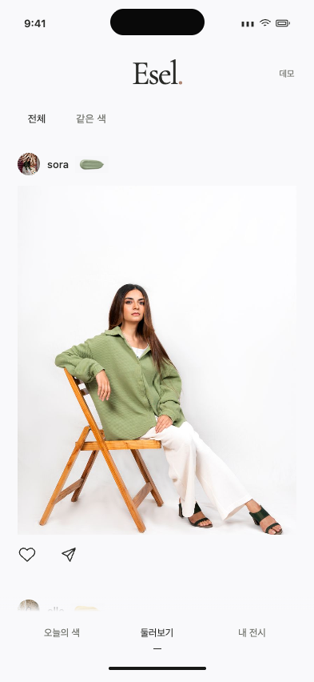
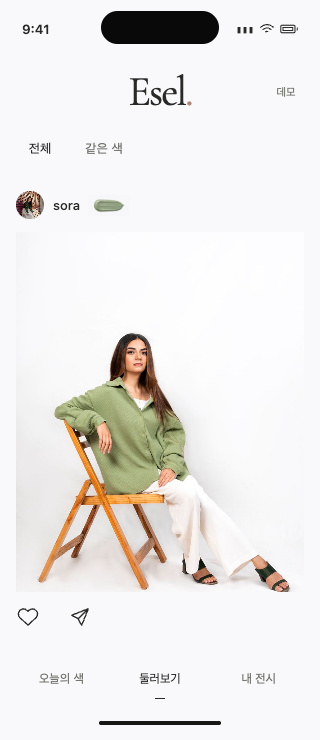

순서 테스트 5개를 추가했다. 아래의 초기 검토 결과·기존 피드 캡처는 탭 통합 전 이력이다. 최신 동작 검증은 `tests/feed-browser.cjs`에 기록하며 Chrome/Playwright가 필요하다. 30초는 브라우저 테스트에서 가상 시계로 진행한다. Expo 앱은 이번 범위가 아니다.

최신 검증: 순수 테스트 42개·하네스 경로 22개 정합성 통과. Chrome 393×852·320×740에서 전체 탭 문구, 다른 색/과거 사진의 최신순, 31초 후 스크롤 추가·인기 후보 선택, 기존 목록 유지, 같은 색 잠금과 샘플 게시 후 공개, 가로 넘침 없음·JavaScript 오류 없음을 확인했다. 캡처는 해당 검증의 초기 전체 피드다.

- URL: http://localhost:4177/
- `npm run check:harness`: 공통 진입점·문서·경로·CSS 토큰·제품 계약·수동 검증 항목 정합성 검사 통과.
- `npm run test:design`: 기능 상태 30개 + 헤더 상태 7개, 총 37개 통과.
- `npm test`: 기존 Expo 상태 12개 통과. `npm run typecheck` 통과. Expo 시각 디자인·네이티브 코드는 이번에 변경하지 않았다.

### 직접 확인한 결과

| 검증 | 관찰 결과 |
|---|---|
| 일반/특별 후보 | 각각 세 개. 특별 배정 설명·확률은 상세에 있음 |
| 게시 전 같은 색 | `#post-list .post-photo` 0개. 다른 색·지난 전시 표시 가능 |
| 지난 전시 | 게시 전에 사진 4개 공개, 날짜는 9월 5일 |
| 사진 준비·게시 | 사진 없음일 때 게시 비활성. 샘플 로드 후 게시하여 같은 색 사진 1개 공개 |
| 색 기록·복구 | 기본은 사진 보기. ‘색 기록’으로 전환, 9/3을 버터로 복구. 게시 수 4 유지, 복구권 2→1, 점선 표시 |
| 빈칸 소진 | 다시 관리 열면 남은 1장과 ‘빈칸 모두 채워짐’ 안내. 불가능한 복구 버튼 없음 |
| 복구 후 잠금 | 실제 게시 전 같은 색 사진 0개 유지 |
| 내가 먼저 / 친구 먼저 | 두 순서 모두 한 사람 게시 때 트윈 이미지 0개, 둘 다 게시 때 2개 |
| 불필요한 시연 버튼 | 초대 전·친구만 게시한 상태에서는 친구 역할 시연 진입을 숨김 |
| 키보드 선택 | Tab/Enter로 색 선택·색 기록 보기 전환 후 활성 요소와 선택 상태 유지 |
| 320×740 | 문서와 오늘 화면 너비 320px, 가로 넘침 없음, 화면의 버튼 중 48px 미만 영역 없음 |
| 상단 | 아래 스크롤 y=518에서 hidden, 위로 y=407에서 floating 확인 |

브라우저 자동화 연결이 한 차례 끊겨 재연결 후 남은 시나리오를 확인했다. 코드 리뷰에서 찾은 오래된 이미지 이벤트·포커스 이탈·실행할 도구 없는 시연 진입·데모 헤더 포커스 보호를 수정했다. 키보드 초대·관리 완료의 포커스 복원은 코드 검토로도 보강했으며 실제 파일 교체 타이밍 경쟁과 모든 보조기기 조합을 재현했다고 주장하지 않는다.

## 가정과 제한

인원·사진·배정 비율·친구·달력은 로컬 예시다. 실제 계정/서버 업로드/동기화는 없다. 새로고침하면 상태가 초기화된다. 노치·시간·홈 표시는 미리보기 장치이며 실기기 검증이 아니다.

최종 사용자 디자인 승인은 아직 받지 않았다. 복구권 월 2장·특별 배정 3.2%·후보 교체·색 확정 시점은 데모 가정이다. 200% 글자 확대·VoiceOver/TalkBack·실제 카메라·사진 파일 업로드 선택·iOS/Android 실기기 검증은 미수행이다. 순수 상태 테스트와 320px 시각 확인을 출시 검증으로 확대 해석하지 않는다.

## 다른 AI를 위한 산출물

- [공통 AI 진입점](../../../../AGENTS.md)
- [앱 컨셉·디자인·기능·검증 하네스](../../../../docs/ESEL_HARNESS.md)
- [기계 판독용 실행 명세](../../../../harness.json)
- [Claude 진입점](../../../../CLAUDE.md)

## 사용한 스킬

`intent-first`로 이번 범위를 UI 수정·공통 문맥 작성으로 한정했다. `prototype-design`으로 이전 시안과 Expo 앱을 보존한 새 프로토타입·캡처를 만들었다. `mobile-design`으로 터치 영역·세 탭·주 행동·스크롤을 점검했고, `cognitive-writing`으로 상세 하네스를 결정 수준과 검증 범위별로 나눴다. `orchestrate-subagents`로 코드 현황과 위험 검토만 분리하고 디자인 판단·코드 수정·브라우저 검증은 주 작업자가 수행했다. 보조 에이전트의 마지막 재검토는 사용량 제한으로 완료되지 않아 주 작업자가 발견 사항 반영과 문서 일치를 직접 확인했다.

## 피드백 질문

설명을 읽지 않아도 색을 선택하고 사진을 감상하는 앱으로 느껴지는가? 기록과 트윈을 필요할 때 찾을 수 있는가?
