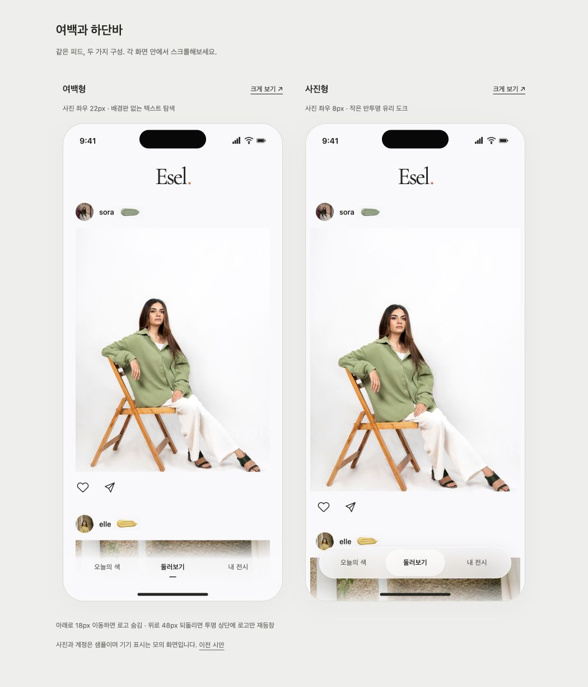
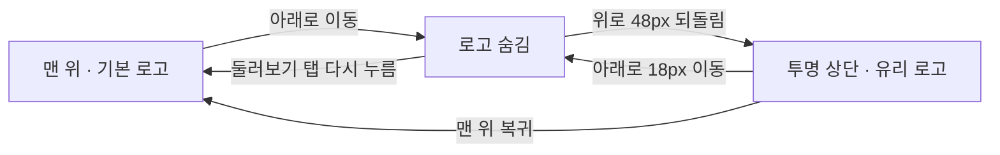
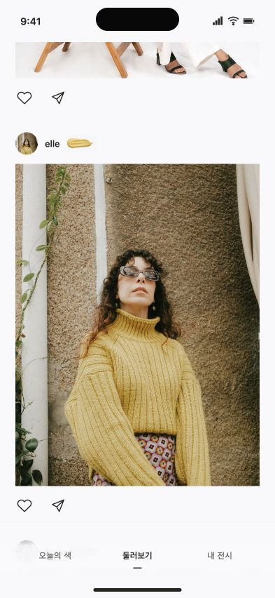
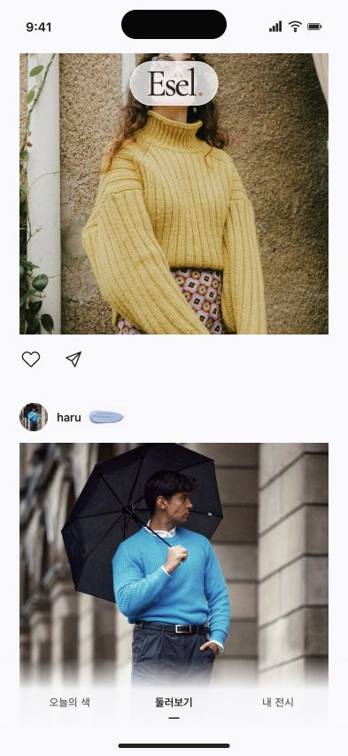
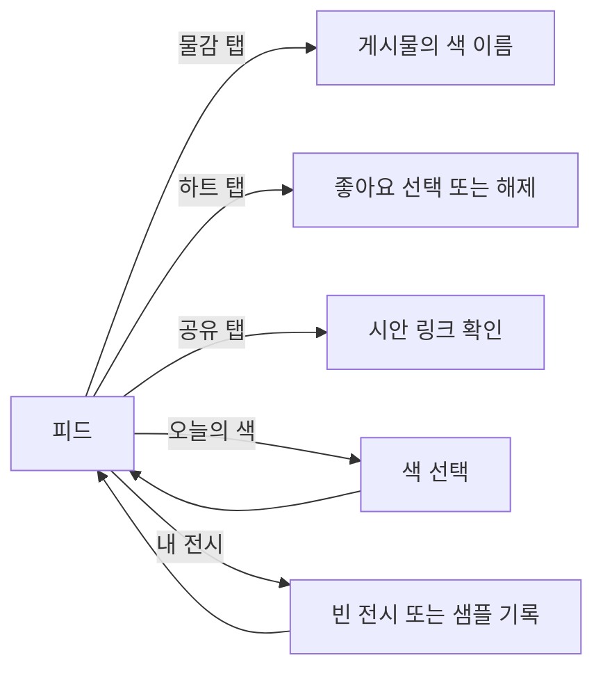
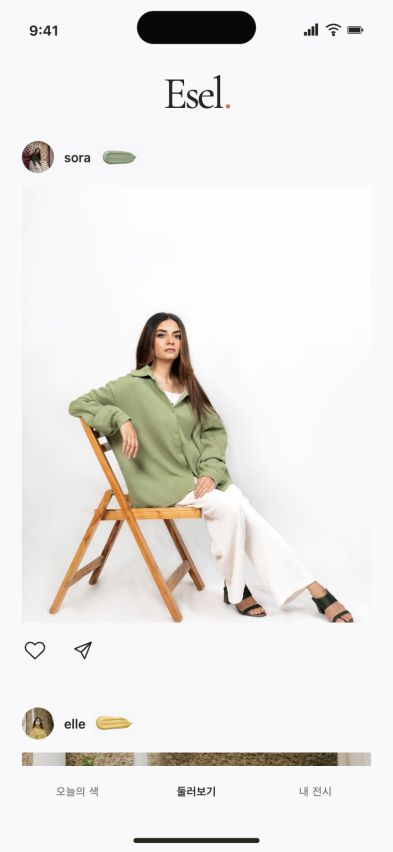

> **보관된 자료 · 최신 아님** — 2026-09-06 닉네임 옆 물감 표식 실험 기록이다. 지금 물감은 [디자인 보드 01](../../../../docs/design/README.md#01-디자인-토큰)의 12색이다. 무엇이 최신인지는 [저장소 안내](../../../../README.md#보관된-자료)에 있다. 비교와 기록용으로만 읽는다.

# Esel — 닉네임 옆 한 점의 물감

## 한눈에 보기

사용자가 직접 그린 피드 스케치를 기준으로 익숙한 SNS 구조 안에 Esel의 색을 담는다. 큰 색 이름·세로 문구·장식 번호·화보형 콜라주는 사용하지 않는다. 기존 Expo 앱과 거절된 두 시안은 덮어쓰지 않고 새로운 시각 프로토타입으로 검토한다.

2026-09-06 후속 요청으로 이 프로토타입에 스크롤 상단과 여백·하단바 비교를 추가했다. 기존 정적 구성은 `?layout=original`에서 확인할 수 있다. 상단 동작은 구현 요청, 두 하단바는 미확정 비교안으로 구분한다.

## 최신 비교: 여백과 하단바

[두 안 나란히 보기](http://localhost:4175/compare.html)

| 비교 | 여백형 · 기본안 | 사진형 · 대안 |
|---|---|---|
| 사진 좌우 여백 | 22px, 350px 이하에서는 18px | 8px |
| 게시물 사이 여백 | 12px | 8px |
| 하단 표현 | 배경판 없는 텍스트와 아래쪽 흰색 페이드 | 높이 56px의 반투명 캡슐과 작은 선택 면 |
| 장점 | 사진 가장자리의 여백과 물감 표식이 함께 전시 느낌 유지 | 사진이 더 커지고 아래로 이어지는 콘텐츠가 도크 뒤에 비침 |
| 주의점 | 유리 도크형보다 변화가 작게 느껴질 수 있음 | 하단바가 하나의 시각적 물체로 더 두드러짐 |

기본 추천은 여백형이다. 사용자에게 이미 아이콘 바가 일반적인 SNS처럼 느껴졌다는 피드백이 있어 아이콘과 구분선을 다시 추가하지 않았다. 독립 검토가 지적한 첫 사진 자체의 큰 흰 배경은 크롭으로 임의 제거하지 않았다. 양쪽 모두 탐색 항목 세 개와 48px 이상의 실제 터치 영역을 유지한다.

### 스크롤에 따른 상단

맨 위에서는 기존처럼 Esel 로고만 중앙에 둔다. 아래 방향으로 18px 누적 이동하면 숨고, 위 방향으로 48px 되돌리면 상단 전체가 투명한 상태에서 로고만 재등장한다. 재등장 시 로고 뒤 100×50px 정도 영역에만 옅은 유리 재질을 두어 사진 위에서도 글자가 읽히도록 했다. 맨 위 12px 범위에서는 초기 상태로 복귀한다. 이 수치는 시안의 초기 설정값이다.

상단을 숨길 때 피드 높이나 패딩을 바꾸지 않아 사진이 튀지 않는다. 모의 상태바·노치 영역 60px는 그대로 보호한다. 하단 탐색은 숨기지 않으며 둘러보기 탭을 다시 누르면 맨 위로 돌아갈 수 있다.

### 후속 변경 검증

- 순수 상태 계산 단위 테스트 7개 통과: 임계값, 누적 위 스크롤, 방향 반전, 미세 움직임, 상단·하단 바운스.
- 393×852에서 실제 스크롤: y=511에서 숨김과 opacity 0, y=400.5에서 재등장과 opacity 1을 확인했다. 두 상태의 피드 영역은 top 60px, height 792px로 동일했다.
- 재등장 상단의 배경은 `rgba(0,0,0,0)`, 로고 뒤에만 `blur(16px) saturate(1.25)`와 반투명 배경이 적용됐다. y=826.5에서 사진 위 상태를 캡처했다.
- 숨긴 로고는 `aria-hidden=true`, `tabindex=-1`이다. 하단 둘러보기 재선택 시 y=0, 초기 로고와 tabindex 0으로 복귀했다.
- 320px에서 두 안 모두 문서 너비 320px로 가로 넘침이 없었다. 유리 도크의 각 탭은 88×48px, 여백형 탭은 약 85.3×48px이다.
- 오늘의 색 → 파우더 블루 선택 → 내 전시 → 둘러보기 이동과 기존 좋아요·색 확인을 확인했다.
- 모션 축소·투명도 축소·고대비·blur 미지원 대체 스타일을 코드에 포함했다. 이 설정들의 실기기 테스트나 프레임률 측정은 수행하지 않았다.
- 개별 캡처: [여백형](screenshots/chrome-quiet.png), [사진형](screenshots/chrome-glass.png), [320px 사진형](screenshots/chrome-glass-320.png).

### 적용한 스킬

`prototype-design`은 기존 앱과 분리된 비교 시안·캡처 기록에, `apple-design`은 작은 유리 재질과 중단 가능한 상단 움직임에, `mobile-design`은 노치·48px 터치 영역과 접근성 대응에 적용했다. `figma-flow-to-implementation`과 `cognitive-writing`은 스크린샷 해석·상태 흐름·검토 문서 정리에, `orchestrate-subagents`는 독립적인 여백·하단바 장단점 검토에 사용했다. 이번 후속 변경에서는 새 이미지를 생성하지 않았다.

구현 범위와 전제: [UI 작업 문서](../../20260906-0210-feat-feed-chrome-ui-workflow.md).

## 설계 목표

- 프로필 사진 → 닉네임 → 작은 아크릴 물감이 사진 위 한 줄에 놓인다.
- 물감은 해당 게시물에 부여된 색을 나타낸다. 새 기능이나 장식 문구로 차별화하지 않는다.
- 사진 아래에는 좋아요와 공유만 둔다. 정사각형을 강제하지 않으며 흰 바탕과 사진 사이 여백을 유지한다.

## 화면 목록

| 화면 | 역할 | 핵심 행동 |
|---|---|---|
| 피드 | 스케치 기반 시안 | 세로 스크롤, 좋아요, 공유 열기, 물감 확인 |
| 색 확인 | 물감의 의미 확인 | 색 이름 확인, 닫기 |
| 오늘의 색 | 최소한의 색 선택 연결 | 세 색 중 하나 선택 |
| 내 전시 | 탭 연결의 빈 상태 예시 | 샘플 착장 한 장 남기기 |

## 페이지와 사용자 흐름

## 시각적 방향

배경 #F9F9FB와 중앙 Esel 로고를 유지한다. 프로필·닉네임·사진·작은 선 아이콘은 익숙한 질서를 따른다. 닉네임 옆에 두툼한 아크릴 물감 질감의 작은 표식을 둬 앱 아이콘의 물감과 연결한다. 색 이름은 물감을 누를 때만 보여주어 기본 화면에 글이 늘어나지 않게 한다.

## 화면 콘셉트

393×852 브라우저에서 실제 렌더링한 시안이다. 노치·상태바·홈 표시만 모의 기기 요소다.

- [스크롤한 피드](screenshots/paint-feed-scrolled.png): 파우더 블루 게시물과 닉네임 옆 물감.
- [색 확인](screenshots/color-detail.png): 물감과 색 이름, 기준색 표시.
- [오늘의 색](screenshots/today.png): 버터 선택 상태.
- [내 전시 샘플](screenshots/profile-sample.png): 선택한 버터색 반영.
- [320px 피드](screenshots/paint-feed-320.png): 작은 화면 배치.

## 상태 변화

좋아요는 모의 상태에서 즉시 선택/해제한다. 공유는 기기 안에서만 열리는 시안 주소를 보여주며 자동 외부 전송은 없다. 물감 확인은 작은 대화상자에서 색 이름을 보여준다. 오늘의 색과 내 전시는 피드 디자인을 이해하기 위한 최소 연결 상태이며 기존 앱의 정책을 대체하지 않는다.

## 검토 방법

- URL: http://localhost:4175
- 기존 앱: http://localhost:4173 (변경하지 않음)
- 확인: 게시물 헤더 순서·사진 비율·세로 스크롤·좋아요·색 확인·공유 닫기·세 탭 이동.

### 확인 결과

- 프로필 → 닉네임 → 작은 물감 순서와 사진 아래 좋아요·공유 배치를 브라우저 캡처로 확인했다.
- 세 게시물의 사진과 물감 에셋 모두 로딩 완료 및 자연 크기 존재를 확인했다.
- 좋아요를 누르면 `aria-pressed=true`, 다시 누르면 해제된다.
- 물감을 누르면 해당 색 이름의 대화상자가 열리고 닫기 버튼으로 돌아온다.
- 공유 버튼은 해당 게시물의 로컬 주소를 보여준다. 외부 공유와 클립보드 복사는 검증 중 실행하지 않았다.
- 세 탭 이동, 버터 선택, 빈 전시에 샘플 남기기 및 버터 물감 반영을 확인했다.
- 393px와 320px에서 문서 너비가 뷰포트 너비와 같아 가로 넘침이 없었다. 320px에서 물감·좋아요·공유 버튼은 48×48px, 하단 탭은 약 86.7×48px이다.
- `node --check src/app.js` 통과. 네이티브 앱·카메라·로그인·실서버 검증을 의미하지 않는다.

## 가정과 제한

- 프로필과 닉네임은 기존 스톡 사진을 재사용한 가상의 샘플이다. 실제 이용자 계정이 아니다. 사진 출처는 `assets/demo-sources.md`에 있다.
- 모의 노치·상태바·홈 인디케이터는 화면 배치 확인용이며 아이폰 실기기 검증이 아니다.
- 실제 가입, 카메라 촬영, 파일 업로드, 서버, 국가별 피드, 동일 색 잠금은 이번 시각 검토 범위 밖이다.
- 내 전시의 샘플 기록과 좋아요는 새로고침하면 사라진다. 공유 주소는 이 서버가 켜진 동일 기기에서만 열 수 있다.
- 물감 질감은 생성 이미지이므로 색상 코드와 모든 픽셀이 일치하지 않는다. 정밀한 색 확인은 색 이름과 기준색으로 보완한다.
- 물감 PNG는 알파 채널이 없는 거의 흰색 배경 이미지다. CSS `mix-blend-mode: multiply`로 #F9F9FB에 합성 표시한다. 배경 픽셀에는 최대 약 2단계 밝기 차이가 남을 수 있으며, 투명 PNG로 간주하지 않는다.
- 물감 3개는 내장 이미지 생성 도구로 생성·편집했다. 실제 프롬프트, 원본과 프로젝트 내 경로, 검증 한계는 [물감 에셋 기록](assets.md)에 남긴다.

## 피드백 질문

물감 표시의 위치와 크기가 스케치의 의도에 맞는가? 사진을 방해하지 않으면서 Esel만의 표시로 느껴지는가?
