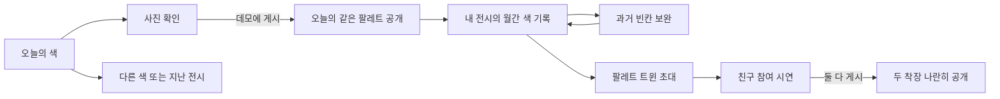

# Esel — 참여와 색상 기록 데모

## 한눈에 보기

사용자가 선택한 같은 팔레트 공개 조건, 희귀 팔레트, 월간 색상 기록·복구권, 팔레트 트윈을 기존의 미니멀 피드 디자인에 연결한다. 기존 Expo 앱과 4175 디자인 비교 시안은 유지하며, 4176에서 기능이 연결된 별도 데모를 제공한다.

## 설계 목표

- 오늘의 같은 팔레트만 게시 후 공개하고 다른 팔레트·과거 게시물은 먼저 볼 수 있게 한다.
- 희귀 팔레트는 무작위 배정 후보이며 유료·가입 기간·연속 출석 특혜를 넣지 않는다.
- 빠진 날 때문에 기록을 지우지 않고 월 2회 빈칸 보완을 제공한다. 보완한 기록은 실제 게시와 구분한다.
- 친구와 같은 팔레트를 받고 둘 다 게시해야 나란히 공개한다.

## 화면 목록

| 화면 | 역할 | 핵심 행동 |
|---|---|---|
| 오늘의 색 | 기본 색 세 가지 또는 특별 조합 확인 | 선택·촬영/파일·샘플 진입 |
| 둘러보기 | 다른 색·같은 팔레트·지난 전시 | 감상·잠금 확인·게시 |
| 착장 남기기 | 기기 안에서 사진 준비·확인 | 샘플 또는 파일 선택·데모 게시 |
| 내 전시 | 월간 색 기록과 받은 희귀 팔레트 | 빈칸 복구·트윈 진입 |
| 팔레트 트윈 | 초대부터 두 사람 게시까지 | 초대·친구 참여 시연·나란히 공개 |

## 페이지와 사용자 흐름

## 시각적 방향

#F9F9FB·중앙 Esel·닉네임 옆 물감·큰 착장 사진을 유지한다. 기능은 세 탭에 나누고 피드에 긴 설명이나 배지를 늘리지 않는다. 상단 아래 스크롤 숨김·위 스크롤 유리 로고 재등장, 텍스트 하단 탐색을 재사용한다.

## 화면 콘셉트

실제 브라우저에서 393 × 852와 320 × 740 크기로 확인했다.

| 상태 | 캡처 |
|---|---|
| 게시 전 같은 팔레트 잠금 | [잠금 화면](screenshots/feed-locked.png) |
| 지난 날짜 공개 | [지난 전시](screenshots/feed-past.png) |
| 게시할 사진 확인 | [사진 미리보기](screenshots/compose.png) |
| 게시 후 같은 팔레트 공개 | [공개된 전시](screenshots/feed-unlocked.png) |
| 희귀 조합 배정 | [오늘의 특별 팔레트](screenshots/rare-today.png) |
| 희귀 배지·색상 기록·빈칸 복구 | [내 전시](screenshots/rare-profile.png), [복구 선택](screenshots/restore-dialog.png) |
| 트윈 한 명 게시 / 두 명 게시 | [기다리는 화면](screenshots/twin-waiting.png), [나란히 공개](screenshots/twin-complete.png) |
| 작은 화면 / 상단 유리 로고 | [320px 피드](screenshots/feed-320.png), [위 스크롤 상태](screenshots/feed-glass-logo-320.png) |

사진·물감·서체는 이전 프로토타입의 기존 자산을 재사용했다. 이번 작업에서 이미지를 새로 생성하지 않았다. [기존 자산 기록](../20260906-paint-feed/assets.md).

## 상태 변화와 가정

- 고정된 데모 날짜는 2026-09-06이다. 인원 428명, 희귀 배정 확률 3.2%는 모두 예시값이며 실제 이용자 통계가 아니다.
- 기본 색은 세이지·버터·파우더 블루 중 하나를 고른다. 특별 팔레트 예시는 세이지와 버터 조합이다. 색상 공급처는 연동하지 않는다.
- 오늘의 색에서 시작한다. 기록 준비·둘러보기·트윈 초대 중 하나를 시작하면 오늘 팔레트를 확정한다. 확정만으로는 같은 팔레트 피드가 열리지 않는다. 잠긴 색을 다른 색으로 돌려 보거나 오래된 초대를 수락해 확정색을 바꾸는 경로도 막는다. 일반·희귀·무작위 배정 시연 설정에서만 초기화하여 다시 고를 수 있다.
- 빈칸 보완은 같은 달의 지난 날짜만 가능하고 오늘 게시로 계산하지 않는다. 보완 기록은 화면에 별도로 표시한다. 기존 기록·미래 날짜·복구권 소진은 거절한다.
- 트윈 초대·친구 게시 버튼은 명시적인 시연 조작이다. 실제 친구에게 메시지를 보내거나 계정을 연결하지 않는다.

## 검토 방법

- URL: http://localhost:4176
- 일반 배정: http://localhost:4176/?scenario=standard
- 희귀 배정: http://localhost:4176/?scenario=rare
- 무작위 배정 시연: http://localhost:4176/?scenario=random
- 검증 대상: 잠금 전후·과거 공개·희귀 배정·게시 시 기록 추가·빈칸 복구·트윈 양쪽 게시 순서·모바일 배치.

### 확인 결과

- 상태 단위 테스트 30개 통과: 확정·게시·과거 공개·잘못된 날짜·복구권 한도·희귀 추첨 경계·트윈 양쪽 순서·불변성·브라우저 전역 API.
- 브라우저에서 게시 전 같은 팔레트 이미지가 DOM에 없는 것을 확인했다. 게시 후 공개되며, 다른 색과 지난 전시는 게시 전에도 공개된다.
- 9월 3일 빈칸을 보완하면 복구권이 2장에서 1장으로 줄고 점선 표시가 생긴다. 게시 수는 증가하지 않고 오늘 잠금도 풀리지 않는다. 오늘 실제 데모 게시 후에만 게시 수가 4회에서 5회로 증가한다.
- 내가 먼저 / 친구가 먼저 게시한 두 순서 모두 한 명 게시 시 트윈 이미지 0개, 두 명 게시 시 2개임을 확인했다.
- 일반 배정과 희귀 배정 시나리오를 확인했다. 무작위 시연은 예시 확률 3.2%의 추첨 함수를 호출한다. 확률 경계는 단위 테스트로 검증했다.
- 320px에서 가로 넘침이 없으며 하단 탭은 48px 높이를 유지한다. 달력 날짜는 작은 버튼이 아닌 읽기 전용 기록이고, 복구는 별도 버튼으로 실행한다.
- 아래 스크롤 시 상단 숨김, 위 스크롤 시 로고만 유리 배경으로 재등장하는 기존 동작을 확인했다. 확장된 내 전시·오늘의 색에도 같은 스크롤 처리를 적용했다.
- 샘플 이미지 게시를 검증했다. 실제 기기 파일 선택·카메라·음성 안내·iOS/Android 실기기 검증은 수행하지 않았다.

재실행: `node --test .codex/temp/prototype/20260906-social-loop/tests/social-state.test.cjs`

## 가정과 제한

로컬 HTML 모의 상태이며 새로고침하면 초기화된다. 사진 파일은 기기 안에서만 미리 보며 서버에 전송하지 않는다. 실제 촬영 권한·편집·로그인·서버 접근 제어·사용자 수 집계·푸시·친구 동기화는 구현하지 않는다. 샘플 자산은 정적 파일이므로 클라이언트 잠금은 보안 기능이 아니다. 실제 서비스에서는 서버에서 공개 조건을 검사해야 한다. 공유 주소는 서버가 켜진 이 컴퓨터 안에서만 열리는 데모 링크다. 모의 노치·홈 표시는 실기기 검증이 아니다.

## 피드백 질문

같은 팔레트를 보려고 게시하는 과정이 부담스럽지 않은가? 월간 기록과 트윈이 피드의 단순함을 해치지 않고 발견되는가?

## 이번에 보류한 제안

해석 반응·확장된 컬러 정체성 분석·외부 SNS 공유 카드는 글로만 정리한다. 기존 하트와 기본 공유 동작을 대체하지 않는다. [나머지 아이디어 정리](remaining-ideas.md).

## 사용한 스킬과 작업 분리

- `prototype-design`: 기존 앱과 이전 시안을 보존하고 별도 클릭형 데모·흐름·검증 캡처를 구성했다.
- `intent-first`: 사용자가 고른 1·4·5·7번만 구현하고 남은 2·3·6번은 글로 정리했다.
- `cognitive-writing`: 화면 문구와 남은 아이디어 문서를 간결하게 정리했다.
- `orchestrate-subagents`: 상태 모듈·테스트와 나머지 아이디어 정리를 독립적으로 나눴다. 주 작업자가 결과를 읽고 UI에 연결한 뒤 테스트와 브라우저 검증을 수행했다.
