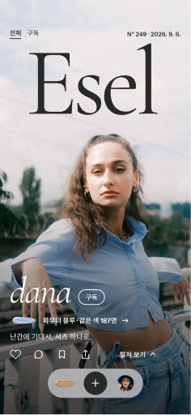
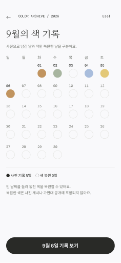
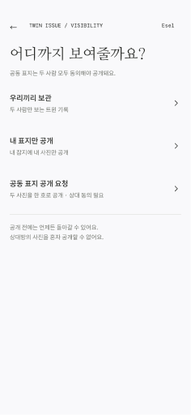

# Esel 앱 만들기 전에 읽는 쉬운 안내

확인 날짜: 2026-10-11. 대상: 기획·디자인·개발 팀원.

**핵심: 색 기록·친구·트윈·좋아요·공유는 그대로 만들고, 시연용 버튼과 겹치는 화면만 정리합니다.**

이 PR은 개발 안내와 최신 디자인 자료를 추가합니다. 앱 기능이나 서버를 완성한 PR은 아닙니다. 아래의 화면 합치기는 개발 제안이며, 피그마 원본을 삭제하거나 변경하지 않았습니다.

## 1. 어려운 말을 먼저 풀어 볼게요

- **UI**: 눈에 보이는 화면과 버튼입니다.
- **UX**: 버튼을 누르고 다음 일을 끝낼 때까지의 경험입니다.
- **목업**: 실제 기능을 만들기 전에 그린 화면 견본입니다. 버튼이 다음 그림으로 이동해도 실제 가입이나 저장이 된 것은 아닙니다.
- **서버**: 여러 사람이 함께 쓰는 기록 보관소입니다. 앱을 껐다 켜도 기록이 남고 친구와 정보를 나눌 수 있게 합니다.
- **화면 상태**: 같은 방에서 불을 켜거나 끄는 것과 같습니다. 알림 ON과 OFF를 위해 방을 두 개 만들 필요가 없습니다.
- **API**: 앱이 서버에 “이 기록을 저장해 줘”, “친구가 동의했니?”라고 묻는 약속입니다.

## 2. 지금 최신 디자인은 어떤 모습인가요?

Esel은 **오늘 입은 옷을 잡지 표지처럼 남기는 패션 앱**입니다. 이전의 갤러리 시안이 아니라, 현재 피그마의 표지 SNS 디자인을 기준으로 합니다.

| 오늘의 표지 | 월간 색 기록 | 트윈 공개 범위 |
|---|---|---|
|  |  |  |

위 이미지는 확인 당일 피그마에서 가져온 화면입니다. 이름·사진·날짜·인원수는 예시이며 실제 사용자 통계가 아닙니다.

- [최신 표지 SNS와 확장 기능 페이지](https://www.figma.com/design/kNBbhEWIhDASkrYlgegU5b?node-id=121-28)
- [최신 로그인·창간 페이지](https://www.figma.com/design/kNBbhEWIhDASkrYlgegU5b?node-id=121-29)
- [60개 전체 화면 목록과 직접 링크](screens.md)
- [확인 당시 화면 이름·문구·크기 기록](figma-screen-inventory.json)

피그마 접근 권한은 기존 설정을 따릅니다. 이 PR은 파일 공유 범위를 바꾸지 않습니다.

### 화면을 이해하는 순서

| 기능 | 사용자에게 보이는 경험 | 대표 화면 |
|---|---|---|
| 로그인과 창간 | 표지를 맛본 뒤 로그인 → 색 선택 → 촬영 → 잡지 이름 → 얼굴 연출 → 첫 호 발행 | J1–J7 |
| 오늘의 표지 | 첫 사진은 큰 Esel 제호, 아래 사진은 잡지 안쪽 페이지처럼 읽기 | C1·C2·C3·C7 |
| 가판대 | 색을 골라 다른 사람의 표지를 살펴보기 | C4·C8 |
| 내 잡지와 서가 | 내 표지를 모으고 표지/책등 보기 바꾸기 | C5·C5b·M1 |
| 오늘 호 만들기 | 사진·문구·얼굴 표현을 고르고 발행 | C6 |
| 월간 색 기록 | 사진을 올린 날과 색만 복원한 날을 구분 | R1–R5 |
| 친구와 트윈 | 친구 요청 → 초대 → 각자 게시 → 둘 다 게시하면 서로 보기 → 공개 범위 선택 | F1–F3·T1–T10·T8private·T8solo |
| 설정과 계정 | 프로필·알림·계정 관리, 계정 안에서 로그아웃·탈퇴 | S1–S6 및 상태 화면 |
| 좋아요와 공유 | 내 반응 확인, 공개된 표지 링크 전달 | A1–A8 |

현재 화면 크기는 393×852입니다. 사진이 중심이고, 큰 잡지 글자와 떠 있는 하단 메뉴를 사용합니다. 색을 화면 전체에 칠하지 않고 물감·색칩 등으로 표현합니다. 얼굴은 그대로·물감·제호 뒤·목 아래 중 선택합니다. 얼굴을 가렸다고 익명성이 보장되는 것은 아닙니다.

글꼴과 간격의 코드 기준은 기존 [하네스](../../ESEL_HARNESS.md)를 참고하되, 피그마 전체가 Pretendard나 공통 토큰에 연결되었다고 이번 확인만으로 단정하지 않습니다. 실제 이식 때 글꼴·반응형 크기·터치 영역을 검증합니다.

## 3. 실제 앱에서는 빼거나 바꿔요

| 현재 목업 | 바꾸는 방법 | 이유 |
|---|---|---|
| T5 “두 사람 게시 완료 상태 보기” | 버튼 제거. 서버에서 상대 게시 완료를 확인 | 내가 버튼을 눌렀다고 친구 사진이 생기면 안 돼요 |
| T8 “두 사람 동의 완료 상태 보기” | 버튼 제거. 실제 친구의 동의를 기다림 | 다른 사람 대신 동의할 수 없어요 |
| S5done·S6done “미리보기 처음으로” | 로그아웃/탈퇴 성공 후 로그인으로 이동 | 실제 앱에는 시연 시작점이 필요 없어요 |
| A3 가짜 공유 앱 목록·설명 | 휴대폰의 실제 공유 메뉴 열기 | 사용자가 설치한 앱으로 보내야 해요 |
| 고정 이름·숫자·날짜·달력 버튼 | 로그인한 사람과 선택한 날짜의 서버 데이터 사용 | 모두에게 selin과 9월 6일만 나오면 안 돼요 |
| J5 “쓸 수 있는 이름” | 서버 중복 검사 성공 후에만 표시 | 그림만 보고 이름 사용 가능 여부를 알 수 없어요 |

샘플 사진과 사용자는 개발·시연용 자료로 따로 둡니다. 실제 서비스 데이터처럼 보이게 섞지 않습니다.

## 4. 여러 그림을 하나의 화면으로 만들어요

**60개의 그림이 있다고 앱 페이지 60개를 만들 필요는 없습니다.** 피그마에는 상태 설명을 남기고, 앱에서는 공통 화면을 사용합니다.

| 피그마 화면 | 개발 제안 |
|---|---|
| C1·C2·C7 | 하나의 피드에서 사진 밝기와 스크롤 위치에 따라 표현 변경 |
| C5·C5b | 서가 화면의 표지/책등 보기 전환 |
| J1·J1b | 같은 비로그인 피드의 스크롤 전/후 상태 |
| J6·J6a·J6b·J6c | 하나의 얼굴 연출 선택 화면 |
| S3·S3off | 같은 알림 설정 화면의 켜짐/꺼짐 |
| R1·R5 | 복원 결과가 반영되는 하나의 달력 |
| A1·A5·A7 | 하나의 공유창에 공유할 게시물만 전달 |
| A2·A6·A8 | 링크 복사 후 짧은 “복사했어요” 알림 |
| S2done·R4·F3 | 저장 성공 후 원래 화면에 완료 알림 |
| T5·T6·T8·T9·T10 | 공통 트윈 상세 화면에서 대기·서로 보기·동의·발행 상태 표시 |
| T8private·T8solo | 선택한 공개 범위와 저장 결과를 같은 상세 화면에 표시 |
| C6·T4 | 사진 편집 도구는 재사용하되 일반 게시와 트윈 보관은 구분 |
| S5 | 작은 로그아웃 확인창 |
| S6·S6confirm | 삭제 범위 안내와 최종 확인을 간결하게 구성하되 실수 방지는 유지 |

처리 실패인데 “완료”라고 표시하면 안 됩니다. 서버의 저장·삭제 성공을 확인한 뒤 안내합니다. 첫 창간의 J7은 축하 경험이 있으므로 일반 저장 알림과 똑같이 없애지 않습니다.

## 5. 꼭 지켜야 하는 약속

### 색 기록

사진을 올린 날과 색만 복원한 날은 다릅니다. 색만 복원해도 오늘 호가 발행되거나 같은 색 피드가 열리면 안 됩니다. 복원 기록은 본인만 봅니다.

오늘 후보는 12색 중 3개입니다. 같은 날짜에 다시 접속했다고 후보가 제멋대로 바뀌지 않게 서버 기준을 정합니다.

### 같은 색 피드

현재 규칙은 발행 전 같은 색 표지 3장 미리보기, 나머지는 본인 발행 또는 자정 이후 공개입니다. 기존 문서의 미성년자 잠금 예외도 유지합니다. 시간대와 미리보기 선정 기준은 개발 전에 확정해야 합니다.

앱에서 사진을 흐리게 하는 것만으로는 보호되지 않습니다. 서버가 피드·공유 링크·이미지 접근 권한을 검사해야 합니다.

### 친구와 트윈

1. 초대받은 사람이 수락해야 시작합니다.
2. 각자 후보 3개를 받고, 공통 후보는 하나입니다. 같은 색을 고를 필요는 없습니다.
3. 두 사람 모두 게시하기 전에는 상대 사진을 볼 수 없습니다.
4. 둘 다 게시해도 처음에는 둘만 봅니다.
5. 내 사진만 공개할 수 있지만, 상대 사진까지 함께 공개하려면 둘 다 동의해야 합니다.
6. 공동 공개 준비가 되면 발행 동작을 수행합니다. 동의했다고 즉시 공개되게 임의 변경하지 않습니다.

친구의 사진이나 동의를 내 앱에서 직접 바꾸지 않습니다. 개인 기록과 트윈 기록도 같은 것으로 취급하지 않습니다.

### 좋아요·공유·계정

- 좋아요·구독자·독자 한 줄 수·스크랩 수는 본인만 봅니다. 같은 색 인원과 호수 등 공개 정보와 구분합니다.
- 좋아요를 여러 번 눌러도 중복 저장되지 않게 합니다.
- 공유 링크가 있어도 비공개 게시물은 열리지 않아야 합니다.
- 로그아웃은 기록 삭제가 아닙니다. 탈퇴는 별도의 확인과 실제 삭제 처리가 필요합니다.
- 계정 삭제 후 상대의 트윈 기록을 어떻게 처리할지는 아직 정책 결정이 필요합니다.
- 앱의 알림 스위치와 휴대폰의 알림 권한은 다릅니다. 권한이 없으면 안내합니다.

## 6. 지금 결정하거나 더 그려야 하는 것

아래는 완료된 기능이 아니라 개발 전 확인 목록입니다.

- J5 영문 제호 규칙과 S2 “이름 2–20자”가 같은 정보인지 결정합니다. 잡지 아이디와 표시 이름을 나누면 각각의 규칙을 씁니다.
- 실제 이메일 로그인·가입·비밀번호 재설정 흐름과 소셜 로그인 취소/실패 화면을 준비합니다.
- 최초 실행 스플래시의 유지 여부와 시간을 확인합니다. 이번 최신 두 페이지 목록에는 별도 스플래시가 없습니다.
- 닉네임 중복 검사, 초대 만료·거절·취소, 차단·신고, 날짜 기준, 삭제 정책을 정합니다.
- 약관·개인정보 링크의 실제 내용을 준비합니다. 현재 목업 문구를 완성된 정책으로 간주하지 않습니다.
- 기록이나 친구가 0명일 때의 화면, 로딩, 인터넷 끊김, 업로드 실패·재시도, 세션 만료를 추가합니다.
- 사진 권한 거절과 긴 이름, 큰 글씨, 작은 화면에서도 버튼과 문장이 보이는지 확인합니다.
- 다크 모드와 같은 색 잠금 해제 모션은 이번 두 페이지의 완료 기능으로 표시하지 않습니다.

## 7. 개발 순서와 완료 확인

| 순서 | 만드는 것 | 직접 확인할 것 |
|---|---|---|
| 1 | 최신 피그마에 맞춘 공통 화면·글꼴·버튼 | 작은 화면과 큰 글씨에서도 읽고 누를 수 있음 |
| 2 | 실제 로그인과 프로필 | 로그아웃 후 보호 화면에 다시 들어갈 수 없음, 닉네임 검사 실패 안내 |
| 3 | 사진 업로드·오늘 호·월간 기록 | 앱을 껐다 켜도 기록 유지, 실패 후 재시도 시 중복 게시 없음 |
| 4 | 친구·좋아요·공유 | 두 계정으로 요청/반응 확인, 비공개 링크 접근 차단 |
| 5 | 트윈과 공개 동의 | 두 기기에서 게시 전 차단, 한 사람만 동의하면 공동 공개 차단 |
| 6 | 알림·탈퇴·실패 상태 | 권한 거절 안내, 삭제 실패 시 완료 표시 안 됨 |

서버 기술이나 주소를 이 문서에서 임의로 정하지 않습니다. 실제 API와 DB는 후속 구현에서 정합니다. 기존 Expo 앱은 최신 피그마와 별개인 프로토타입이며 실제 인증·업로드·영구 저장이 구현된 것으로 취급하지 않습니다.

## 8. 이 PR에서 확인한 범위

- 현재 피그마 2개 페이지의 모바일 프레임 60개를 읽고 이름·문구·393×852 크기를 기록했습니다.
- 표지·월간 기록·트윈 공개 범위의 대표 이미지를 포함했습니다.
- 화면 합치기와 서버 처리 제안은 아직 구현하지 않았습니다.
- 시각 자료는 화면 설계 증거입니다. 실제 로그인·서버 저장·공유·푸시·실기기 검증의 증거는 아닙니다.
