# Esel 디자인 보드

2026-10-18 2차: 팔레트는 R5-4(사진이 화면을 채우고 캡슐 위 둥근 버튼의 부채로 추천·구독·색을 고름), 내 스케치북은 마이페이지 X4-1(M1). 고르는 데 쓴 시안은 캔버스 "보관 · 팔레트 · 마이페이지 시안"에 있다.

2026-10-18 개편: 구조는 인스타(홈 피드 + 팔레트 탐색 탭), 화면은 잡지처럼, 화면 단어는 미술 도구 이름이다([하네스 §1 대응표](../ESEL_HARNESS.md)). 하단 캡슐은 3칸(첫 칸이 홈에서는 팔레트, 그 밖에서는 홈으로 바뀜), 팔레트 칸은 그 사람의 표지를 그대로 줄인 것, 자세히 보기에 착용 정보가 있다. 콘텐츠 화면(CH1 이번 주 주제, CL1 전시)은 [앱 목업](../dev/screens/ch1-challenges.jpg)에만 있고 캔버스에는 아직 없다.

Claude Design 캔버스(비공개)에 있는 디자인 보드 00~04와 화면을 레포에서 볼 수 있게 옮긴 사본이다. 그림은 사람이 보기 위한 것이고, 그림마다 붙인 표는 다른 AI와 구현자가 값을 그대로 읽기 위한 것이다.

- **캡처 기준**: 2026-10-11, 캔버스 버전과 `generator/project/*.dc.html`이 한 글자도 다르지 않음을 확인한 상태.
- **값이 어긋나면**: 사용자 결정과 계약은 [앱 하네스](../ESEL_HARNESS.md), 숫자 값은 [harness.json](../../harness.json)과 생성기 [lib.mjs](../../.codex/temp/prototype/20261003-cover-sns/generator/lib.mjs)가 맞다. 이 문서를 그쪽에 맞춰 고친다.
- **그림을 손으로 고치지 않는다.** 생성기로 다시 만들고 캡처한다([다시 만들기](#다시-만들기)).
- 사진 속 인물, 닉네임, 숫자, 날짜(2026-09-06)는 모두 예시다.

| 순서 | 보드 | 무엇을 정하나 |
|---|---|---|
| 00 | [무드보드](#00-무드보드) | 키워드, 말투, 12색, Esel 문법 7가지 |
| 01 | [디자인 토큰](#01-디자인-토큰) | 바탕색, 12색, 글꼴, 간격, 모서리, 깊이, 움직임 곡선과 시간 |
| 02 | [컴포넌트](#02-컴포넌트) | 3칸 캡슐(바뀌는 칸), 로그인 바, 버튼, 팔레트 둥근 버튼·부채·모든 색·격자, 세그먼트, 입력, 반응, 착용 정보, 작은 표지, 정보 줄 |
| 03 | [화면](#03-화면) | 홈·팔레트·스케치북 C1–C8·M1, 로그인·첫 캔버스 J1–J7 |
| 04 | [모션](#04-모션) | 적용된 동작 4개, 제안 7개, 움직이지 않는 것 |

## 00 무드보드

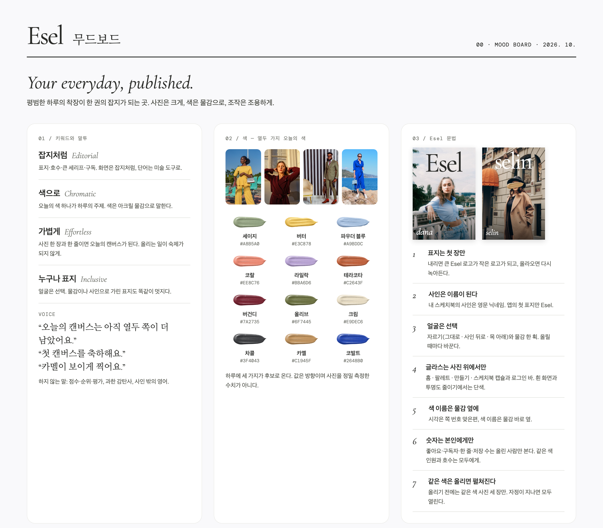

> *Your everyday, published.* 평범한 하루의 착장이 한 권의 잡지가 되는 곳. 사진은 크게, 색은 물감으로, 조작은 조용하게.

| 키워드 | 영문 | 뜻 |
|---|---|---|
| 잡지처럼 | Editorial | 표지·호수·큰 세리프·구독. 화면은 잡지처럼, 단어는 미술 도구로. |
| 색으로 | Chromatic | 오늘의 색 하나가 하루의 주제. 색은 아크릴 물감으로 말한다. |
| 가볍게 | Effortless | 사진 한 장과 한 줄이면 오늘의 캔버스가 된다. 올리는 일이 숙제가 되지 않게. |
| 누구나 표지 | Inclusive | 얼굴은 선택. 물감이나 사인으로 가린 표지도 똑같이 멋지다. |

**말투**: "오늘의 캔버스는 아직 열두 쪽이 더 남았어요." · "첫 캔버스를 축하해요." · "카멜이 보이게 찍어요."
**하지 않는 말**: 점수·순위·평가, 과한 감탄사, 사인 밖의 영어.

**Esel 문법**

| # | 원칙 | 내용 |
|---|---|---|
| 1 | 표지는 첫 장만 | 내리면 큰 Esel 로고가 작은 로고가 되고, 올라오면 다시 녹아든다. |
| 2 | 사인은 이름이 된다 | 내 스케치북의 사인은 영문 닉네임. 앱의 첫 표지만 Esel. |
| 3 | 얼굴은 선택 | 자르기(그대로 · 사인 뒤로 · 목 아래)와 물감 한 획. 올릴 때마다 바꾼다. |
| 4 | 글라스는 사진 위에서만 | 메뉴 캡슐과 로그인 바. 흰 화면과 투명도 줄이기에서는 단색. |
| 5 | 색 이름은 물감 옆에 | 시각은 쪽 번호 맞은편, 색 이름은 물감 바로 옆. |
| 6 | 숫자는 본인에게만 | 좋아요·구독자·한 줄·저장 수는 올린 사람만 본다. 같은 색 인원과 호수는 모두에게. |
| 7 | 같은 색은 올리면 펼쳐진다 | 올리기 전에는 같은 색 사진 세 장만. 자정이 지나면 모두 열린다. |

## 01 디자인 토큰

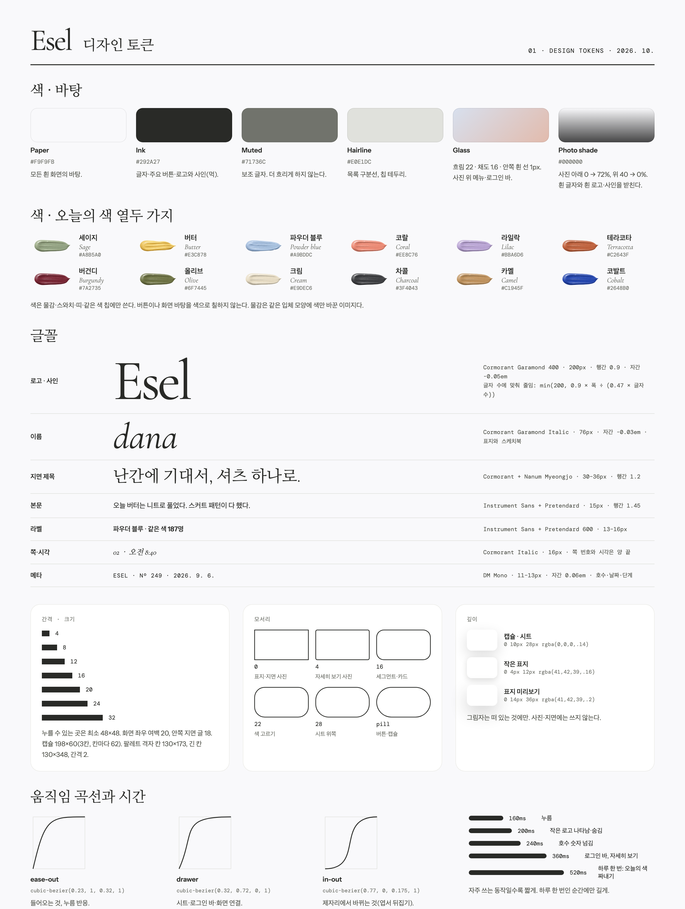

**바탕 색**

| 이름 | 값 | 쓰는 곳 |
|---|---|---|
| Paper | `#F9F9FB` | 모든 흰 화면의 바탕 |
| Ink | `#292A27` | 글자, 주요 버튼, 먹색 제호 |
| Muted | `#71736C` | 보조 글자. 이보다 흐리게 하지 않는다 |
| Hairline | `#E0E1DC` | 목록 구분선, 칩 테두리 |
| Glass | `rgba(249,249,251,0.58)` + `blur(22px) saturate(1.6)` + 안쪽 흰 선 `rgba(255,255,255,0.6)` 1px + `0 10px 28px rgba(0,0,0,0.14)` | 사진 위 메뉴 캡슐, 로그인 바, 로그인 시트 |
| Glass 대체 | 투명도 줄이기: `#F9F9FB` 단색 / 고대비: `#F9F9FB` + 안쪽 `#292A27` 1.5px | 접근성 설정 |
| Photo shade | 아래 `rgba(0,0,0,0)` → `rgba(0,0,0,0.72)`, 위 `0.4` → `0` | 사진 위 흰 글자와 흰 제호 받침 |

**오늘의 색 12가지** — 색은 물감·스와치·색 띠·같은 색 칩에만 쓴다. 버튼이나 화면 바탕을 색으로 칠하지 않는다. 물감은 같은 입체 모양에 색만 바꾼 투명 PNG(1200×600, `paint/esel-paint-{key}.png`)다. 하루에 세 가지가 후보로 온다. hex는 방향이며 사진을 측정한 값이 아니다.

| key | 이름 | 영문 | hex |
|---|---|---|---|
| sage | 세이지 | Sage | `#A8B5A0` |
| butter | 버터 | Butter | `#E3C878` |
| powder | 파우더 블루 | Powder blue | `#A9BDDC` |
| coral | 코랄 | Coral | `#EE8C76` |
| lilac | 라일락 | Lilac | `#BBA6D6` |
| terracotta | 테라코타 | Terracotta | `#C2643F` |
| burgundy | 버건디 | Burgundy | `#7A2735` |
| olive | 올리브 | Olive | `#6F7445` |
| cream | 크림 | Cream | `#E9DEC6` |
| charcoal | 차콜 | Charcoal | `#3F4043` |
| camel | 카멜 | Camel | `#C1945F` |
| cobalt | 코발트 | Cobalt | `#2648B0` |

**글꼴** — 세리프 `Cormorant Garamond` + 한글 `Nanum Myeongjo`, 산세리프 `Instrument Sans` + 한글 `Pretendard`, 고정폭 `DM Mono`. 가운뎃점(U+00B7)만 한글 시스템 글꼴(`Esel Dot`)로 그린다.

| 역할 | 값 | 예 |
|---|---|---|
| 제호 | Cormorant Garamond 400 · 200px · 행간 0.9 · 자간 -0.05em. 글자 수에 맞춰 줄임: `min(200, floor(0.9 × 폭 ÷ (0.47 × 글자 수)))` | Esel |
| 이름 | Cormorant Garamond Italic · 76px · 자간 -0.03em · 표지와 서가 | *dana* |
| 지면 제목 | Cormorant + Nanum Myeongjo · 30–36px · 행간 1.2 | 난간에 기대서, 셔츠 하나로. |
| 본문 | Instrument Sans + Pretendard · 15px · 행간 1.45 | 노란 셋업에 은색 가방 하나. |
| 라벨 | Instrument Sans + Pretendard 600 · 13–16px | 파우더 블루 · 같은 색 187명 |
| 쪽·시각 | Cormorant Italic · 16px · 쪽 번호와 시각은 양 끝 | 02 … 오전 8:40 |
| 메타 | DM Mono · 11–13px · 자간 0.06em · 호수·날짜·단계 | ESEL · Nº 249 · 2026. 9. 6. |

**간격·크기** — 4 · 8 · 12 · 16 · 20 · 24 · 32. 누를 수 있는 곳은 최소 48×48. 화면 좌우 여백 20, 안쪽 지면 글 18. 화면 기준 393×852.

**모서리**

| 값 | 쓰는 곳 |
|---|---|
| 0 | 표지·지면 사진 |
| 4 | 펼침면 사진 |
| 16 | 세그먼트·카드 |
| 22 | 색 고르기 카드 |
| 28 | 시트 위쪽 |
| pill(높이의 절반) | 버튼·캡슐·칩 |

**깊이** — 그림자는 떠 있는 것에만 쓰고 사진·지면에는 쓰지 않는다.

| 대상 | 그림자 |
|---|---|
| 캡슐·시트 | `0 10px 28px rgba(0,0,0,0.14)` |
| 작은 표지 | `0 4px 12px rgba(41,42,39,0.16)` |
| 표지 미리보기 | `0 14px 36px rgba(41,42,39,0.2)` |

**움직임 곡선과 시간** — 자주 쓰는 동작일수록 짧게, 하루 한 번인 순간에만 길게.

| 곡선 | 값 | 쓰는 곳 |
|---|---|---|
| ease-out | `cubic-bezier(0.23, 1, 0.32, 1)` | 들어오는 것, 누름 반응 |
| drawer | `cubic-bezier(0.32, 0.72, 0, 1)` | 시트, 로그인 바, 화면 연결 |
| in-out | `cubic-bezier(0.77, 0, 0.175, 1)` | 제자리에서 바뀌는 것 |

| 시간 | 쓰는 곳 |
|---|---|
| 160ms | 누름 |
| 200ms | 작은 로고 나타남·숨김 |
| 240ms | 호수 숫자 넘김 |
| 360ms | 로그인 바, 표지 → 펼침면 |
| 520ms | 하루 한 번: 오늘의 색 짜내기 |

## 02 컴포넌트

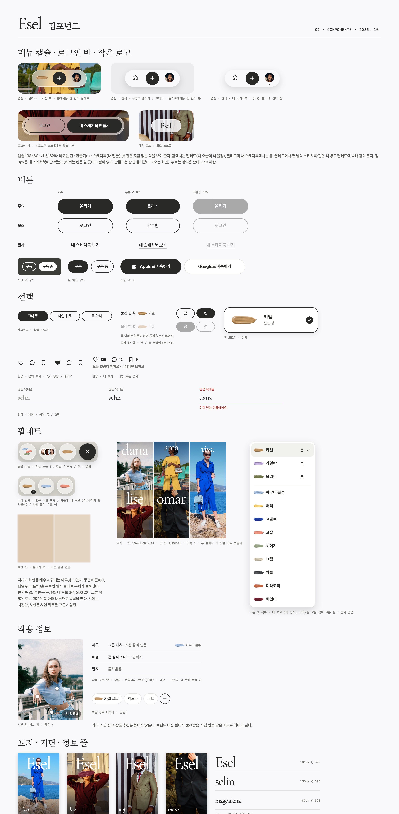

| 컴포넌트 | 모양과 값 | 동작 |
|---|---|---|
| 메뉴 캡슐 | 198×60, 모서리 30, 화면 아래 34, Glass, 칸 62 × 3: 바뀌는 칸 · Ink 원 48 안의 + · 내 아바타 34. 바뀌는 칸은 홈 피드에서 내 오늘의 색 물감(52px), 그 밖(팔레트·같은 색 방·팔레트에서 연 스케치북·내 스케치북)에서 홈 아이콘. 4px Ink 점은 내 스케치북에서 아바타 아래에만 | 물감 → 팔레트(C4), 홈 아이콘 → C1, + → 오늘의 캔버스 만들기(C6), 아바타 → 내 스케치북(C5). 로그인 후에만 보임 |
| 캡슐 · 단색 | 같은 크기, `#F9F9FB` + 캡슐 그림자 | 흰 화면 위, 투명도 줄이기, 고대비 |
| 로그인 바 | 좌우 16, 높이 66, 모서리 33, 안쪽 8, Glass. 로그인(Ink 1.5px 테두리) : 내 스케치북 만들기(Ink 채움) = 1 : 1.35, 버튼 높이 50 | 비로그인 상태에서 640px 내려가면 캡슐 자리에서 올라옴 |
| 작은 로고 | 108×46 알약, `rgba(249,249,251,0.86)` + blur 14, "Esel" 28px + 점 `#AE8775` | 위로 48px 스크롤하면 나타남, 아래로 18px이면 숨김. 누르면 맨 위로 |
| 주요 버튼 | 높이 54, 모서리 27, 16px 600, Ink 채움 + Paper 글자 | 누름 scale 0.97, 비활성 opacity 0.38 |
| 보조 버튼 | 같은 크기, Ink 1.5px 안쪽 테두리 | 같음 |
| 글자 버튼 | 밑줄, 밑줄 간격 5px | 같음 |
| 구독 · 사진 위 | 높이 32, 흰 1.5px 테두리 → 구독 중은 흰 채움 + Ink 글자 | |
| 구독 · 흰 화면 | 높이 44, Ink 채움 → 구독 중은 Ink 1.5px 테두리 | |
| 소셜 로그인 | 높이 54. Apple은 Ink 채움, Google·이메일은 흰 바탕 + `#D8D9D3` 1px | |
| 둥근 버튼 · 부채 | 둥근 버튼 60(캡슐 위 오른쪽, 글라스): 지금 보는 것(추천 물감 세 점 · 구독 얼굴 3 · 색 물감 46), 열리면 Ink 원 안의 ×. 부채 항목 58 원(글라스), 반지름 80 추천·구독 / 142 내 후보 3색(올리기 전 자물쇠 16) / 202 많이 고른 색 5개 | 누르면 엄지 둘레로 펼침(200ms ease-out, 0.9→1), 바깥을 누르면 닫힘 |
| 모든 색 | 왼쪽 아래 글라스 버튼(높이 36) → 시트 목록 | 줄을 누르면 그 색 방 |
| 색 목록 | 시트 안, 줄 48. 내 후보 3색(자물쇠, 지금 색은 체크) → 구분선 → 나머지(오늘 많이 고른 순, 숫자 없음) | 줄을 누르면 그 색 방으로 바꾸고 닫힘 |
| 팔레트 격자 | 3열 130/129/130, 간격 2, 칸 130×173(3:4), 긴 칸 130×348. 5칸 한 묶음, 긴 칸은 묶음마다 오른쪽 ↔ 왼쪽 | 칸 = 그 사람의 사진과 얼굴 연출만(10-18 R5-4). 사인은 사인 뒤로를 고른 사람만. 이름·숫자 없음. 누르면 그 사람의 스케치북 |
| 흐린 칸 | 사진 없이 그 색 단색(불투명도 0.32~0.56, blur 1.5) | 올리기 전 같은 색 방에서 먼저 3장 뒤의 나머지. 이름·얼굴이 새지 않음 |
| 세그먼트 | 높이 36(누르는 영역 44), 모서리 18, Ink 1.5px 테두리, 선택은 Ink 채움 | 자르기(그대로·사인 뒤로·목 아래), 물감 한 획(끔·켬, 목 아래면 흐려지고 눌리지 않음), 사인 색(먹·흰) |
| 색 고르기 카드 | 높이 92, 모서리 22, 흰 바탕 + Ink 1.5px(선택), 물감 110 + 이름 18px + 영문 이탤릭 16px + 체크 원 26 | 창간 색 고르기(J3) |
| 반응 · 남의 표지 | 하트·한 줄·저장 아이콘 23px, 누르는 영역 48, **숫자 없음** | 하트는 채움만 바뀜 |
| 착용 태그 점 · 착용 n | 사진 위 흰 점 12px + 그림자, 사진 오른쪽 아래 "착용 n" 알약(높이 28, 반투명 Ink) | 누르면 자세히 보기의 착용 정보로 |
| 착용 정보 줄 | 높이 42, 옷 종류 14px 600 · 이름·메모 Muted · 오늘의 색 옷이면 오른쪽에 물감 + 색 이름. 가격·링크 없음 | 보기만 하는 줄(P19) |
| 착용 정보 더하기 | 칩 높이 38(누르는 영역 44): 오늘의 색 옷은 물감 칩, 나머지는 글자 칩, 끝에 + 원 | 만들기(C6) |
| 반응 · 내 표지 | 같은 아이콘 + 숫자, 아래 "오늘 12명이 읽었어요 · 나에게만 보여요" | 올린 본인에게만 |
| 입력 · 닉네임 | 라벨 12px Muted, Cormorant 24px, 밑줄 1.5px(입력 중 2px). 오류는 `#B3261E` + "이미 있는 이름이에요." | 소문자 a–z 2~10자만 남김 |
| 작은 표지 | 사인 크기 = 폭 × 0.44(그대로는 얼굴에 닿지 않게 더 줄임), 위 38% 옅은 그림자 | 큰 표지의 자르기 + 물감을 그대로 줄임. 사인 뒤로도 작은 크기에서 얼굴을 가림 |
| 사인 줄임 | 393 폭에서 Esel 188 · selin 150 · magdalena 83px. 앱 첫 표지의 Esel 로고는 200px | 글자 수에 맞춤 |
| 안쪽 지면 머리 | 높이 40, 쪽 번호 왼쪽 · 시각 오른쪽, Cormorant Italic 16 | |
| 이름 줄 | 사인 18px 600 · 물감 54 · 색 이름 13px Muted · 오른쪽에 하트·저장(숫자 없음) | |

## 03 화면

모든 화면은 393×852 기준이다. 상태가 여러 개인 화면은 대표 상태를 함께 실었다. 화면마다 반드시 보일 것과 빼야 할 것은 [앱 하네스의 화면별 정보량 계약](../ESEL_HARNESS.md#화면별-정보량-계약)이 정한다.

### 홈 · 팔레트 · 스케치북 (C1–C8, M1)

| C1 홈 | C2 홈 · 다음 표지 | C3 자세히 보기 | C4 팔레트 · 추천 |
|---|---|---|---|
| 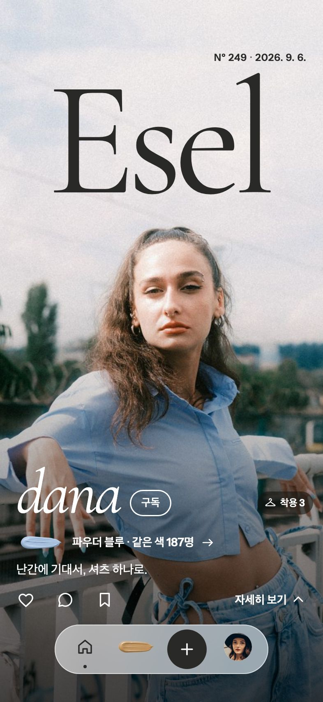 | 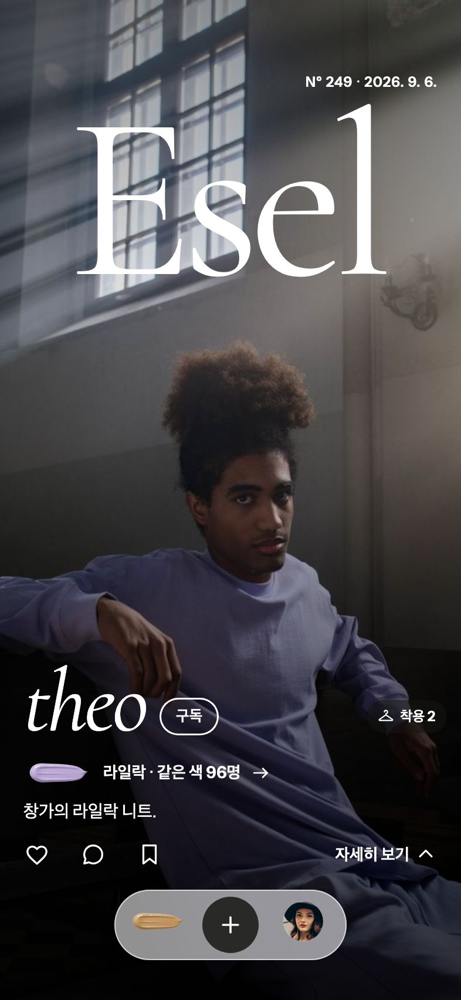 | 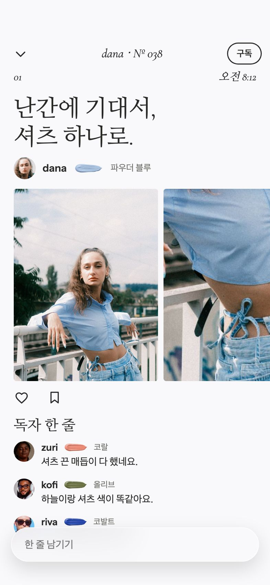 | 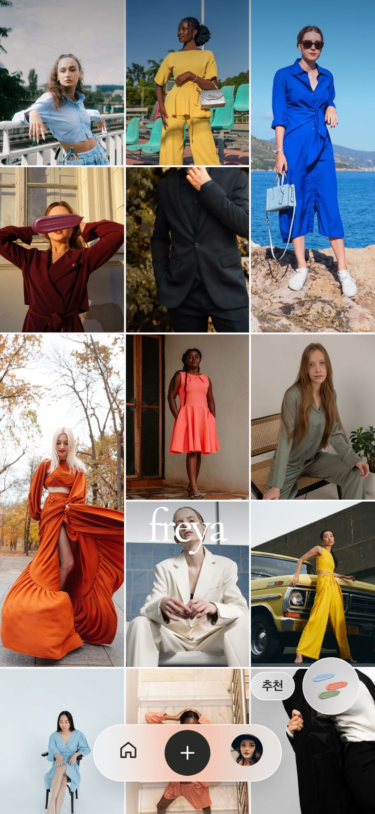 |

| C5 스케치북 | C4 팔레트 · 부채 | C6 만들기 · 그대로 | C6 만들기 · 물감 |
|---|---|---|---|
| 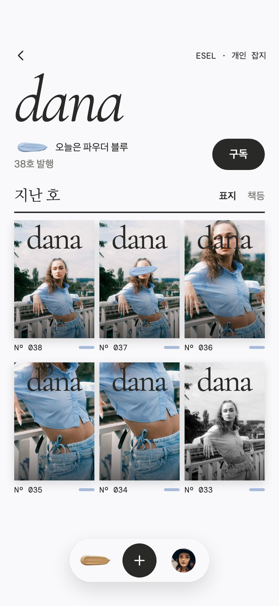 | 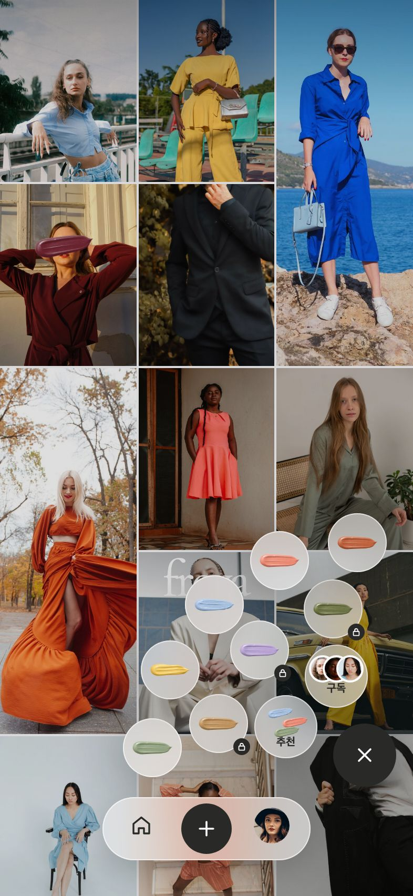 | 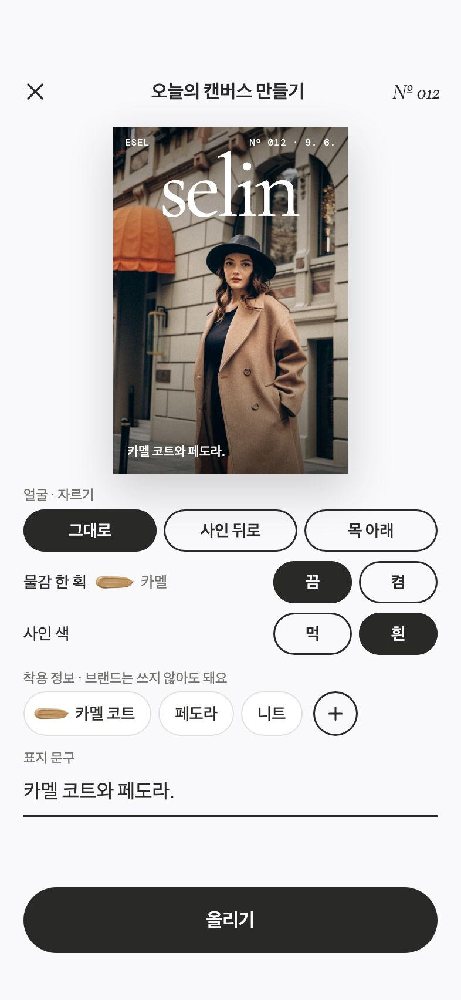 | 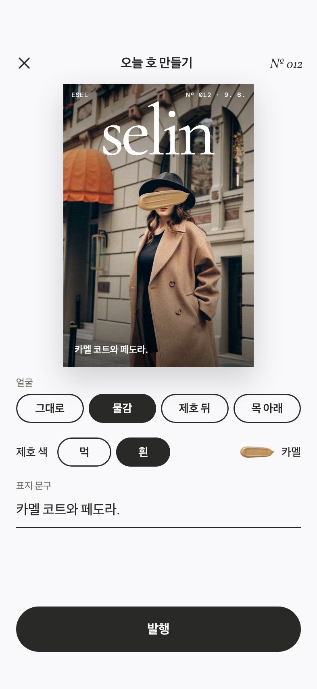 |

| C6 만들기 · 사인 뒤로 | C6 만들기 · 목 아래 | C7 스크롤 · 첫 장 | C7 스크롤 · 안쪽 지면 |
|---|---|---|---|
| 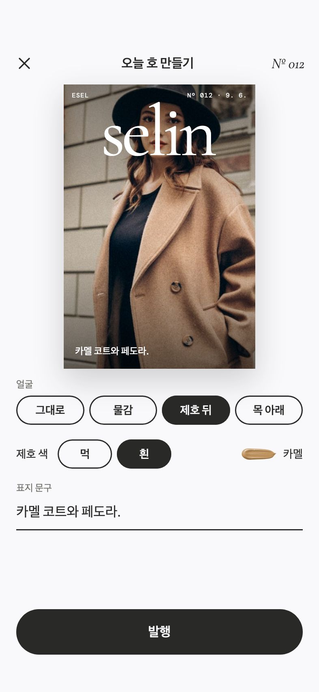 | 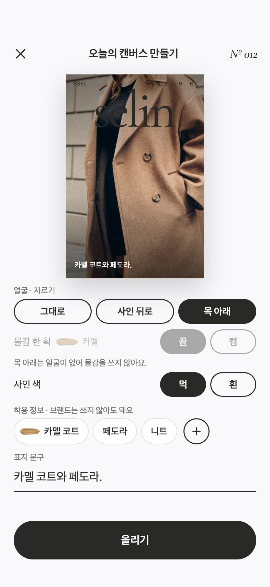 | 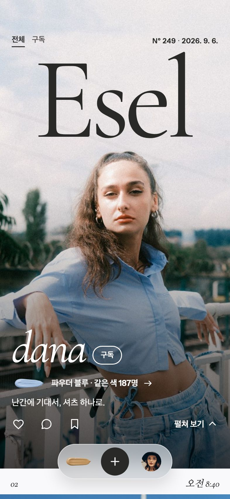 | 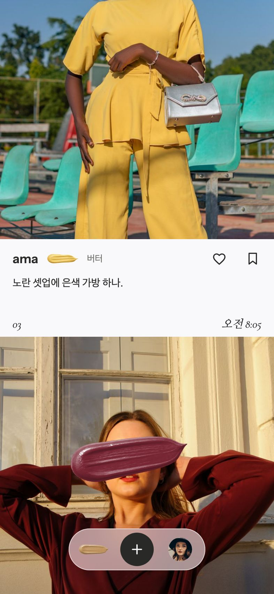 |

| C7 스크롤 · 녹아드는 중 | C8 팔레트 · 카멜 방(올리기 전) | M1 내 스케치북 | M1 · ≡ 메뉴 |
|---|---|---|---|
| 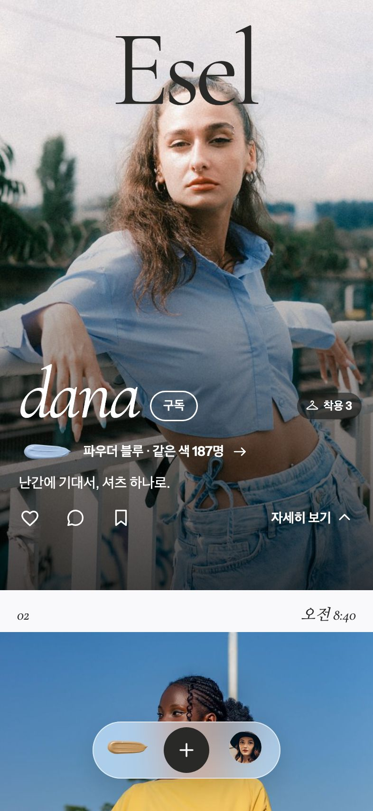 | 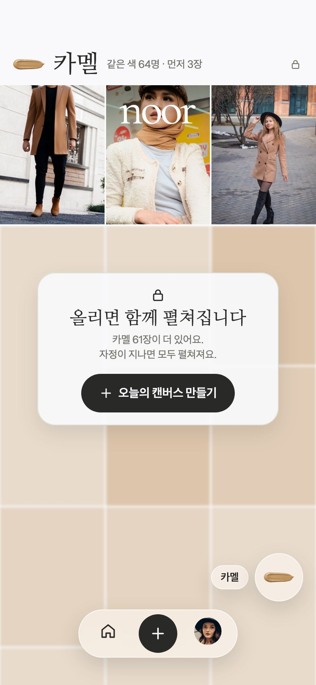 | 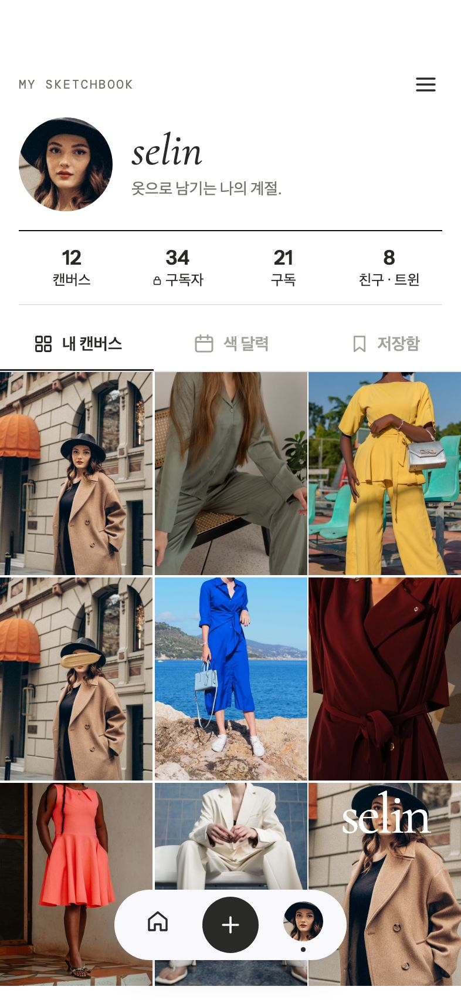 | 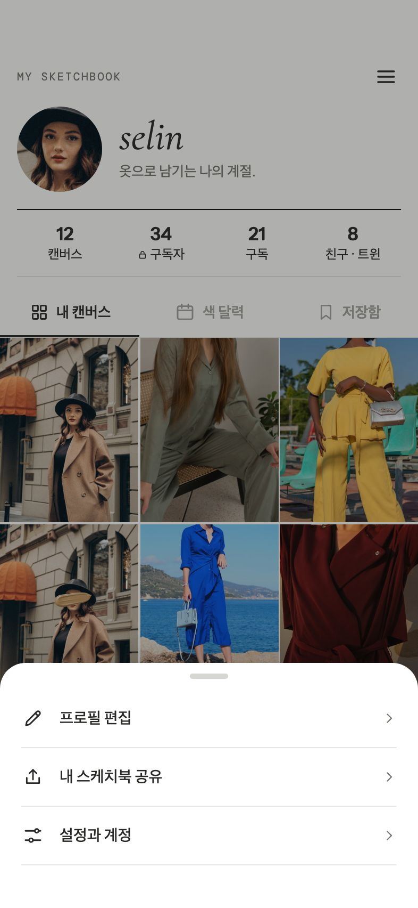 |

| 화면 | 내용 | 연결 |
|---|---|---|
| C1 홈 | 구독 + 추천을 섞은 피드의 첫 장(Nº 249). 전면 사진 + 먹색 Esel 로고, 위 잡지 번호·날짜(탭 없음), 아래 사인·구독·착용 n, 물감·같은 색 인원, 캡션, 하트·한 줄·저장, 자세히 보기, 캡슐(홈 점) | 사인 → C5, 같은 색 → C4, 착용·자세히 보기 → C3 |
| C2 홈 · 다음 표지 | 어두운 사진: 흰 로고, 위·아래 그림자 | C1과 같음 |
| C3 자세히 보기 | 머리 "dana · Nº 038", 쪽 번호·시각, 큰 제목, 사인 줄과 하트·저장, 사진(태그 점 3개 + 착용 3), 착용 정보 목록(셔츠는 파우더 블루 물감 칩), 한 줄, 글라스 한 줄 입력 | 아래 화살표 → C1 |
| C4 팔레트 · 추천 | 위에 아무것도 없이 사진 격자가 화면을 채움(스크롤). 캡슐 위 오른쪽 둥근 버튼(추천 물감 세 점)과 "추천". 누르면 부채(C4 부채). 올리기 전이라 후보 3색 사진은 없음 | 칸 → C5, 부채의 색 → C8 |
| C5 스케치북 | dana: 아바타·큰 사인·구독, 소개 한 줄, "오늘은 파우더 블루 · 캔버스 38장", 아래로 최신 사진부터 세로 피드(Nº·날짜·물감·문구·숫자 없는 반응) | 뒤로 → C4 |
| C6 오늘의 캔버스 만들기 | selin Nº 012 미리보기, 자르기(그대로·사인 뒤로·목 아래) + 물감 끔/켬, 사인 색 먹/흰, 착용 정보 칩, 표지 문구, 올리기 | 세그먼트로 미리보기 바뀜 |
| C7 스크롤 시안 | 첫 장만 표지. 내리면 로고가 사진과 함께 올라가 사라지고 안쪽 지면이 이어짐. 위로 48px이면 작은 로고, 맨 위 360px 안에서 로고로 녹아듦 | 작은 로고 → 맨 위 |
| C8 팔레트 · 카멜 방(올리기 전) | 짧은 머리 "카멜 · 같은 색 64명 · 먼저 3장 🔒", 먼저 3장(leo 목 아래 · noor 사인 뒤로 · mara 그대로), 나머지는 흐린 칸, "올리면 함께 펼쳐집니다", "자정이 지나면 모두 펼쳐져요", 오늘의 캔버스 만들기. 둥근 버튼은 카멜 물감 | 부채 → C4·다른 색, 버튼 → C6 |
| M1 내 스케치북(마이페이지) | MY SKETCHBOOK, ≡, 얼굴·사인·소개, 숫자 줄(캔버스 12 · 구독자 34 🔒 · 구독 21 · 친구·트윈 8), 탭 내 캔버스 · 색 달력 · 저장함, 3열 격자. ≡는 프로필 편집 · 공유 · 설정 시트 | 친구·트윈 → 친구, 칸 → 내 사진 세로 |

### 로그인 · 첫 캔버스 (J1–J7)

| J1 비로그인 표지 | J1 로그인 바 | J2 로그인 | J3 첫 캔버스의 색 |
|---|---|---|---|
| 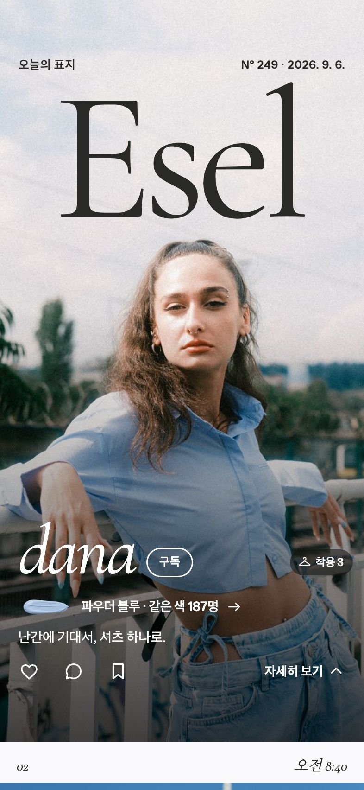 | 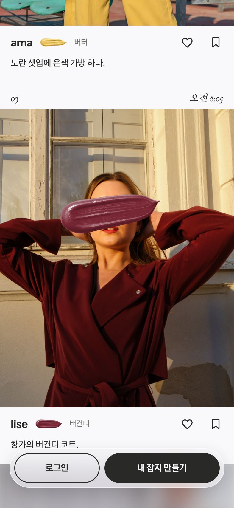 | 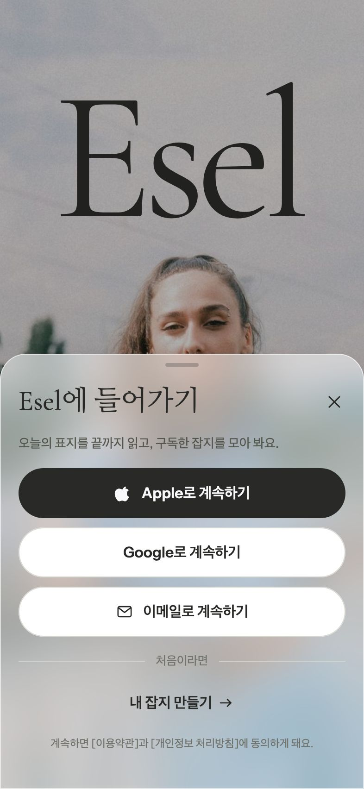 | 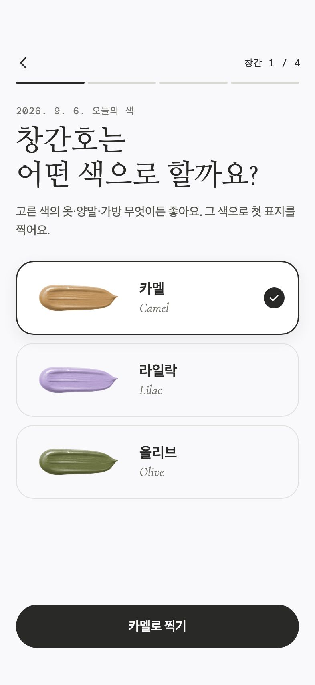 |

| J4 촬영 | J5 사인 정하기 | J6 얼굴 연출 | J7 첫 캔버스 |
|---|---|---|---|
| 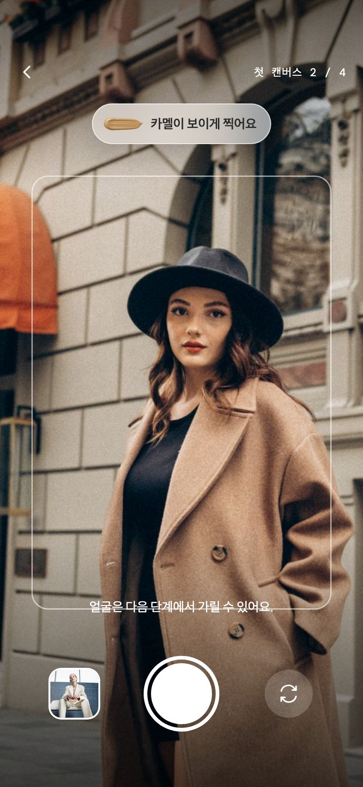 | 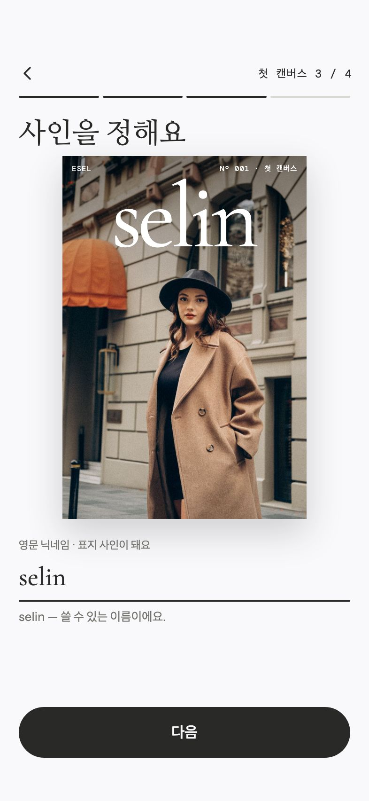 | 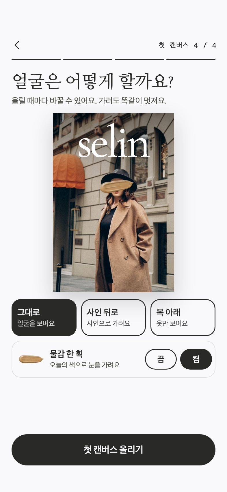 | 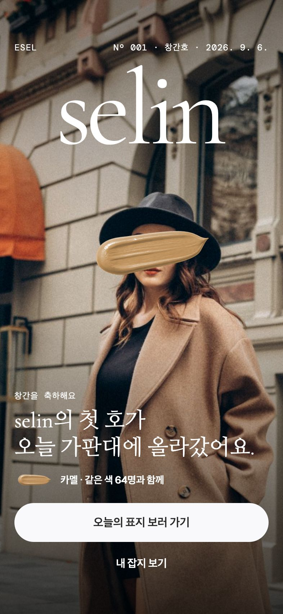 |

| 화면 | 내용 | 연결 |
|---|---|---|
| J1 비로그인 표지 | 캡슐 없이 오늘의 표지 + 안쪽 2쪽 맛보기, "오늘 호는 아직 열두 쪽이 더 남았어요." 640px 지나 로그인 바 | 로그인 → J2, 내 스케치북 만들기 → J3 |
| J2 로그인 | 어둡게 덮은 표지 위 글라스 시트: Apple·Google·이메일, "처음이라면" → 내 스케치북 만들기, 약관 안내 | 닫기 → J1 |
| J3 첫 캔버스의 색 | 첫 캔버스 1/4. 오늘 후보 3색(카멜·라일락·올리브) 카드, 버튼 문구에 색 반영("카멜로 찍기") | → J4 |
| J4 촬영 | 첫 캔버스 2/4. 전체 화면 카메라, "카멜이 보이게 찍어요", 몸 전체 안내 틀, "얼굴은 다음 단계에서 가릴 수 있어요." | → J5 |
| J5 사인 정하기 | 첫 캔버스 3/4. 표지 미리보기에 닉네임 사인, 영문 닉네임 입력(a–z 2~10자), 사용 가능 안내 | → J6 |
| J6 얼굴 연출 | 첫 캔버스 4/4. 자르기(그대로 · 사인 뒤로 · 목 아래) + 물감 끔/켬, 첫 캔버스 올리기 | → J7 |
| J7 첫 캔버스 | Nº 001 첫 캔버스 표지, 축하 한 줄, "카멜 · 같은 색 64명과 함께", 오늘의 표지 보러 가기, 내 스케치북 보기 | → C7, C5 |

## 04 모션

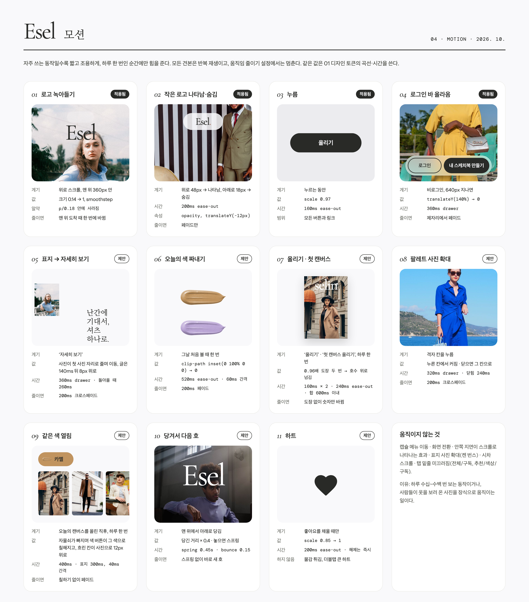

캔버스에서는 견본이 반복 재생된다. 위 그림은 견본마다 효과가 가장 잘 보이는 순간에 멈춰 찍은 것이고, 정확한 값은 아래 표로 읽는다. 모든 견본은 움직임 줄이기 설정에서 멈춘다.

| # | 동작 | 상태 | 계기 | 값 | 시간 | 움직임 줄이기 |
|---|---|---|---|---|---|---|
| 01 | 제호 녹아들기 | 적용됨 | 위로 스크롤, 맨 위 360px 안 | 크기 0.14 → 1, smoothstep. 작은 로고 알약은 진행 18% 안에 사라짐 | 스크롤에 붙음 | 맨 위 도착 때 한 번에 바뀜 |
| 02 | 작은 로고 나타남·숨김 | 적용됨 | 위로 48px → 나타남, 아래로 18px → 숨김 | opacity, translateY(-12px) | 200ms ease-out | 페이드만 |
| 03 | 누름 | 적용됨 | 누르는 동안, 모든 버튼과 링크 | scale 0.97 | 160ms ease-out | 전환 없이 바로 |
| 04 | 로그인 바 올라옴 | 적용됨 | 비로그인, 640px 지나면 | translateY(140%) → 0 | 360ms drawer | 제자리에서 페이드 |
| 05 | 표지 → 자세히 보기 | 제안 | '자세히 보기' | 사진이 첫 사진 자리로 줄며 이동, 글은 140ms 뒤 8px 위로 | 360ms drawer, 돌아올 때 260ms | 200ms 크로스페이드 |
| 06 | 오늘의 색 짜내기 | 제안 | 그날 처음 볼 때 한 번 | clip-path inset(0 100% 0 0) → 0 | 520ms ease-out, 60ms 간격 | 200ms 페이드 |
| 07 | 올리기 · 첫 캔버스 | 제안 | '올리기' · '첫 캔버스 올리기', 하루 한 번 | 0.96배 도장 두 번 → 호수 위로 넘김 | 160ms × 2 + 240ms ease-out, 합 600ms 이내 | 도장 없이 숫자만 바뀜 |
| 08 | 팔레트 사진 확대 | 제안 | 격자 칸을 누름 | 누른 자리에서 커짐, 닫으면 그 자리로 | 320ms drawer, 닫힘 240ms | 200ms 크로스페이드 |
| 09 | 같은 색 열림 | 제안 | 오늘의 캔버스 올린 직후, 하루 한 번 | 자물쇠가 빠지며 색 버튼이 그 색으로 칠해지고, 흐린 칸이 사진으로 12px 위로 | 400ms, 표지 300ms · 40ms 간격 | 칠하기 없이 페이드 |
| 10 | 당겨서 다음 호 | 제안 | 맨 위에서 아래로 당김 | 당긴 거리 × 0.4, 놓으면 스프링 | spring 0.45s, bounce 0.15 | 스프링 없이 바로 새 호 |
| 11 | 하트 | 제안 | 좋아요를 채울 때만 | scale 0.85 → 1. 물감 튀김·더블탭 큰 하트는 하지 않음 | 200ms ease-out, 해제는 즉시 | — |

**움직이지 않는 것**: 캡슐 메뉴 이동, 화면 전환, 안쪽 지면이 스크롤로 나타나는 효과, 표지 사진 확대(켄 번스), 시차 스크롤, 탭 밑줄 미끄러짐. 하루 수십~수백 번 보는 동작이거나, 사람들이 옷을 보러 온 사진을 장식으로 움직이는 일이기 때문이다.

## 앱 목업

이 보드와 화면, 그리고 피그마의 추가 기능(내 잡지·월간 색 기록·트윈·친구·설정·공유)을 한 앱으로 이은 눌러 보는 목업이 있다. 위치와 화면 지도는 [앱 목업 README](../../.codex/temp/prototype/20261011-app-mockup/README.md)에 있다. 게시본은 비공개 링크라 공유 전에는 소유자만 열 수 있다.

## 다른 AI가 이 디자인으로 작업할 때

1. [AGENTS.md](../../AGENTS.md) → [앱 하네스](../ESEL_HARNESS.md) → [harness.json](../../harness.json) → 이 문서 순서로 읽는다. 사용자 결정과 시안 가정을 구분한다.
2. 값은 기계가 읽는 원본에서 가져온다: `harness.json`의 `designTokens`, `glass`, `typography`, `colors`, `motion`, `sameColorLock`, `publicCounts`와 생성기 `lib.mjs`의 `PAINT`, `PEOPLE`, `INK`·`PAPER`·`MUTED`·`HAIR`, `EASE_OUT`·`EASE_DRAWER`, `mastSize`.
3. 새 요소는 02 컴포넌트에 있는 것부터 쓴다. 없는 것을 만들면 보드에도 추가한다.
4. 화면 파일(`.dc.html`)은 캔버스 전용 형식이라 레포에서 바로 열면 사진이 보이지 않는다. 눈으로 볼 때는 이 폴더의 그림을 쓴다.
5. Flutter 앱(`flutter_app/`)은 이 디자인을 맞춰 가는 중이다. 메뉴 캡슐과 글꼴은 반영했고, 나머지 화면은 아직 다를 수 있다.

## 다시 만들기

저장소 루트에서:

```bash
npm run design:build
npm run design:capture
npm run check:harness
```

- `design:build`는 생성기로 `.codex/temp/prototype/20261003-cover-sns/generator/project/`의 화면 파일을 다시 쓴다. 캔버스에 반영하려면 바뀐 파일을 캔버스에 올린다.
- `design:capture`는 그 파일을 로컬 사진·물감으로 바꿔 Google Chrome으로 찍고 `docs/design/boards`(PNG, 2배)와 `docs/design/screens`(JPEG, 2배)에 쓴다. Chrome이 기본 위치(macOS)에 없으면 `CHROME` 환경 변수로 경로를 준다. 글꼴은 Google Fonts에서 받으므로 인터넷이 필요하다.
- 사진 출처는 [models-sources](../../assets/models-sources.md)와 [demo-sources](../../assets/demo-sources.md)에 있다.
