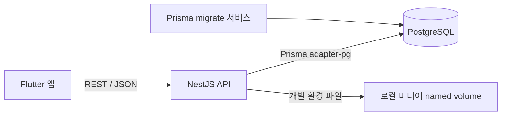
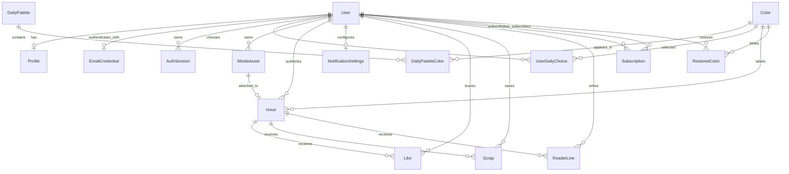

# Esel 서버 구현 가이드

이 문서는 Esel 서버의 현재 구현 방식과 설계 의도를 설명한다. 새로운 개발자나 AI가 서버 작업을 이어갈 때는 루트의 `AGENTS.md`, `docs/ESEL_HARNESS.md`, `harness.json`을 먼저 읽고 이 문서를 참고한다.

## 1. 현재 구현 범위

현재 단계는 서버 기반 위에 실제 기능을 API 하나씩 연결하는 중이다.

- NestJS 기반 REST API 서버
- PostgreSQL 개발 데이터베이스
- Prisma 스키마, 초기 마이그레이션, 하네스 규칙 CHECK 제약과 12색 마이그레이션
- Docker Compose 실행 환경
- 환경변수 검증
- CORS, Helmet, 전역 DTO 검증
- Swagger 문서(운영이 아닐 때만)
- API와 DB 연결 상태를 확인하는 헬스체크
- 이메일 회원가입·로그인·토큰 갱신·로그아웃 API(`/api/auth/email/signup`, `/api/auth/email/login`, `/api/auth/refresh`, `/api/auth/logout`)
- 비밀번호 `scrypt` 해시, 불투명 access/refresh token 발급과 해시 저장
- refresh token 회전과 재사용 시 전체 세션 폐기
- access token을 검사하는 전역 인증 가드와 `@Public()` 공개 예외
- Flutter 서버 모드의 회원가입·로그인·세션 복원·로그아웃 호출 경로
- `SERVICE_TIME_ZONE` 날짜별 오늘의 3색 후보 조회와 발행 전 선택·변경
- 제호 형식(`^[a-z]{2,10}$`)·DB 중복 확인과 프로필 생성
- 로컬 개발 저장소를 이용한 미디어 준비·완료와 실제 파일 검증
- 사용자별 알림 설정 조회·변경
- P01/P02 공개 판정을 거치는 호 조회와 멱등 좋아요·스크랩
- cursor 독자 한 줄과 제호별 서가·멱등 구독
- 내 잡지·소유자 반응 목록, 월간 기록·색 복원, 제호 사용자 조회
- 단위 테스트와 DB 연결 E2E 테스트

이메일 인증의 가입·로그인·토큰 갱신·로그아웃, 오늘의 색 조회·선택, 제호 확인·프로필 생성, 미디어 준비·완료, 알림 설정, 호 조회·반응·독자 한 줄, 서가·구독, 내 잡지·반응 목록, 월간 기록·복원, 사용자 조회까지 구현했다. Apple·Google 로그인, 실제 모바일 파일 전송, 발행, 피드와 가판대는 아직 구현 전이다.

## 2. 기술 선택

| 영역 | 선택 | 이유 |
|---|---|---|
| 런타임 | Node.js 24 LTS | NestJS·Prisma 요구사항을 충족한다. Docker 이미지도 Node 24다. `package.json`의 `engines`는 의존성 요구(`^22.22.3 \|\| ^24.15.0 \|\| >=26`)를 따른다. |
| 서버 | NestJS 12 | 기능별 모듈 분리, 의존성 주입, 요청 검증과 테스트 구성이 명확하다. |
| API | REST + OpenAPI | Flutter 앱에서 호출하기 쉽고 Swagger로 계약을 확인할 수 있다. |
| 데이터베이스 | PostgreSQL 17 | 발행·개인 호수·공개 권한에 필요한 트랜잭션과 제약조건을 지원한다. |
| DB 접근 | Prisma 7.10 | 타입 안전한 쿼리, 스키마, 마이그레이션을 함께 관리한다. |
| 로컬 실행 | Docker Compose | 팀원이 같은 PostgreSQL과 API 환경을 재현할 수 있다. |
| 테스트 | Vitest + Supertest | 단위 테스트와 실제 HTTP·DB E2E 테스트를 분리한다. |

Supabase나 Firebase 같은 BaaS는 사용하지 않는다. 인증, 권한, 발행 정책과 데이터 저장을 Esel 서버가 직접 담당한다.

## 3. 전체 구조



```text
Esel/
├── compose.yaml
└── server/
    ├── Dockerfile
    ├── .env.example
    ├── package.json
    ├── prisma.config.ts
    ├── prisma/
    │   ├── schema.prisma
    │   └── migrations/
    ├── src/
    │   ├── main.ts
    │   ├── app.setup.ts      # configureApp: main과 e2e가 같이 쓰는 전역 설정
    │   ├── app.module.ts
    │   ├── account/          # 알림 설정 조회·변경
    │   ├── auth/             # 이메일 가입, 비밀번호·세션 토큰 처리, DTO
    │   ├── common/           # 오류 형식, @Public, 페이지, 서비스 날짜
    │   ├── config/
    │   ├── health/
    │   ├── issues/           # 호 공개 판정·조회·좋아요·스크랩
    │   ├── magazines/        # 제호별 서가와 구독
    │   ├── me/               # 내 잡지와 소유자 전용 반응 목록
    │   ├── media/            # 파일 업로드 준비·완료와 내용 검사
    │   ├── profile/          # 제호 형식·중복 확인, 프로필 생성
    │   ├── records/          # 월간 사진 기록과 색 복원
    │   ├── today/            # 날짜별 후보·내 선택, 순수 규칙
    │   ├── users/            # 제호 기반 공개 사용자 조회
    │   └── prisma/
    └── test/
```

## 4. 애플리케이션 시작 흐름

`server/src/main.ts`는 다음 순서로 서버를 초기화한다. 3~7은 `src/app.setup.ts`의 `configureApp(app)` 한 함수에 있고, e2e 테스트(`test/create-app.ts`)도 같은 함수를 거친다. 그래서 테스트가 실제 서버와 같은 설정을 확인한다.

1. `AppModule`을 생성한다.
2. `.env`를 읽고 Zod 스키마로 환경변수를 검증한다.
3. Helmet 보안 헤더를 적용한다.
4. `CORS_ORIGINS`에 적힌 앱 주소에만 CORS를 연다.
5. 모든 API에 `/api` prefix를 붙인다.
6. 전역 `ValidationPipe`로 정의되지 않은 요청 필드를 거절한다.
7. `NODE_ENV`가 `production`이 아닐 때만 `/api/docs`에 Swagger 문서를 연다.
8. `enableShutdownHooks()`로 종료 신호를 받으면 DB 연결을 닫고 끝내게 한다.
9. 설정된 `PORT`에서 요청을 받는다.

환경변수가 빠졌거나 형식이 잘못되면 서버는 조용히 잘못된 설정으로 실행되지 않고 시작 단계에서 실패한다.

## 5. Docker Compose 실행 흐름

`compose.yaml`에는 세 서비스가 있다.

### `postgres`

- PostgreSQL 17 Alpine 이미지
- 개발 DB·사용자 이름은 `esel`, 비밀번호 `esel_dev`는 개발용
- 호스트의 `127.0.0.1:5432`에만 연다(같은 네트워크의 다른 기기에서는 접속 불가)
- named volume에 데이터를 보존
- `pg_isready` 기반 healthcheck 제공

### `migrate`

- PostgreSQL이 healthy가 된 뒤 실행
- `prisma migrate deploy`로 커밋된 마이그레이션 적용(CHECK 제약과 12색 기준 데이터도 마이그레이션에 들어 있다)
- 성공하면 종료 코드 `0`으로 끝남
- 새 환경에서도 API 시작 전에 DB 구조를 맞추기 위한 일회성 서비스

### `api`

- `migrate`가 성공해야 시작
- 호스트의 `127.0.0.1:3000`에만 연다
- `NODE_ENV=production`으로 돌기 때문에 Swagger는 꺼져 있다. 문서는 `npm run start:dev`로 볼 수 있다
- 컨테이너 안에서는 root가 아닌 `node` 사용자로, `node dist/main.js`가 PID 1이 되어 실행한다(종료 신호를 서버가 직접 받음)
- `MEDIA_STORAGE_ROOT=/app/data/media`를 쓰며 `esel-media-data` named volume으로 개발 미디어 파일을 보존한다
- `/api/health`를 Docker healthcheck로 호출
- 멀티 스테이지 Dockerfile로 빌드 의존성과 실행 이미지를 분리

`migrate` 컨테이너가 `Exited (0)`으로 보이는 것은 정상이다. 계속 실행되는 서비스가 아니라 마이그레이션 완료 후 종료되는 작업이다.

## 6. 환경변수

실제 `.env`는 커밋하지 않는다. 필요한 키는 `.env.example`에만 기록한다.

| 변수 | 용도 | 개발 기본값 |
|---|---|---|
| `NODE_ENV` | 실행 환경 | `development` |
| `PORT` | API 포트 | `3000` |
| `DATABASE_URL` | PostgreSQL 연결 문자열 | 로컬 `esel` DB |
| `CORS_ORIGINS` | 허용할 클라이언트 주소 목록(쉼표로 구분, 경로 없는 http(s) 주소) | 개발: `http://localhost:8081`. **운영에서는 기본값이 없어 꼭 정해야 서버가 시작한다** |
| `SERVICE_TIME_ZONE` | 서비스 날짜(오늘의 색·하루 한 호·같은 색 잠금 자정) 기준. IANA 시간대인지 시작할 때 확인한다 | `Asia/Seoul` |
| `MEDIA_STORAGE_ROOT` | 개발용 미디어 파일 저장 루트. 상대 경로는 서버 실행 디렉터리 기준 | `./data/media` |

운영 환경에서는 Compose에 작성된 개발용 비밀번호를 사용하지 말고 별도 비밀 관리 수단으로 주입해야 한다.

서비스 날짜는 `src/common/service-date.ts`의 `serviceDate(now, SERVICE_TIME_ZONE)`로 정한다(`"YYYY-MM-DD"`). 앱이 보낸 "오늘"은 믿지 않는다.

## 7. Prisma 데이터 모델

현재 스키마는 핵심 발행 흐름을 먼저 지원하도록 작성했다.



### 주요 모델

- `User`: 계정의 기본 상태와 정규화된 이메일.
- `EmailCredential`: 이메일 계정의 `scrypt` 비밀번호 해시. 원문은 저장하지 않는다.
- `AuthSession`: 기기별 access/refresh token 해시, 만료 시각, 폐기 시각. 원문 토큰은 API 응답 시 한 번만 앱으로 간다.
- `Profile`: 개인 잡지 제호와 누적 발행 호수.
- `Color`: Esel의 12색 기준 데이터.
- `DailyPalette`: 특정 서비스 날짜의 후보 색 묶음.
- `DailyPaletteColor`: 후보 색과 표시 순서.
- `UserDailyChoice`: 사용자가 특정 날짜에 고른 색.
- `MediaAsset`: 업로드 파일의 저장 경로와 검증 상태.
- `Issue`: 실제 발행된 개인 잡지 한 호.
- `NotificationSettings`: 사용자별 전체·새 호·반응 알림 허용값. 행이 없으면 API 기본값은 모두 `true`다.
- `Like`, `Scrap`: 사용자와 호의 복합 기본키로 저장하는 반응. 같은 요청을 반복해도 한 행뿐이다.
- `ReaderLine`: 공개 가능한 호에 남기는 60자 이내 한 줄.
- `Subscription`: 구독자와 잡지 소유자의 복합 기본키로 저장하는 구독 상태.
- `RestoredColor`: 이번 달 지난 빈 날에 사용자가 복원한 색. 발행·선택과 분리한다.

### DB가 직접 보장하는 규칙

- 제호 `masthead`는 전체에서 고유하다.
- 대소문자만 다른 이메일은 같은 이메일로 보고 DB unique index로 막는다.
- 한 사용자는 이메일 비밀번호 레코드를 하나만 가지며, 세션의 두 토큰 해시는 각각 고유하다.
- 한 사용자는 한 서비스 날짜에 하나의 색 선택만 가진다.
- 한 사용자는 하루에 한 호만 발행한다.
- 같은 사용자의 개인 호수는 중복될 수 없다.
- 하나의 미디어 파일은 하나의 호에만 연결된다.
- 한 사용자는 알림 설정 행을 하나만 가지며 사용자 삭제 시 함께 지워진다.
- 한 사용자는 한 호에 좋아요와 스크랩을 각각 한 번만 남길 수 있고 사용자·호 삭제 시 함께 지워진다.
- 한 사용자는 같은 잡지를 한 번만 구독할 수 있고 사용자 삭제 시 구독과 한 줄도 함께 지워진다.
- 한 사용자는 같은 날짜를 한 번만 복원할 수 있다. 월 2회 제한은 serializable transaction에서 검사한다.
- 날짜·색·발행 시각 조회를 위한 피드 인덱스를 둔다.
- 제호는 영문 소문자 2~10자(`^[a-z]{2,10}$`)만 저장된다(CHECK).
- 하루 후보 색 자리(`position`)는 1~3, 색 hex는 `^#[0-9A-F]{6}$`, 개인 호수는 1 이상, 발행 호 수는 0 이상이다(CHECK).
- 12색(`colors`)은 루트 `harness.json`의 `colors`와 같은 key·hex·순서(`sort_order`)로 마이그레이션이 넣는다. 앱이 돌려면 꼭 있어야 하는 기준 데이터라 seed 스크립트가 아니라 마이그레이션에 둔다. `npm run check:server`가 루트 harness.json과 같은지 확인한다.

API 검사만 믿지 않고 PostgreSQL의 unique constraint로 동시 요청도 방어한다. 개인 호수 증가와 `Issue` 생성은 이후 하나의 DB 트랜잭션으로 구현해야 한다.

## 8. Prisma 사용 규칙

스키마를 변경할 때는 다음 순서를 따른다.

```bash
cd server
npm run prisma:migrate -- --name 변경내용
npm run prisma:generate
npm run build
npm test
```

`npm install`·`npm ci`가 끝나면 `postinstall`이, `npm run build` 전에는 `prebuild`가 `prisma generate`를 자동으로 돌린다. 스키마를 바꾼 뒤 `start:dev`·테스트 전에는 `npm run prisma:generate`를 직접 한 번 돌린다.

- 이미 공유된 migration SQL을 직접 수정하지 않는다.
- 스키마 변경은 새로운 migration으로 추가한다.
- 운영에서는 `migrate dev`가 아니라 `migrate deploy`를 사용한다.
- 생성된 `src/generated/prisma`는 커밋하지 않는다.
- `DATABASE_URL`을 코드에 직접 쓰지 않는다.

`PrismaService`는 `@prisma/adapter-pg`를 사용해 PostgreSQL에 연결한다. 모듈을 global로 등록했기 때문에 이후 기능 모듈에서 별도 모듈 재등록 없이 주입할 수 있다.

## 9. 이메일 회원가입·로그인과 Flutter 연결

```http
POST /api/auth/email/signup
Content-Type: application/json

{
  "email": "me@example.com",
  "password": "8자 이상 비밀번호"
}
```

처리 흐름:

1. `EmailSignupDto`가 이메일 형식과 비밀번호 길이(8~128자)를 검사한다.
2. 이메일 앞뒤 공백을 지우고 소문자로 바꾼다.
3. 같은 이메일의 짧은 시간 반복 요청은 `SignupRateLimiter`가 429로 막는다.
4. 비밀번호를 Node 내장 `crypto.scrypt`와 무작위 salt로 해시한다.
5. access/refresh token을 `randomBytes(32)`로 만들고, DB에는 SHA-256 해시만 저장한다.
6. `User`, `EmailCredential`, `AuthSession` 생성을 하나의 Prisma 트랜잭션으로 처리한다.
7. 이메일 중복은 서비스 처리뿐 아니라 PostgreSQL unique index가 동시 요청까지 막는다.
8. Flutter가 읽는 `SessionDto`를 201로 반환한다. 창간 전이므로 `masthead`는 빈 문자열, `issueCount`는 0이다.

로그인은 같은 모양의 요청을 `/api/auth/email/login`으로 받는다. `EmailCredential`의 해시를 `crypto.scrypt`로 다시 계산해 일정 시간 비교하고, 성공할 때마다 별도 `AuthSession`을 만든다. 가입하지 않은 이메일도 가짜 해시 계산을 거친 뒤 잘못된 비밀번호와 똑같이 `401 WRONG_CREDENTIALS`로 답하므로, 응답만 보고 계정 존재 여부를 구분하기 어렵다. 같은 이메일의 여섯 번째 1분 내 시도는 `429 RATE_LIMITED`로 막는다. 시도는 비밀번호를 확인하기 전에 세므로 제한에 걸린 동안에는 맞는 비밀번호여도 429이고, 동시에 몰려온 요청도 다섯 개까지만 비밀번호 확인까지 간다. 제한 전에 로그인이 성공하면 기록을 지우고, 1분이 지난 기록은 1분에 한 번씩 메모리에서 정리한다.

로그인 응답의 `masthead`와 `issueCount`는 `Profile`에서, `hasPublishedToday`는 서버의 `SERVICE_TIME_ZONE` 기준 오늘 `Issue`에서 읽는다. 미성년자 판별과 프로필 이미지 모델은 아직 정해지지 않아 각각 `false`, `null`이다.

`POST /api/auth/refresh`는 refresh token의 SHA-256 해시로 세션을 찾고 다음 순서로 처리한다.

1. 없거나 이미 폐기된 토큰은 `401 AUTH_REQUIRED`로 거절한다.
2. 만료된 토큰은 해당 세션을 폐기하고 `401 TOKEN_EXPIRED`로 답한다.
3. 유효한 토큰은 조건부 DB 갱신으로 한 요청만 선점해 기존 세션을 폐기하고 새 `AuthSession`을 만든다.
4. 이미 사용된 토큰이 다시 들어오면 탈취 가능성으로 보고 그 사용자의 활성 세션 전체를 폐기한다.

따라서 refresh token은 한 번만 쓸 수 있다. 새 token 원문은 응답으로 한 번만 전달하고 DB에는 새 SHA-256 해시만 저장한다. 별도 JWT 패키지나 외부 인증 서비스는 추가하지 않았다.

보호 API는 전역 `AccessTokenGuard`가 `Authorization: Bearer <access token>`을 검사한다. DB에서 token 해시와 활성 세션을 확인해 요청에 `AuthUser`를 넣고, 컨트롤러는 `@CurrentUser()`로 사용자·세션 ID를 받는다. access token이 없거나 세션이 폐기됐으면 `401 AUTH_REQUIRED`, access token만 만료됐으면 refresh가 가능하도록 세션을 유지한 채 `401 TOKEN_EXPIRED`로 답한다.

`POST /api/auth/logout`은 `@Public()`이 없는 보호 API다. 현재 요청의 세션 하나만 `revokedAt`으로 폐기하고 본문 없이 204를 반환한다. 다른 기기의 세션은 유지한다.

Flutter 쪽 실제 호출 흐름:

```text
EmailLoginView
  → AuthController
  → AuthRepositoryImpl (ESEL_API_MODE=server)
  → AuthRemoteSource
  → StandardHttpClient
  → POST /api/auth/email/signup, /api/auth/email/login, /api/auth/refresh 또는 /api/auth/logout
```

Android 에뮬레이터는 `API_BASE_URL=http://10.0.2.2:3000/api`를 사용한다. USB Android 실기기는 `adb reverse tcp:3000 tcp:3000` 후 `http://127.0.0.1:3000/api`를 사용한다. 앱은 저장된 refresh token으로 재시작 후 세션을 복원하고, 로그아웃할 때 서버 세션을 폐기한 뒤 기기의 token도 지운다.

## 10. 오늘의 색과 제호 중복 확인

`GET /api/today`는 서버가 `SERVICE_TIME_ZONE`으로 계산한 `serviceDate`를 쓴다. 앱이 보낸 날짜를 믿지 않으므로 사용자가 휴대폰 시간을 바꾸어도 하루 기준을 우회할 수 없다. 조회는 DB를 바꾸지 않는다. 해당 날짜의 `DailyPalette`가 없으면 결정적 규칙으로 후보를 계산만 하고, 첫 `PUT /api/today/choice`가 들어올 때 아래 순서로 저장한다.

1. `Color.sortOrder`로 정렬한 정식 12색을 읽는다.
2. `dailyCandidateIds()`가 날짜를 seed로 Park–Miller 방식의 서로 다른 3색을 고른다.
3. 첫 선택 요청에서 `DailyPalette` + `DailyPaletteColor(position 1~3)`로 한 번만 저장한다. 동시 요청은 `serviceDate` unique 제약과 `P2002` 재조회로 같은 팔레트를 공유한다.
4. 응답에는 후보 3색, 나의 `selectedColorId`, 오늘 `Issue` 존재 여부만 담는다.

**임시 정책:** 현재 확률·희귀 팔레트 규칙은 사용자가 확정하지 않았다. 따라서 `today.rules.ts`는 Flutter 데모와 같은 날짜 기반 결정적 알고리즘을 사용한다. `2026-09-06`은 디자인 기준과 동일하게 `camel`, `lilac`, `olive`다. 실제 배정 정책이 정해지면 이 순수 함수와 단위 테스트만 교체한다.

`PUT /api/today/choice` 요청은 후보 3색에 없는 `colorId`를 `422 COLOR_NOT_CANDIDATE`로 거절한다. 발행 전에는 `UserDailyChoice` upsert로 선택을 바꿀 수 있고, `lockedAt`이 있거나 오늘 `Issue`가 있으면 `409 CHOICE_LOCKED`로 거절한다. 색을 고르는 요청은 `Issue`를 만들거나 `lockedAt`을 설정하지 않으므로, 선택·변경만으로 같은 색 방이 열리지 않는다(P01·P03).

`GET /api/mastheads/:name/availability`는 먼저 `^[a-z]{2,10}$`를 검사한다. 형식이 틀리면 `422 MASTHEAD_INVALID`, 맞으면 `Profile.masthead` unique 값을 조회해 `{ masthead, available }`을 돌려준다. 이 API는 Flutter `AuthRemoteSource.isMastheadAvailable()`의 기존 실제 호출 경로와 바로 연결된다.

`POST /api/profile`은 같은 형식의 제호로 로그인 사용자의 `Profile`을 만든다. 이미 프로필이 있으면 `409 PROFILE_EXISTS`, 다른 사용자가 같은 제호를 쓰면 `409 MASTHEAD_TAKEN`이다. 사전 조회 결과만 믿지 않고 PostgreSQL unique 제약의 `P2002`도 다시 해석하므로 동시에 같은 제호를 요청해도 하나만 성공한다. 응답은 소유자용 `ProfileOwnerDto`이며 창간 직후 `issueCount`는 0이다.

Flutter의 오늘 화면은 아직 `TodayController`가 로컬 `DailyCandidates`를 쓴다. 서버 API는 완성했지만 화면 상태·오프라인 처리와 함께 바꾸는 작업은 별도로 남아 있다.

## 11. 미디어 업로드와 알림 설정

미디어 업로드는 `POST /api/media` 준비와 `POST /api/media/:id/complete` 완료의 두 단계다.

1. 준비 API가 선언한 MIME 타입과 크기를 검사하고 `PENDING` `MediaAsset`을 만든다.
2. 응답의 `storageKey`는 DB에 저장되는 상대 키이고, `uploadPath`는 현재 개발 서버 파일시스템의 실제 경로다.
3. 파일이 저장된 뒤 완료 API가 소유권과 파일 존재 여부를 확인한다.
4. 선언한 값만 믿지 않고 실제 파일 크기, PNG·JPEG·HEIC 시그니처, 선언 MIME 일치를 검사한다. PNG·JPEG는 실제 가로·세로도 읽는다.
5. 통과하면 `READY`, 잘못된 형식이나 초과 크기면 `REJECTED`로 바꾼다. 최대 크기는 15MB다.

파일 바이트는 PostgreSQL에 넣지 않는다. 개발 환경은 `MEDIA_STORAGE_ROOT` 아래와 Docker `esel-media-data` named volume을 사용한다. 이 구현은 저장과 검증 경계를 먼저 확정하기 위한 임시 개발 방식이다. `uploadPath`가 컨테이너 내부 경로이므로 Flutter 기기는 직접 쓸 수 없다. 운영 연결 전에는 자체 운영 S3 호환 스토리지 등 저장소를 정하고, 준비 응답을 모바일에서 사용할 수 있는 업로드 URL 방식으로 교체해야 한다.

쓰이지 않은 사진은 `MediaCleanupScheduler`가 서버 시작 시 한 번, 그 뒤 6시간마다 `MediaService.cleanupUnusedMedia()`를 불러 정리한다. 대상은 호·트윈 게시에 연결되지 않고 `updatedAt`이 24시간 지난 `PENDING`·`READY`·`REJECTED` 사진이다(기준값은 `media.rules.ts`). 한 번에 오래된 것부터 100장까지, 한 장씩 같은 조건을 다시 건 `deleteMany`로 DB 행을 지운 뒤 파일을 지운다. 순서를 반대로 하면 파일만 사라지고 `READY` 행이 남아 올리기가 깨질 수 있기 때문이다. 앞 정리가 돌고 있으면 겹쳐 실행하지 않고, 종료 시에는 돌던 정리를 기다린다(Nest가 이 모듈을 전역 `PrismaModule`보다 먼저 닫는다). 별도 API·migration·외부 스케줄러 패키지는 없다. 서버를 여러 대 띄우면 각자 정리하지만 조건부 삭제라 같은 사진을 두 번 지우는 문제는 없다.

`GET /api/me/notifications`는 저장된 행이 없을 때 `enabled`, `newIssue`, `reactions`를 모두 `true`로 돌려주되 GET 요청으로 DB를 변경하지 않는다. `PUT /api/me/notifications`는 세 값을 모두 boolean으로 받아 upsert한다. 알림 전송 시스템 자체가 아니라 사용자 설정 저장 API까지만 구현된 상태다.

## 12. 호 조회와 반응·독자 한 줄

`GET /api/issues/:id`와 네 반응 API는 `IssuesService.assertVisible()`의 같은 공개 판정을 먼저 거친다.

1. 작성자 자신의 호와 지난 서비스 날짜의 호는 공개한다.
2. 미래 날짜의 호는 존재 여부도 드러내지 않고 `404 NOT_FOUND`로 답한다(P02).
3. 오늘 후보 3색이 아닌 호는 발행 전에도 공개한다(P02).
4. 오늘 후보 3색은 색별 최신 3개만 미리보기로 공개하고 그보다 오래된 호는 `404`로 숨긴다(P01).
5. 요청한 사용자가 오늘 자신의 호를 발행했다면 후보 3색을 모두 공개한다(P01).

오늘 팔레트가 아직 DB에 없으면 `GET /api/today`와 같은 결정적 임시 규칙으로 후보를 계산만 하며 조회가 DB를 바꾸지 않는다. 미성년자 잠금 예외는 판별 방법이 아직 정해지지 않아 적용하지 않는다.

공개 `IssuePublicDto`에는 호·제호·색·미디어 메타데이터·캡션과 요청자의 `liked`, `scrapped` 상태가 들어간다. 반응 개수는 넣지 않는다. 작성자 본인이 요청할 때만 `IssueOwnerDto`로 `likeCount`, `scrapCount`를 추가한다(P18). 현재 운영 미디어 URL 방식이 미정이라 호 응답은 파일 ID와 메타데이터만 주며 이미지 URL은 이후 저장소 결정과 함께 추가한다.

좋아요와 스크랩은 `(user_id, issue_id)` 복합 기본키와 Prisma upsert로 멱등하게 만든다. 같은 생성 요청을 두 번 보내도 한 행이고, 없는 반응을 취소해도 성공 상태를 반환한다. 모든 반응 응답은 개수 없이 `{ liked, scrapped }`만 반환한다.

`GET /api/issues/:id/lines`와 `POST /api/issues/:id/lines`도 먼저 같은 `assertVisible()`을 통과한다. 잠긴 호는 한 줄 내용이나 작성자 제호도 드러내지 않고 `404`다. 한 줄은 trim 후 1~60자이고 작성자의 내부 사용자 ID 대신 공개 제호만 반환한다. 목록은 최신순 20개와 opaque cursor만 제공하고 전체 개수는 제공하지 않는다(P18). 같은 사용자가 같은 호에 1분 동안 5개까지 작성할 수 있으며 여섯 번째는 `429 RATE_LIMITED`다. 현재 제한기는 단일 프로세스 메모리 기반이므로 서버를 여러 대 운영할 때 공유 저장소 방식으로 교체해야 한다.

## 13. 서가와 구독

`GET /api/magazines/:masthead`는 프로필의 공개 `issueCount`, 요청자의 `isSubscribed`, 공개 가능한 호 최대 20개와 다음 cursor를 반환한다. 각 호는 `IssuesService.publicIssue()`를 거치므로 지난 날짜·오늘 비후보 색·후보 색 미리보기 규칙이 단일 호 조회와 같다. 잠긴 호는 목록에서 제외하고 ID·미디어·제호를 전달하지 않는다. 페이지 cursor에는 숨긴 호 ID 대신 공개 호수 경계만 넣는다.

서가와 그 안의 `IssuePublicDto`에는 구독자 수·좋아요 수·스크랩 수·한 줄 수가 없다(P18). `issueCount`는 인기도가 아니라 발행으로만 증가하는 공개 개인 호수(P04)다.

`POST`와 `DELETE /api/magazines/:masthead/subscription`은 `(subscriber_id, magazine_id)` 복합 기본키로 멱등하게 동작한다. 자기 잡지를 구독하거나 없는 제호를 요청하면 `404 NOT_FOUND`다. 구독한 잡지가 실제 구독 피드에 나타나는지는 큰 작업으로 분리한 `GET /api/feed` 구현에서 연결한다.

## 14. 내 잡지와 소유자 반응

`GET /api/me/magazine`은 오늘 호 하나와 지난 호를 분리하고 지난 호는 최신 개인 호수순 20개씩 반환한다. 각 호는 요청자가 작성자이므로 `IssueOwnerDto`의 `likeCount`, `scrapCount`, `lineCount`를 포함한다. 아직 프로필이 없는 가입 직후 사용자는 오류 대신 `masthead: null`, `issueCount: 0`, 빈 목록을 받는다.

`GET /api/me/issues/:id/reactions`은 `IssuesService.assertVisible()`을 먼저 호출한 뒤 소유권을 확인한다. 따라서 공개되어 요청자에게 보이는 남의 호는 `403 FORBIDDEN`, 잠긴 호·미래 호·없는 호는 존재를 숨겨 `404 NOT_FOUND`다. 좋아요·스크랩·독자 한 줄은 각각 최근 50개까지만 목록으로 보내고, 세 count는 전체 행을 센 값이다. 목록에는 내부 사용자 ID가 아니라 제호만 포함한다.

## 15. 월간 기록과 색 복원

`GET /api/me/records?month=YYYY-MM`은 월 범위의 `Issue`와 `RestoredColor`를 날짜순으로 합쳐 반환한다. `kind`가 `ISSUE`면 사진 메타데이터와 `issueId`가 있고, `RESTORED`면 둘 다 `null`이다. `remainingRestores`는 그달 복원 행 수만으로 계산한다.

`POST /api/me/records/:date/restore`는 서버 시간대 기준 이번 달의 오늘보다 이전인 빈 날짜만 받는다. 해당 날짜의 저장된 `DailyPalette`가 있으면 그대로 사용하고, 없으면 `dailyCandidateIds()`로 같은 후보 3색을 읽기 전용 계산한다. 후보 밖 색은 `422 COLOR_NOT_CANDIDATE`, 오늘·미래·다른 달·이미 발행 또는 복원한 날은 `422 RESTORE_NOT_ALLOWED`, 세 번째 복원은 `409 RESTORE_LIMIT`다.

날짜 중복은 `(user_id, service_date)` unique 제약으로 막고 월 2회 경쟁 요청은 serializable transaction과 충돌 재시도로 막는다. 복원은 `Issue`, `Profile.issueCount`, `UserDailyChoice`를 쓰지 않으므로 게시·호수·같은 색 방 공개 상태를 바꾸지 않는다(P01·P03·P07).

## 16. 사용자 조회

`GET /api/users/:masthead`는 친구 요청 전 확인에 필요한 `masthead`, `issueCount`만 공개한다. 내부 사용자 ID와 구독자·반응 숫자는 반환하지 않는다(P18). 차단 사용자를 검색에서 숨길지는 아직 미정이므로 차단 기능 구현 전까지 제호 존재 여부만 따른다.

## 17. 헬스체크

```http
GET /api/health
```

정상 응답:

```json
{
  "status": "ok",
  "database": "up",
  "timestamp": "2026-10-11T08:35:33.829Z"
}
```

이 API는 단순히 NestJS 프로세스만 확인하지 않고 `SELECT 1`을 실행해 PostgreSQL 연결까지 확인한다. DB에 연결할 수 없으면 HTTP 503을 반환한다.

## 18. 실행과 검증

저장소 루트에서 전체 환경을 실행한다.

```bash
docker compose up -d --build api
docker compose ps -a
```

주요 주소:

- API: `http://localhost:3000/api`
- 헬스체크: `http://localhost:3000/api/health`
- Swagger: `http://localhost:3000/api/docs`(운영이 아닐 때만. Compose의 api는 운영 모드라 `npm run start:dev`로 본다)
- PostgreSQL: `127.0.0.1:5432`

종료:

```bash
docker compose down
```

DB 데이터를 포함한 volume 삭제는 복구가 필요한 데이터가 없는지 확인한 뒤 별도로 수행한다.

서버 검증:

```bash
cd server
npm run lint
npm test
npm run test:e2e
npm run build
```

- 단위 테스트는 DB 실패 처리 같은 개별 로직을 검증한다.
- E2E 테스트는 실행 중인 PostgreSQL과 실제 HTTP 인증·오늘의 색·프로필·미디어·알림·호 공개 판정·반응·한 줄·서가·구독·내 잡지·월간 기록·사용자 조회 요청을 검증한다.
- Docker 이미지 빌드 성공 여부도 별도로 확인한다.

## 19. 보안 기준

- `.env`와 실제 비밀값은 Git에 올리지 않는다.
- DTO에 정의되지 않은 요청 필드는 전역에서 거절한다.
- CORS는 명시된 클라이언트 주소만 허용한다.
- Helmet으로 기본 보안 헤더를 적용한다.
- Docker Compose의 계정 정보는 개발 전용이고, 포트는 `127.0.0.1`에만 연다.
- API 컨테이너는 root가 아닌 `node` 사용자로 돈다.
- Swagger 문서는 운영(`NODE_ENV=production`)에서 열지 않는다.
- 운영에서는 `CORS_ORIGINS`를 명시해야 시작한다(localhost 기본값 없음).
- 이미지 파일 자체를 PostgreSQL에 저장하지 않는다.
- 잠긴 게시물의 실제 이미지 URL이나 사용자 식별자를 클라이언트에 전달하지 않는다.
- 좋아요·구독자·독자 한 줄 수·스크랩 수는 소유자용 응답에만 포함한다.
- 비밀번호는 `scrypt` 해시만 저장하고, access/refresh token도 SHA-256 해시만 저장한다.
- 모든 API는 기본적으로 전역 인증 가드로 닫고 계약상 `public`인 컨트롤러만 `@Public()`으로 연다.
- 현재 요청 제한은 한 서버 프로세스의 메모리 기준이다. 서버를 여러 대 운영할 때는 공유 저장소 기반 제한으로 교체해야 한다.

현재 npm 감사 결과에는 해결되지 않은 의존성 취약점이 있다(2026-10-15 기준 high 4건, 모두 Prisma 7 도구 체인의 `deepmerge-ts`·`mysql2` 경유). `npm audit fix --force`는 Prisma 6으로 내리는 호환성 파괴 변경이므로 검토 없이 실행하지 않는다.

## 20. 제품 계약과 서버 책임

서버 기능을 구현할 때 특히 다음 제품 계약을 서버에서 강제해야 한다.

- P01 같은 색 잠금(2026-10-15 결정): 오늘 발행 전에는 그날 나의 **후보 3색 방이 모두** 미리보기다. 각 방은 최신 3장만 주고, 나머지는 개수(`hiddenCount`)만 준다. 숨긴 표지의 이름·사진(이미지 URL)·ID는 어떤 응답에도 없다(책등은 앱이 개수로만 그린다).
  - 어떤 색을 골랐는지·바꿨는지와 무관하다. 색을 바꿔도 아무 방도 열리지 않는다.
  - 오늘 발행하면 전부 열린다. 서비스 날짜(`SERVICE_TIME_ZONE`) 자정이 지나면 어제 방은 지난 날짜라 열린다.
  - 색 확정·복원·트윈 게시로는 열리지 않는다. 미성년자는 잠금이 없다(판별 방법은 미정).
  - 잠긴 표지를 ID로 직접 부르면 403이 아니라 404로 답한다(있다는 사실도 새지 않게).
- P02: 후보가 아닌 색과 지난 날짜는 발행 전에도 공개하되, 미래·잘못된 날짜는 공개하지 않는다. 인기 혼합도 공개 권한 필터 뒤에 적용한다.
- P04: 하루 한 번 발행하고 발행 성공으로만 개인 호수가 증가한다(결호 없음).
- P11: 얼굴 가리기 합성은 기기에서 처리하며 익명화를 보장한다고 표현하지 않는다.
- P12: 비로그인은 오늘의 표지와 안쪽 2쪽까지만 받는다. 좋아요·구독·독자 한 줄·스크랩·만들기(발행) 같은 쓰기는 로그인이 필요하다.
- P14: 개인 제호는 영문 소문자 2~10자이며 중복 검사 정책이 필요하다(형식은 DB CHECK로도 막는다).
- P18: 좋아요·구독자·독자 한 줄 수·스크랩 수는 발행한 본인에게만 보인다. 같은 색 인원·호수·독자 한 줄 글은 공개다. 호수·반응으로 정렬하거나 순위를 매기지 않고, 인기 혼합은 내부 신호로만 쓴다.

정확한 문구와 전체 목록(P01~P18)은 루트 `docs/ESEL_HARNESS.md`가 정본이다. 이 요약과 다르면 하네스를 따른다.

클라이언트의 잠금 UI는 보안 경계가 아니다. 피드 API, 프로필 API, 공유 링크, 이미지 접근 단계에서 모두 서버가 같은 권한을 검사해야 한다.

## 21. 다음 구현 순서

1. 하루 한 번 발행 트랜잭션과 개인 호수 할당(`POST /api/issues`) — 트랜잭션·미디어 소유권·READY 상태·일일 잠금을 함께 다루므로 다음 단독 작업
2. P01/P02가 적용된 피드와 가판대(각각 큰 작업으로 분리)
3. 친구 요청·수락·거절과 친구 목록
4. 차단·신고·삭제
5. Flutter 오늘 화면과 나머지 mock 데이터 소스를 실제 API 호출로 교체
6. 운영 미디어 저장소와 모바일 업로드 URL 방식 결정·연결

다음 기능을 구현할 때는 컨트롤러에 모든 로직을 넣지 않는다. `controller → service → PrismaService` 흐름을 유지하고, 공개 권한과 발행 규칙은 테스트 가능한 서비스 함수로 분리한다.

## 22. AI 작업 체크리스트

다른 AI가 서버를 수정할 때 다음을 확인한다.

1. 루트 `AGENTS.md`, `docs/ESEL_HARNESS.md`, `harness.json`을 읽었는가.
2. 현재 요청이 서버 범위인지 확인했는가.
3. 제품 계약 P01~P18을 클라이언트 편의 때문에 약화하지 않았는가.
4. 스키마 변경에 새 migration이 포함됐는가.
5. 비밀값이나 `.env`가 스테이징되지 않았는가.
6. 소유자 전용 숫자가 공개 DTO에 포함되지 않았는가.
7. 잠긴 게시물의 이미지·이름·사용자 ID가 유출되지 않는가.
8. `lint`, 단위 테스트, E2E 테스트, build를 실행했는가.
9. 확인하지 않은 운영 안정성이나 보안 수준을 완료했다고 주장하지 않았는가.

## 23. 현재 검증 상태

2026-10-18 인증, 오늘의 색, 프로필, 미디어, 알림, 호 조회·반응·한 줄·서가·구독·내 잡지·월간 기록·사용자 조회 연결 시 다음을 실제로 확인했다(Windows 11, Docker Desktop).

- `POST /api/auth/email/signup`, `POST /api/auth/email/login`, `POST /api/auth/refresh` 실제 요청 201, `POST /api/auth/logout` 204
- Flutter의 `AuthRemoteSource`·`StandardHttpClient`에서 실제 컨테이너 가입·로그인·토큰 갱신·로그아웃 호출 성공
- PostgreSQL에 비밀번호 원문 없음, access/refresh token은 64자 SHA-256 해시만 저장
- 대소문자 이메일 중복 409, 잘못된 입력 400, 잘못된 로그인 401, 여섯 번째 반복 요청 429
- refresh token 회전 뒤 이전 token 재사용은 `401 AUTH_REQUIRED`, 해당 사용자의 활성 세션 0개 확인
- 로그아웃 뒤 서버 활성 세션 0개, Flutter 로컬 token 삭제, 기존 refresh token은 `401 AUTH_REQUIRED` 확인
- 실제 컨테이너에서 가입 → `GET /api/today` 3색 조회 → `PUT /api/today/choice` 선택 저장 → `GET /api/mastheads/smoke/availability` 호출 성공
- 실제 컨테이너에서 프로필 생성, 알림 기본값 조회·변경, 미디어 준비 → named volume에 1080×1440 PNG 저장 → 실제 내용 검사 뒤 `READY` 완료 성공
- 숫자가 들어간 테스트 제호는 `422 MASTHEAD_INVALID`로 거절됐고, 테스트 계정·미디어 파일은 확인 뒤 즉시 삭제
- Flutter `AuthRemoteSource.isMastheadAvailable()`이 Bearer token과 정확한 경로를 보내고 `{ masthead, available }`을 읽는 테스트 통과
- 오늘 후보는 3색·중복 없음을 확인했고, 실호출 테스트 계정은 즉시 cascade 삭제
- 가입 테스트 계정 삭제 시 credential·session cascade 정리
- P01: 오늘 후보 색의 최신 3개는 공개, 오래된 호는 조회·좋아요·스크랩 모두 `404`; 내가 오늘 발행하면 다시 공개
- P02: 지난 날짜와 오늘 비후보 색은 공개, 미래 날짜는 `404`
- P18: 남의 호 응답에는 반응 개수가 없고 작성자 응답에만 `likeCount`, `scrapCount` 포함
- 좋아요·스크랩 생성과 취소를 각각 두 번 호출해도 DB 상태가 한 번만 반영됨
- 독자 한 줄 60자·빈 값·분당 제한과 20개 cursor 페이지, 잠긴 호의 한 줄 404 확인
- 서가에서 잠긴 호의 ID·미디어가 빠지고 발행 후 열리는 것, 구독·취소 중복 요청의 멱등성 확인
- 내 잡지의 오늘·지난 호 분리와 소유자 숫자, 반응 목록의 공개 남의 호 403·잠긴 호 404 확인
- 월간 사진·복원 기록 구분, 지난 빈 날 후보 색만 월 2회 복원, 세 번째 409, 복원이 호수·발행·선택을 바꾸지 않음을 확인
- 제호 조회가 내부 사용자 ID·구독자·반응 수 없이 `masthead`, `issueCount`만 반환함을 확인
- migration 7개 적용, PostgreSQL·API 컨테이너 healthy, migrate 종료 코드 0
- `check:server`(API 28/55·테스트 158개), 하네스 테스트 24개, lint, 단위 테스트 31개, DB E2E 127개, Flutter 실제 API 어댑터 테스트 7개, 루트 규칙 테스트 60개, production build, Docker API 이미지 빌드 통과

2026-10-15 고친 뒤 다음을 실제로 확인했다(맥, Homebrew PostgreSQL 17, Docker 없음).

- `npm ci` → `npm run lint` → `npm test` → `npm run build`가 저장소 루트 설치 없이 통과
- 새 마이그레이션 포함 `prisma migrate deploy`, 스키마와 마이그레이션 차이 없음(`prisma migrate diff`)
- e2e: health, 앱 설정(개발 Swagger 200·운영 404, CORS 허용 목록, Helmet 헤더), DB CHECK 제약과 12색
- 빌드 결과를 운영 모드로 실행: `CORS_ORIGINS` 없으면 시작 실패, 있으면 `/api/docs` 404, SIGTERM에 정상 종료
- `docker compose up --build`는 이번에 확인하지 못했다(Docker 없음). Dockerfile의 `USER node`·`node dist/main.js`·포트 바인딩은 아직 실제 컨테이너로 검증하지 않았다.

초기 기반 구현 시(2026-10-11) 다음을 실제로 확인했다.

- PostgreSQL 컨테이너 healthy
- Prisma 초기 migration 적용 성공
- migration 컨테이너 종료 코드 0
- API 컨테이너 healthy
- `/api/health`에서 `database: up` 반환
- 공개 스키마 테이블 9개 생성
- lint 통과
- 단위 테스트 2개 통과
- DB 연결 E2E 테스트 1개 통과
- NestJS production build 통과
- Docker API 이미지 빌드 통과

이 검증은 서버 기반이 실행된다는 의미이며 인증·업로드·발행·피드가 구현됐다는 뜻은 아니다.
