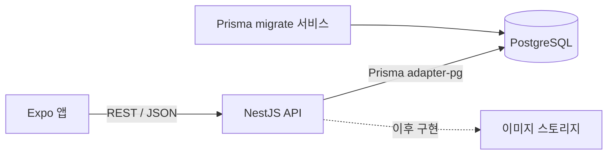
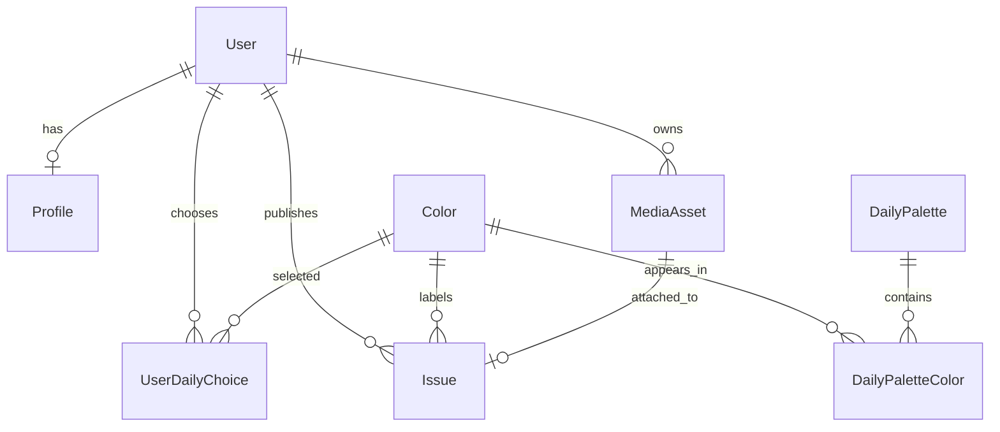

# Esel 서버 구현 가이드

이 문서는 Esel 서버의 현재 구현 방식과 설계 의도를 설명한다. 새로운 개발자나 AI가 서버 작업을 이어갈 때는 루트의 `AGENTS.md`, `docs/ESEL_HARNESS.md`, `harness.json`을 먼저 읽고 이 문서를 참고한다.

## 1. 현재 구현 범위

현재 단계는 실제 기능 개발 전의 서버 기반 구축이다.

- NestJS 기반 REST API 서버
- PostgreSQL 개발 데이터베이스
- Prisma 스키마, 초기 마이그레이션, 하네스 규칙 CHECK 제약과 12색 마이그레이션
- Docker Compose 실행 환경
- 환경변수 검증
- CORS, Helmet, 전역 DTO 검증
- Swagger 문서(운영이 아닐 때만)
- API와 DB 연결 상태를 확인하는 헬스체크
- 단위 테스트와 DB 연결 E2E 테스트

아직 인증, 사진 업로드, 오늘의 색 배정, 발행, 피드, 반응 기능은 구현하지 않았다.

## 2. 기술 선택

| 영역 | 선택 | 이유 |
|---|---|---|
| 런타임 | Node.js 24 LTS | NestJS·Prisma 요구사항을 충족한다. Docker 이미지도 Node 24다. `package.json`의 `engines`는 의존성 요구(`^22.22.3 \|\| ^24.15.0 \|\| >=26`)를 따른다. |
| 서버 | NestJS 12 | 기능별 모듈 분리, 의존성 주입, 요청 검증과 테스트 구성이 명확하다. |
| API | REST + OpenAPI | Expo 앱에서 호출하기 쉽고 Swagger로 계약을 확인할 수 있다. |
| 데이터베이스 | PostgreSQL 17 | 발행·개인 호수·공개 권한에 필요한 트랜잭션과 제약조건을 지원한다. |
| DB 접근 | Prisma 7.10 | 타입 안전한 쿼리, 스키마, 마이그레이션을 함께 관리한다. |
| 로컬 실행 | Docker Compose | 팀원이 같은 PostgreSQL과 API 환경을 재현할 수 있다. |
| 테스트 | Vitest + Supertest | 단위 테스트와 실제 HTTP·DB E2E 테스트를 분리한다. |

Supabase나 Firebase 같은 BaaS는 사용하지 않는다. 인증, 권한, 발행 정책과 데이터 저장을 Esel 서버가 직접 담당한다.

## 3. 전체 구조



```text
Esel/
├── compose.yaml
└── server/
    ├── Dockerfile
    ├── .env.example
    ├── package.json
    ├── prisma.config.ts
    ├── prisma/
    │   ├── schema.prisma
    │   └── migrations/
    ├── src/
    │   ├── main.ts
    │   ├── app.setup.ts      # configureApp: main과 e2e가 같이 쓰는 전역 설정
    │   ├── app.module.ts
    │   ├── common/           # service-date.ts(서비스 날짜) 등 공통 도우미
    │   ├── config/
    │   ├── health/
    │   └── prisma/
    └── test/
```

## 4. 애플리케이션 시작 흐름

`server/src/main.ts`는 다음 순서로 서버를 초기화한다. 3~7은 `src/app.setup.ts`의 `configureApp(app)` 한 함수에 있고, e2e 테스트(`test/create-app.ts`)도 같은 함수를 거친다. 그래서 테스트가 실제 서버와 같은 설정을 확인한다.

1. `AppModule`을 생성한다.
2. `.env`를 읽고 Zod 스키마로 환경변수를 검증한다.
3. Helmet 보안 헤더를 적용한다.
4. `CORS_ORIGINS`에 적힌 앱 주소에만 CORS를 연다.
5. 모든 API에 `/api` prefix를 붙인다.
6. 전역 `ValidationPipe`로 정의되지 않은 요청 필드를 거절한다.
7. `NODE_ENV`가 `production`이 아닐 때만 `/api/docs`에 Swagger 문서를 연다.
8. `enableShutdownHooks()`로 종료 신호를 받으면 DB 연결을 닫고 끝내게 한다.
9. 설정된 `PORT`에서 요청을 받는다.

환경변수가 빠졌거나 형식이 잘못되면 서버는 조용히 잘못된 설정으로 실행되지 않고 시작 단계에서 실패한다.

## 5. Docker Compose 실행 흐름

`compose.yaml`에는 세 서비스가 있다.

### `postgres`

- PostgreSQL 17 Alpine 이미지
- 개발 DB·사용자 이름은 `esel`, 비밀번호 `esel_dev`는 개발용
- 호스트의 `127.0.0.1:5432`에만 연다(같은 네트워크의 다른 기기에서는 접속 불가)
- named volume에 데이터를 보존
- `pg_isready` 기반 healthcheck 제공

### `migrate`

- PostgreSQL이 healthy가 된 뒤 실행
- `prisma migrate deploy`로 커밋된 마이그레이션 적용(CHECK 제약과 12색 기준 데이터도 마이그레이션에 들어 있다)
- 성공하면 종료 코드 `0`으로 끝남
- 새 환경에서도 API 시작 전에 DB 구조를 맞추기 위한 일회성 서비스

### `api`

- `migrate`가 성공해야 시작
- 호스트의 `127.0.0.1:3000`에만 연다
- `NODE_ENV=production`으로 돌기 때문에 Swagger는 꺼져 있다. 문서는 `npm run start:dev`로 볼 수 있다
- 컨테이너 안에서는 root가 아닌 `node` 사용자로, `node dist/main.js`가 PID 1이 되어 실행한다(종료 신호를 서버가 직접 받음)
- `/api/health`를 Docker healthcheck로 호출
- 멀티 스테이지 Dockerfile로 빌드 의존성과 실행 이미지를 분리

`migrate` 컨테이너가 `Exited (0)`으로 보이는 것은 정상이다. 계속 실행되는 서비스가 아니라 마이그레이션 완료 후 종료되는 작업이다.

## 6. 환경변수

실제 `.env`는 커밋하지 않는다. 필요한 키는 `.env.example`에만 기록한다.

| 변수 | 용도 | 개발 기본값 |
|---|---|---|
| `NODE_ENV` | 실행 환경 | `development` |
| `PORT` | API 포트 | `3000` |
| `DATABASE_URL` | PostgreSQL 연결 문자열 | 로컬 `esel` DB |
| `CORS_ORIGINS` | 허용할 클라이언트 주소 목록(쉼표로 구분, 경로 없는 http(s) 주소) | 개발: `http://localhost:8081`. **운영에서는 기본값이 없어 꼭 정해야 서버가 시작한다** |
| `SERVICE_TIME_ZONE` | 서비스 날짜(오늘의 색·하루 한 호·같은 색 잠금 자정) 기준. IANA 시간대인지 시작할 때 확인한다 | `Asia/Seoul` |

운영 환경에서는 Compose에 작성된 개발용 비밀번호를 사용하지 말고 별도 비밀 관리 수단으로 주입해야 한다.

서비스 날짜는 `src/common/service-date.ts`의 `serviceDate(now, SERVICE_TIME_ZONE)`로 정한다(`"YYYY-MM-DD"`). 앱이 보낸 "오늘"은 믿지 않는다.

## 7. Prisma 데이터 모델

현재 스키마는 핵심 발행 흐름을 먼저 지원하도록 작성했다.



### 주요 모델

- `User`: 계정의 기본 상태. 인증 방식은 이후 별도 모델로 확장한다.
- `Profile`: 개인 잡지 제호와 누적 발행 호수.
- `Color`: Esel의 12색 기준 데이터.
- `DailyPalette`: 특정 서비스 날짜의 후보 색 묶음.
- `DailyPaletteColor`: 후보 색과 표시 순서.
- `UserDailyChoice`: 사용자가 특정 날짜에 고른 색.
- `MediaAsset`: 업로드 파일의 저장 경로와 검증 상태.
- `Issue`: 실제 발행된 개인 잡지 한 호.

### DB가 직접 보장하는 규칙

- 제호 `masthead`는 전체에서 고유하다.
- 한 사용자는 한 서비스 날짜에 하나의 색 선택만 가진다.
- 한 사용자는 하루에 한 호만 발행한다.
- 같은 사용자의 개인 호수는 중복될 수 없다.
- 하나의 미디어 파일은 하나의 호에만 연결된다.
- 날짜·색·발행 시각 조회를 위한 피드 인덱스를 둔다.
- 제호는 영문 소문자 2~10자(`^[a-z]{2,10}$`)만 저장된다(CHECK).
- 하루 후보 색 자리(`position`)는 1~3, 색 hex는 `^#[0-9A-F]{6}$`, 개인 호수는 1 이상, 발행 호 수는 0 이상이다(CHECK).
- 12색(`colors`)은 루트 `harness.json`의 `colors`와 같은 key·hex·순서(`sort_order`)로 마이그레이션이 넣는다. 앱이 돌려면 꼭 있어야 하는 기준 데이터라 seed 스크립트가 아니라 마이그레이션에 둔다. `npm run check:server`가 루트 harness.json과 같은지 확인한다.

API 검사만 믿지 않고 PostgreSQL의 unique constraint로 동시 요청도 방어한다. 개인 호수 증가와 `Issue` 생성은 이후 하나의 DB 트랜잭션으로 구현해야 한다.

## 8. Prisma 사용 규칙

스키마를 변경할 때는 다음 순서를 따른다.

```bash
cd server
npm run prisma:migrate -- --name 변경내용
npm run prisma:generate
npm run build
npm test
```

`npm install`·`npm ci`가 끝나면 `postinstall`이, `npm run build` 전에는 `prebuild`가 `prisma generate`를 자동으로 돌린다. 스키마를 바꾼 뒤 `start:dev`·테스트 전에는 `npm run prisma:generate`를 직접 한 번 돌린다.

- 이미 공유된 migration SQL을 직접 수정하지 않는다.
- 스키마 변경은 새로운 migration으로 추가한다.
- 운영에서는 `migrate dev`가 아니라 `migrate deploy`를 사용한다.
- 생성된 `src/generated/prisma`는 커밋하지 않는다.
- `DATABASE_URL`을 코드에 직접 쓰지 않는다.

`PrismaService`는 `@prisma/adapter-pg`를 사용해 PostgreSQL에 연결한다. 모듈을 global로 등록했기 때문에 이후 기능 모듈에서 별도 모듈 재등록 없이 주입할 수 있다.

## 9. 헬스체크

```http
GET /api/health
```

정상 응답:

```json
{
  "status": "ok",
  "database": "up",
  "timestamp": "2026-10-11T08:35:33.829Z"
}
```

이 API는 단순히 NestJS 프로세스만 확인하지 않고 `SELECT 1`을 실행해 PostgreSQL 연결까지 확인한다. DB에 연결할 수 없으면 HTTP 503을 반환한다.

## 10. 실행과 검증

저장소 루트에서 전체 환경을 실행한다.

```bash
docker compose up -d --build api
docker compose ps -a
```

주요 주소:

- API: `http://localhost:3000/api`
- 헬스체크: `http://localhost:3000/api/health`
- Swagger: `http://localhost:3000/api/docs`(운영이 아닐 때만. Compose의 api는 운영 모드라 `npm run start:dev`로 본다)
- PostgreSQL: `127.0.0.1:5432`

종료:

```bash
docker compose down
```

DB 데이터를 포함한 volume 삭제는 복구가 필요한 데이터가 없는지 확인한 뒤 별도로 수행한다.

서버 검증:

```bash
cd server
npm run lint
npm test
npm run test:e2e
npm run build
```

- 단위 테스트는 DB 실패 처리 같은 개별 로직을 검증한다.
- E2E 테스트는 실행 중인 PostgreSQL과 실제 HTTP `/api/health` 요청을 검증한다.
- Docker 이미지 빌드 성공 여부도 별도로 확인한다.

## 11. 보안 기준

- `.env`와 실제 비밀값은 Git에 올리지 않는다.
- DTO에 정의되지 않은 요청 필드는 전역에서 거절한다.
- CORS는 명시된 클라이언트 주소만 허용한다.
- Helmet으로 기본 보안 헤더를 적용한다.
- Docker Compose의 계정 정보는 개발 전용이고, 포트는 `127.0.0.1`에만 연다.
- API 컨테이너는 root가 아닌 `node` 사용자로 돈다.
- Swagger 문서는 운영(`NODE_ENV=production`)에서 열지 않는다.
- 운영에서는 `CORS_ORIGINS`를 명시해야 시작한다(localhost 기본값 없음).
- 이미지 파일 자체를 PostgreSQL에 저장하지 않는다.
- 잠긴 게시물의 실제 이미지 URL이나 사용자 식별자를 클라이언트에 전달하지 않는다.
- 좋아요·구독자·독자 한 줄 수·스크랩 수는 소유자용 응답에만 포함한다.
- 인증 구현 시 비밀번호와 refresh token 원문을 저장하지 않는다.

현재 npm 감사 결과에는 해결되지 않은 의존성 취약점이 있다(2026-10-15 기준 high 4건, 모두 Prisma 7 도구 체인의 `deepmerge-ts`·`mysql2` 경유). `npm audit fix --force`는 Prisma 6으로 내리는 호환성 파괴 변경이므로 검토 없이 실행하지 않는다.

## 12. 제품 계약과 서버 책임

서버 기능을 구현할 때 특히 다음 제품 계약을 서버에서 강제해야 한다.

- P01 같은 색 잠금(2026-10-15 결정): 오늘 발행 전에는 그날 나의 **후보 3색 방이 모두** 미리보기다. 각 방은 최신 3장만 주고, 나머지는 개수(`hiddenCount`)만 준다. 숨긴 표지의 이름·사진(이미지 URL)·ID는 어떤 응답에도 없다(책등은 앱이 개수로만 그린다).
  - 어떤 색을 골랐는지·바꿨는지와 무관하다. 색을 바꿔도 아무 방도 열리지 않는다.
  - 오늘 발행하면 전부 열린다. 서비스 날짜(`SERVICE_TIME_ZONE`) 자정이 지나면 어제 방은 지난 날짜라 열린다.
  - 색 확정·복원·트윈 게시로는 열리지 않는다. 미성년자는 잠금이 없다(판별 방법은 미정).
  - 잠긴 표지를 ID로 직접 부르면 403이 아니라 404로 답한다(있다는 사실도 새지 않게).
- P02: 후보가 아닌 색과 지난 날짜는 발행 전에도 공개하되, 미래·잘못된 날짜는 공개하지 않는다. 인기 혼합도 공개 권한 필터 뒤에 적용한다.
- P04: 하루 한 번 발행하고 발행 성공으로만 개인 호수가 증가한다(결호 없음).
- P11: 얼굴 가리기 합성은 기기에서 처리하며 익명화를 보장한다고 표현하지 않는다.
- P12: 비로그인은 오늘의 표지와 안쪽 2쪽까지만 받는다. 좋아요·구독·독자 한 줄·스크랩·만들기(발행) 같은 쓰기는 로그인이 필요하다.
- P14: 개인 제호는 영문 소문자 2~10자이며 중복 검사 정책이 필요하다(형식은 DB CHECK로도 막는다).
- P18: 좋아요·구독자·독자 한 줄 수·스크랩 수는 발행한 본인에게만 보인다. 같은 색 인원·호수·독자 한 줄 글은 공개다. 호수·반응으로 정렬하거나 순위를 매기지 않고, 인기 혼합은 내부 신호로만 쓴다.

정확한 문구와 전체 목록(P01~P18)은 루트 `docs/ESEL_HARNESS.md`가 정본이다. 이 요약과 다르면 하네스를 따른다.

클라이언트의 잠금 UI는 보안 경계가 아니다. 피드 API, 프로필 API, 공유 링크, 이미지 접근 단계에서 모두 서버가 같은 권한을 검사해야 한다.

## 13. 다음 구현 순서

1. 이메일 회원가입·로그인과 refresh token 회전
2. 제호 생성과 중복 검사
3. 날짜별 후보 색 3개 생성(12색 기준 데이터는 마이그레이션에 있음)
4. 사용자의 오늘 색 선택·변경·발행 후 잠금
5. 이미지 업로드 준비·완료·검증
6. 하루 한 번 발행 트랜잭션과 개인 호수 할당
7. P01/P02가 적용된 피드
8. 좋아요·스크랩·구독·독자 한 줄
9. 차단·신고·삭제
10. Expo 메모리 상태를 실제 API 호출로 교체

다음 기능을 구현할 때는 컨트롤러에 모든 로직을 넣지 않는다. `controller → service → PrismaService` 흐름을 유지하고, 공개 권한과 발행 규칙은 테스트 가능한 서비스 함수로 분리한다.

## 14. AI 작업 체크리스트

다른 AI가 서버를 수정할 때 다음을 확인한다.

1. 루트 `AGENTS.md`, `docs/ESEL_HARNESS.md`, `harness.json`을 읽었는가.
2. 현재 요청이 서버 범위인지 확인했는가.
3. 제품 계약 P01~P18을 클라이언트 편의 때문에 약화하지 않았는가.
4. 스키마 변경에 새 migration이 포함됐는가.
5. 비밀값이나 `.env`가 스테이징되지 않았는가.
6. 소유자 전용 숫자가 공개 DTO에 포함되지 않았는가.
7. 잠긴 게시물의 이미지·이름·사용자 ID가 유출되지 않는가.
8. `lint`, 단위 테스트, E2E 테스트, build를 실행했는가.
9. 확인하지 않은 운영 안정성이나 보안 수준을 완료했다고 주장하지 않았는가.

## 15. 현재 검증 상태

2026-10-15 고친 뒤 다음을 실제로 확인했다(맥, Homebrew PostgreSQL 17, Docker 없음).

- `npm ci` → `npm run lint` → `npm test` → `npm run build`가 저장소 루트 설치 없이 통과
- 새 마이그레이션 포함 `prisma migrate deploy`, 스키마와 마이그레이션 차이 없음(`prisma migrate diff`)
- e2e: health, 앱 설정(개발 Swagger 200·운영 404, CORS 허용 목록, Helmet 헤더), DB CHECK 제약과 12색
- 빌드 결과를 운영 모드로 실행: `CORS_ORIGINS` 없으면 시작 실패, 있으면 `/api/docs` 404, SIGTERM에 정상 종료
- `docker compose up --build`는 이번에 확인하지 못했다(Docker 없음). Dockerfile의 `USER node`·`node dist/main.js`·포트 바인딩은 아직 실제 컨테이너로 검증하지 않았다.

초기 기반 구현 시(2026-10-11) 다음을 실제로 확인했다.

- PostgreSQL 컨테이너 healthy
- Prisma 초기 migration 적용 성공
- migration 컨테이너 종료 코드 0
- API 컨테이너 healthy
- `/api/health`에서 `database: up` 반환
- 공개 스키마 테이블 9개 생성
- lint 통과
- 단위 테스트 2개 통과
- DB 연결 E2E 테스트 1개 통과
- NestJS production build 통과
- Docker API 이미지 빌드 통과

이 검증은 서버 기반이 실행된다는 의미이며 인증·업로드·발행·피드가 구현됐다는 뜻은 아니다.
