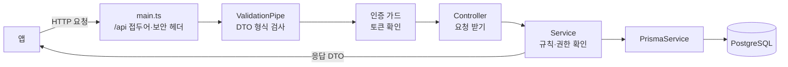

# Esel 서버 배움 안내

서버를 처음 만드는 사람을 위한 안내다. 개념을 Esel의 실제 기능으로 설명하고, [6장](#6-배움-순서)의 미션을 순서대로 하면 서버가 완성되도록 짰다. AI를 쓸 때는 미션마다 적힌 지시문을 그대로 주면 된다. 규칙의 정본은 [API 규칙](API_RULES.md)과 [약속 목록](../api-contract.json)이다.

## 1. 서버가 하는 일

Esel은 세 부분으로 움직인다.

| 부분 | 하는 일 | Esel의 예 |
|---|---|---|
| 앱(Expo) | 화면을 그리고 사람의 손짓을 받는다 | 표지를 보여 주고, 발행 버튼을 누른다 |
| 서버(NestJS) | 요청을 받아 **규칙을 확인**하고 데이터를 읽고 쓴다 | "오늘 이미 발행했나?"를 확인하고, 아니면 호수를 1 올려 저장한다 |
| DB(PostgreSQL) | 데이터를 표(테이블)로 오래 보관한다 | `issues` 표에 누가, 몇 호를, 무슨 색으로 냈는지 |

앱만으로는 안 되는 이유: 앱은 사용자의 휴대폰에서 돈다. 누군가 앱을 고쳐서 "잠긴 표지를 보여 줘"라고 요청할 수 있다. 그래서 **누가 무엇을 볼 수 있는지는 서버가 정한다.** 같은 색 잠금(P01), 하루 한 호(P04), 숫자는 본인에게만(P18)이 모두 서버의 일이다.

## 2. API: 앱과 서버의 약속

API는 "이 주소로, 이 방법으로, 이것을 보내면, 이것을 돌려준다"는 약속이다. 예:

```http
POST /api/issues/3f2a…/like
Authorization: Bearer eyJhbGci…

→ 201 { "liked": true }
```

- **주소(path)**: 무엇에 대한 요청인지. `/api/issues/:id/like` = 그 호의 좋아요.
- **방법(method)**: GET 읽기, POST 만들기·실행, PUT 정하기, PATCH 일부 바꾸기, DELETE 지우기.
- **상태 코드**: 200·201 성공, 400 형식 틀림, 401 로그인 필요, 403 권한 없음, 404 없음, 409 상태 충돌, 422 규칙상 안 됨.
- **DTO**: 주고받는 데이터의 모양을 정한 틀(클래스). `ReactionStateDto = { liked: boolean }`.

API를 설계하는 일(무슨 주소에 무엇을 주고받을지)은 앱과 서버가 함께 정하고, 그것을 실제로 지키는 코드를 서버가 만든다. Esel의 약속은 [api-contract.json](../api-contract.json)에 모두 적혀 있다. **여기 없는 API는 만들지 않는다.**

## 3. 요청이 지나가는 길



| 단계 | 파일 | 하는 일 | 하지 않는 일 |
|---|---|---|---|
| Controller | `src/issues/issues.controller.ts` | 주소와 DTO를 연결하고 서비스를 부른다 | DB를 직접 읽지 않는다 |
| Service | `src/issues/issues.service.ts` | "이미 발행했나?", "주인인가?"를 확인하고 DB를 읽고 쓴다 | HTTP를 몰라도 된다 |
| Rules | `src/issues/issues.rules.ts` | P01·P04 같은 규칙을 작은 함수로 | DB·HTTP를 모른다. 그래서 테스트가 쉽다 |
| DTO | `src/issues/dto/*.dto.ts` | 받을 값의 검사 규칙과 돌려줄 모양 | |

## 4. DB, Prisma, migration

- **테이블**: 엑셀 시트처럼 행과 열로 된 표. `profiles` 표의 한 행 = 한 사람의 잡지.
- **Prisma**: TypeScript로 DB를 다루게 해 주는 도구. 표의 모양은 `prisma/schema.prisma`에 적는다.
- **migration**: DB 모양이 바뀐 **기록**. "issues 표에 mastheadColor 열을 추가" 같은 변경이 SQL 파일로 쌓인다. 다른 사람 DB도 이 기록을 순서대로 적용해 같은 모양이 된다. 그래서 **이미 공유한 migration은 고치지 않고, 새 migration을 만든다.** 검사가 고친 것을 잡아낸다.
- **unique 제약**: "같은 값이 두 번 들어갈 수 없다"를 DB가 지키게 하는 것. `issues(author_id, service_date)`가 unique라서, 버튼을 두 번 빨리 눌러도 하루에 호가 두 개 생기지 않는다(P04).
- **트랜잭션**: 여러 작업을 "모두 되거나 모두 안 되거나"로 묶는 것. 발행은 ① 호 저장 ② 내 호수 +1이 함께여야 한다. 중간에 실패하면 둘 다 취소되어야 호수만 오르는 일이 없다.
- **seed**: 처음부터 있어야 하는 기본 데이터(12색). 이것도 코드로 넣는다.

## 5. 테스트와 검사

| 종류 | 확인하는 것 | 명령 | 필요한 것 |
|---|---|---|---|
| 하네스 검사 | 약속·규칙을 어겼는지 | `npm run check:server` | 아무것도(설치 없이 됨) |
| 단위 테스트 | 규칙 함수 하나 | `npm test` | `npm install` |
| API 테스트(e2e) | 실제 HTTP 요청과 DB | `npm run test:e2e` | `docker compose up -d postgres` |
| 빌드·린트 | 코드가 컴파일되고 깔끔한지 | `npm run build`, `npm run lint` | `npm install` |

`test/contracts/`에는 합격 기준이 `it.todo('…')`로 적혀 있다. todo는 실패가 아니라 "남은 일"로 표시된다. API 하나를 만들 때 그 todo를 실제 테스트로 바꾼다. `check:server`가 실패하면 "왜 문제인가"와 "고치는 법"을 같이 보여 준다.

## 6. 배움 순서

미션은 순서대로 한다. 앞 미션이 끝나야 다음 미션의 바탕이 생긴다. 미션마다 AI에게 줄 지시문이 있다. AI가 끝나면 [학습용 보고](../AGENTS.md#학습용-보고)를 받고, 보고의 "새로 나온 개념"을 스스로 한 번 더 설명해 본다.

### 미션 0. 검사 통과시키기

- **목표**: `npm run check:server`의 실패 3건을 고친다. 운영에서 Swagger 끄기, 유료 배포 패키지 `@nestjs/mau` 지우기, `deploy` 명령 지우기.
- **배울 것**: `package.json`의 의존성, 환경 변수 `NODE_ENV`, 왜 운영 서버는 문서를 숨기는지.
- **끝난 기준**: `check:server` 통과, `lint`·`test`·`build` 통과.

```text
server/AGENTS.md를 먼저 읽어. npm run check:server의 실패 3건을 "고치는 법"대로 고쳐 줘.
다른 파일은 바꾸지 말고, 끝나면 check:server, lint, test, build를 돌린 뒤 학습용 보고 형식으로 설명해 줘.
```

### 미션 1. 서버를 직접 띄워 보기 (코드 없음)

- **목표**: `docker compose up -d --build api`로 띄우고 `http://localhost:3000/api/health`, `http://localhost:3000/api/docs`(개발 모드)를 연다.
- **배울 것**: 컨테이너, 포트, 헬스체크, Swagger 읽는 법.
- **끝난 기준**: health가 `database: up`을 돌려준다. `docker compose down`으로 끈다.

### 미션 2. 공통 틀 만들기

- **목표**: `src/common/`에 `AppException`, 전역 예외 필터(오류 모양 통일), `errors.ts`(api-contract.json의 errors와 같게), `@Public()` 데코레이터, 목록 응답 타입 `Page<T>`를 만든다.
- **배울 것**: 예외 필터, 데코레이터, 왜 오류 모양을 하나로 맞추는지.
- **끝난 기준**: 없는 주소를 부르면 `{ "error": { "code": "NOT_FOUND", … } }`가 오는 e2e 테스트가 통과한다.

```text
server/AGENTS.md와 docs/API_RULES.md 7장·8장을 따라 src/common의 공통 틀을 만들어 줘.
오류 코드와 메시지는 api-contract.json의 errors와 똑같이 맞추고, 없는 주소의 404 응답 모양을 e2e 테스트로 확인해.
새 패키지는 추가하지 마. 끝나면 모든 검사를 돌리고 학습용 보고 형식으로 설명해 줘.
```

### 미션 3. 12색과 오늘의 후보 색

- **목표**: 12색 seed, 서비스 날짜 계산(Asia/Seoul 자정 기준), 날짜별 후보 3색을 만드는 규칙 함수와 단위 테스트.
- **배울 것**: seed, 시간대, 순수 함수와 단위 테스트.
- **끝난 기준**: "한국 시간 0시 1분은 새 날짜", "후보는 항상 서로 다른 3색" 단위 테스트 통과. 12색 값은 저장소 루트 `harness.json`의 `colors`와 같다.

```text
server/AGENTS.md를 따라 미션 3을 해 줘. 12색은 저장소 루트 harness.json의 colors와 같은 key·hex로 seed하고,
서비스 날짜와 후보 3색은 src/today/today.rules.ts의 순수 함수로 만들어 단위 테스트를 붙여. API는 아직 만들지 마.
후보를 고르는 방식은 아직 팀이 정하지 않았으니, 날짜로 결정되는 간단한 방식으로 하고 보고에 "임시"라고 적어 줘.
```

### 미션 4. 이메일 가입·로그인 (DEV-05)

- **목표**: `auth.signup`, `auth.login`, `auth.refresh`, `auth.logout`과 전역 인증 가드.
- **배울 것**: 비밀번호를 그대로 저장하지 않는 이유와 해시(Node 내장 `crypto.scrypt`), access token과 refresh token, 401과 403의 차이.
- **끝난 기준**: `test/contracts/auth.e2e-spec.ts`의 todo가 실제 테스트로 바뀌어 통과. 비밀번호·refresh token 원문이 DB에 없다.
- **주의**: 토큰 서명용 패키지(예: `@nestjs/jwt`)를 추가해야 하면, 추가하기 전에 리뷰어에게 먼저 묻는다.

```text
server/AGENTS.md를 따라 api-contract.json의 auth.* 네 개를 만들어 줘. 비밀번호는 node:crypto의 scrypt로 해시하고,
refresh token은 해시만 저장하고 쓸 때마다 새로 바꿔(회전). 전역 인증 가드를 걸고 public API에만 @Public()을 달아.
새 패키지가 꼭 필요하면 설치하기 전에 이유와 함께 먼저 물어봐. test/contracts/auth.e2e-spec.ts의 todo를 실제 테스트로 바꾸고,
끝나면 모든 검사를 돌린 뒤 학습용 보고 형식으로 설명해 줘.
```

### 미션 5. 오늘의 색 고르기 (DEV-07)

- **목표**: `today.get`, `today.choose`. 후보 밖 색은 422, 발행한 뒤 바꾸면 409.
- **배울 것**: 422와 409의 차이, 서버가 "오늘"을 정하는 이유.

```text
server/AGENTS.md를 따라 api-contract.json의 today.get과 today.choose를 만들어 줘. 미션 3의 규칙 함수를 쓰고,
test/contracts/today.e2e-spec.ts의 해당 todo를 실제 테스트로 바꿔. 끝나면 모든 검사를 돌리고 학습용 보고로 설명해 줘.
```

### 미션 6. 제호 정하기 (DEV-06)

- **목표**: `mastheads.availability`, `profile.create`. 형식이 틀리면 422, 이미 있으면 409.
- **배울 것**: unique 제약과 동시 요청, DB CHECK 제약(`^[a-z]{2,10}$`)을 새 migration으로 추가하기.

### 미션 7. 사진 올리기 (DEV-08)

- **목표**: `media.prepare`, `media.complete`. 15MB 초과 413, 사진 아님 415.
- **배울 것**: 사진 파일은 DB가 아니라 저장소에 두고 DB에는 위치만 적는 이유. 저장소 서비스는 팀이 정하지 않았으니, 개발용으로는 로컬 폴더를 쓰고 보고에 "임시"라고 적는다.

### 미션 8. 오늘 호 발행 (DEV-09)

- **목표**: `issues.publish`. 트랜잭션으로 호 저장 + 호수 +1, 같은 날 두 번째는 409.
- **배울 것**: 트랜잭션, 동시에 두 요청이 올 때의 테스트(`Promise.all`로 두 번 보내 하나만 성공).

### 미션 9. 같은 색 잠금 (DEV-12)

- **목표**: `stand.get`. 오늘 발행 전, 내 색은 최신 3장과 `hiddenCount`만. 숨긴 표지의 ID·이름·사진 주소는 응답에 없다.
- **배울 것**: 권한에 따라 응답을 다르게 만드는 법, 숨긴 것을 404로 답하는 이유(있다는 사실도 새지 않게).
- **참고 구현**: 저장소의 `.codex/temp/prototype/20260906-minimal-gallery/src/social-state.js`의 `sameColorRoom`과 그 테스트.

### 그다음

피드(DEV-10) → 펼침면·반응(DEV-11) → 서가·구독(DEV-13) → 내 잡지(DEV-14) → 색 기록(DEV-15) → 친구(DEV-16) → 트윈(DEV-17) → 공유(DEV-18) → 계정(DEV-19) 순서로, 미션과 같은 방식(약속 확인 → todo를 테스트로 → 구현 → 검사 → 보고)으로 진행한다. 지시문은 미션 5의 것에서 API 이름과 테스트 파일만 바꿔 쓰면 된다.

## 7. 자주 하는 실수

| 실수 | 왜 문제인가 | 이렇게 |
|---|---|---|
| 컨트롤러에서 `prisma.…`를 바로 부름 | 규칙 확인이 흩어져 빠뜨리기 쉽다 | 서비스에서만 DB를 쓴다 |
| 공개 응답에 `likeCount`를 넣음 | 모든 사람에게 인기 숫자가 보인다(P18) | `…OwnerDto`에만 |
| 잠긴 표지를 403으로 답함 | "그 표지가 있다"는 사실이 샌다 | 404로 답한다 |
| 공유된 migration 파일 수정 | 다른 사람 DB와 어긋난다 | 새 migration을 만든다 |
| 앱이 보낸 "오늘 날짜"를 믿음 | 휴대폰 시간을 바꾸면 규칙을 피할 수 있다 | 서버가 날짜를 정한다 |
| 테스트 없이 status를 done으로 | 완료가 증명되지 않는다 | todo를 테스트로 바꾼 뒤 done |
| 약속에 없는 API를 먼저 만듦 | 앱이 모르는 API, 리뷰 없는 기능이 생긴다 | api-contract.json부터 고치고 리뷰 |
